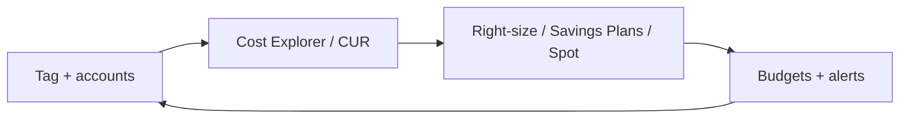

## 1. Core Concept

Tối ưu chi phí AWS là **quan sát → phân bổ → tối ưu → quản trị**: biết tiền đi đâu (tag, Cost Explorer), cam kết hợp lý (Savings Plans), bỏ lãng phí (right-sizing) và đặt cảnh báo (Budgets). Mental model: *không thể tối ưu thứ không đo được và không gán được cho ai.*

## 2. How It Works

- **Cost Explorer**: phân tích theo dịch vụ/tag/account, dự báo; **Budgets**: ngưỡng và cảnh báo (cả dự báo); **Cost and Usage Report (CUR)**: dữ liệu chi tiết nhất vào S3 để phân tích bằng Athena.
- **Cost allocation tags**: phải **kích hoạt** trong Billing mới xuất hiện trong báo cáo; **Cost Anomaly Detection**.
- **Mua theo cam kết**: **Savings Plans** (Compute linh hoạt qua EC2/Fargate/Lambda; EC2 Instance cố định họ+Region), **Reserved Instances**, **Spot** (giảm tới ~90%, bị thu hồi), **On-Demand**.
- **Right-sizing**: **Compute Optimizer**, Trusted Advisor; tắt tài nguyên rảnh, **EBS chưa gắn**, snapshot cũ, Elastic IP không dùng.
- **Lưu trữ**: S3 **Intelligent-Tiering**, lifecycle; **dữ liệu ra Internet** và **cross-AZ/Region** tốn phí.
- **Kiến trúc**: Graviton (ARM) rẻ hơn, serverless khi tải thưa, scheduling tắt môi trường dev ngoài giờ.
- **Organizations**: hoá đơn gộp, chia sẻ giảm giá giữa account.

## 3. Visual Diagram

## 4. Rules of Thumb & Trade-offs

| Tải | Mua |
| --- | --- |
| Ổn định 24/7 | Savings Plans / RI |
| Gián đoạn được, batch | Spot |
| Không dự đoán được | On-Demand + auto scaling |

- Trade-off: **cam kết** giảm giá nhưng giảm tính linh hoạt.

## 5. Must Remember / Production Pitfalls

- Chi phí **NAT Gateway và data transfer** thường bị bỏ sót.
- Mua RI/Savings Plan rồi đổi kiến trúc → cam kết lãng phí.
- Không tag → không biết team nào tốn.
- Spot cho tải không chịu được gián đoạn.
- Log CloudWatch không retention phình dần.
- Interview trap: "Giảm chi phí batch xử lý ban đêm?" → Spot + Graviton.

## 6. Search Hooks

- `AWS Savings Plans vs Reserved Instances` — hai hình thức cam kết.
- `AWS Cost and Usage Report CUR` — dữ liệu chi phí chi tiết.
- `AWS Compute Optimizer right sizing` — gợi ý kích cỡ.
- `FinOps cost allocation tags` — phân bổ chi phí theo tag.
- `EC2 Spot Instances interruption` — thu hồi và cách xử lý.
