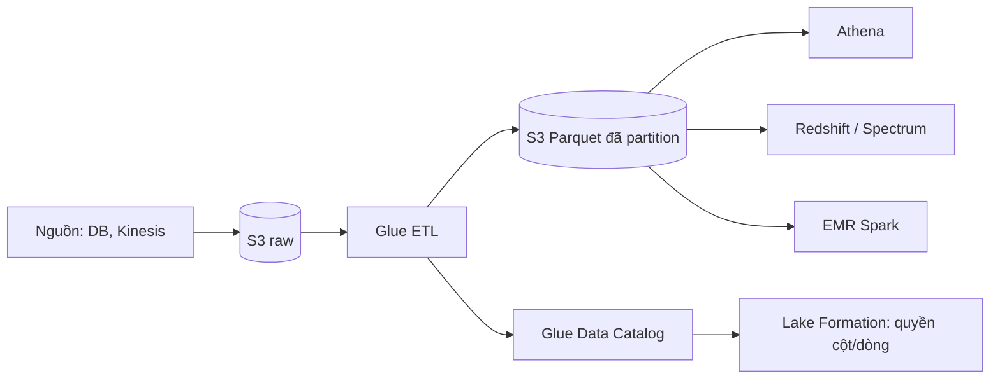

## 1. Core Concept

Stack analytics của AWS xoay quanh **S3 data lake**: **Glue** (Data Catalog + ETL), **Athena** (SQL serverless trên S3), **Redshift** (data warehouse MPP), **EMR** (Spark/Hadoop managed), **Lake Formation** (phân quyền) và **QuickSight** (BI). Chúng giải quyết bài toán lưu dữ liệu rẻ ở một chỗ rồi truy vấn bằng engine phù hợp.

**Mental model:** S3 là **kho hàng khổng lồ rẻ tiền**; Glue Catalog là **mục lục** cho mọi engine; Athena là **mượn kính lúp tra cứu một lần** (trả theo lượng giấy lật); Redshift là **phòng phân tích riêng** nhiều bàn làm việc sẵn sàng; EMR là **xưởng Spark tuỳ biến**.

## 2. How It Works

**Glue → Catalog và ETL**
- **Crawler** suy luận schema và ghi vào **Data Catalog** (Hive metastore dùng chung cho Athena, EMR, Redshift Spectrum). **Glue ETL** là Spark serverless, có **job bookmark** để chỉ xử lý dữ liệu mới.

**Athena → SQL trên S3, trả theo dữ liệu quét**
- Tính tiền khoảng **5 USD/TB quét**. Giảm chi phí và tăng tốc: **Parquet/ORC** (columnar, nén), **partition** theo cột hay lọc (ví dụ `dt`), chỉ chọn cột cần. Ví dụ: 1 TB CSV quét hết = 5 USD; cùng dữ liệu Parquet đã partition, chỉ quét vài chục GB.

**Redshift → Warehouse MPP**
- Columnar, **leader node + compute node**. **Distribution style** (KEY, ALL, EVEN, AUTO) quyết định dữ liệu nằm node nào; **sort key** tối ưu lọc theo khoảng. **RA3** tách compute và storage; **Spectrum** truy vấn S3; **Serverless** tự co giãn; nạp nhanh nhất bằng **`COPY` từ S3**.

**EMR → Spark/Hadoop tuỳ biến**
- Chạy trên EC2/EKS/Serverless; **core node** giữ HDFS, **task node** dùng **Spot** để giảm chi phí.

**Lake Formation → Phân quyền tập trung**
- Quyền **mức cột/dòng/cell** và **tag-based** trên catalog, thay cho IAM/bucket policy lẻ tẻ.

```sql
-- Athena: partition pruning chỉ quét ngày cần
SELECT country, SUM(amount)
FROM sales_parquet
WHERE dt BETWEEN '2026-11-01' AND '2026-11-07'
GROUP BY country;
```

## 3. Visual Diagram



## 4. Rules of Thumb & Trade-offs

| Tình huống / Nhu cầu | Chọn gì |
| --- | --- |
| Truy vấn ad-hoc, ít dùng, không muốn quản cluster | Athena |
| BI nhiều người, join phức tạp, hiệu năng ổn định | Redshift |
| Spark tuỳ biến, ML lớn | EMR |
| ETL không muốn quản cluster | Glue |
| Phân quyền cột/dòng cho cả data lake | Lake Formation |

- **Được gì:** lưu rẻ, chọn engine theo nhu cầu. **Mất gì:** serverless trả theo lượng quét có thể đắt nếu dữ liệu không tối ưu; cluster thì tốn chi phí cố định.

## 5. Must Remember / Production Pitfalls

- **Hoá đơn Athena tăng vọt → truy vấn CSV không partition quét toàn bộ → Parquet + partition + chỉ chọn cột cần**.
- **Truy vấn chậm dần → quá nhiều file nhỏ trong S3 → gộp file (compaction)**.
- **Redshift join chậm, shuffle nhiều → distribution key sai → chọn KEY theo cột join hoặc ALL cho bảng nhỏ**.
- **Crawler chạy tốn kém trên bảng lớn → quét lặp → đặt lịch hợp lý hoặc dùng partition projection**.
- **Phân quyền rối nhiều chỗ → dùng bucket policy + IAM riêng lẻ → Lake Formation tập trung**.
- Exam trap: "giảm chi phí Athena" → **Parquet + partition + chỉ chọn cột**; "BI nhiều người, join phức tạp" → **Redshift**; "phân quyền mức cột cho data lake" → **Lake Formation**.

## 6. Search Hooks

- `Athena partitioning Parquet cost` — giảm dữ liệu quét.
- `Glue Data Catalog crawler` — suy luận schema và catalog dùng chung.
- `Redshift distribution key sort key` — thiết kế bảng cho MPP.
- `Redshift Spectrum` — truy vấn S3 từ Redshift.
- `Lake Formation permissions` — phân quyền data lake mức cột/dòng.
