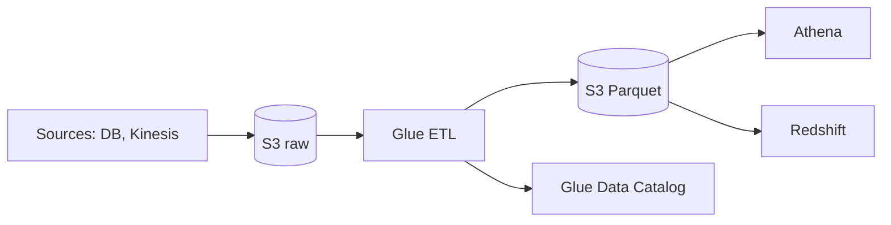

## 1. Core Concept

Stack analytics của AWS xoay quanh **S3 data lake**: **Glue** (ETL + Data Catalog), **Athena** (SQL serverless trên S3), **Redshift** (data warehouse MPP), **EMR** (Spark/Hadoop managed), **Lake Formation** (quản lý quyền). Mental model: *lưu rẻ ở S3, truy vấn bằng engine phù hợp.*

## 2. How It Works

- **Glue**: **Crawler** suy luận schema vào **Data Catalog** (Hive metastore dùng chung cho Athena/EMR/Redshift Spectrum); **Glue ETL** (Spark serverless), job bookmark.
- **Athena**: trả tiền theo **dữ liệu quét** (~5 USD/TB). Giảm chi phí bằng **Parquet/ORC**, **partition** theo cột lọc, nén.
- **Redshift**: columnar, MPP; **distribution style** (KEY/ALL/EVEN), **sort key**; **Spectrum** truy vấn S3; **RA3** tách compute và storage; **Serverless** option.
- **EMR**: Spark/Hive/Presto trên EC2/EKS/Serverless; dùng **Spot** cho task node.
- **Lake Formation**: quyền cột/dòng trên catalog, thay cho IAM/S3 policy lẻ.
- **Pipeline điển hình**: nguồn (RDS/DMS, Kinesis) → S3 raw → Glue ETL → S3 curated dạng Parquet partition → Athena/Redshift Spectrum; đặt lifecycle chuyển raw sang lớp lưu trữ rẻ.
- **QuickSight**: BI; **OpenSearch**: tìm kiếm log.

## 3. Visual Diagram

## 4. Rules of Thumb & Trade-offs

| Nhu cầu | Chọn |
| --- | --- |
| Truy vấn ad-hoc, ít dùng | Athena |
| BI nhiều người dùng, join phức tạp | Redshift |
| Spark tuỳ biến, ML quy mô lớn | EMR |
| ETL không muốn quản cluster | Glue |

- Trade-off: **serverless trả theo quét** vs **cluster cố định dự đoán chi phí**.

## 5. Must Remember / Production Pitfalls

- Athena trên **CSV không partition** quét toàn bộ, rất đắt.
- **Small files problem** làm chậm truy vấn; gộp file.
- Redshift chọn **distribution key sai** gây shuffle dữ liệu giữa node.
- Crawler chạy trên bảng lớn tốn kém; đặt lịch hợp lý.
- Interview trap: "Giảm chi phí Athena" → Parquet + partition + chỉ chọn cột cần.

## 6. Search Hooks

- `Athena partitioning Parquet cost` — giảm dữ liệu quét.
- `Glue Data Catalog crawler` — suy luận schema và catalog dùng chung.
- `Redshift distribution key sort key` — thiết kế bảng cho MPP.
- `Redshift Spectrum` — truy vấn S3 từ Redshift.
- `Lake Formation permissions` — phân quyền data lake mức cột/dòng.
