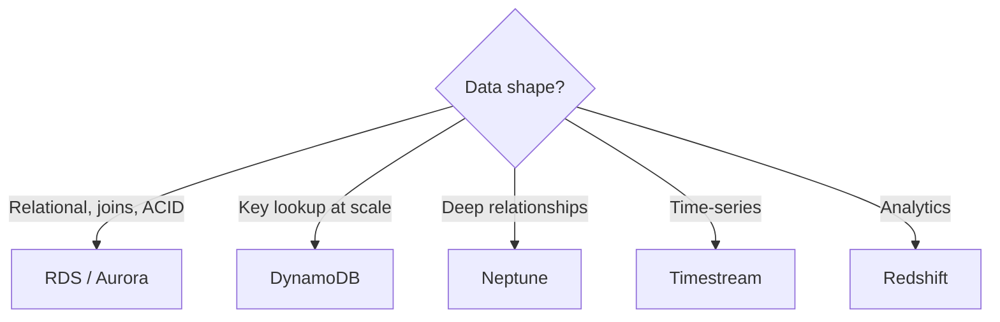

## 1. Core Concept

AWS có nhiều database chuyên dụng; chọn theo **mô hình dữ liệu và mẫu truy cập**, không phải theo thói quen. Mental model: *relational cho giao dịch và quan hệ, key-value/document cho scale ngang, graph cho quan hệ sâu, time-series cho metric, cache cho tốc độ.*

## 2. How It Works

- **Relational**: **RDS** (MySQL, PostgreSQL, SQL Server, Oracle…), **Aurora** (tương thích MySQL/PostgreSQL, storage 6 bản sao 3 AZ).
- **Key-value/document**: **DynamoDB** (single-digit ms, scale vô hạn), **DocumentDB** (tương thích MongoDB).
- **Wide-column**: **Keyspaces** (Cassandra).
- **Graph**: **Neptune** (Gremlin, SPARQL, openCypher) cho mạng xã hội, gian lận, recommendation.
- **In-memory**: **ElastiCache**, **MemoryDB** (Redis bền, dùng làm DB chính).
- **Time-series**: **Timestream** cho IoT/metric.
- **Ledger**: **QLDB** (sổ cái bất biến, đã bị khai tử dần, ưu tiên Aurora + bảng audit).
- **Search**: **OpenSearch**; **Warehouse**: **Redshift**.
- **Đa Region**: **Aurora Global Database**, **DynamoDB Global Tables** (active-active).

## 3. Visual Diagram

## 4. Rules of Thumb & Trade-offs

- Bắt đầu với **PostgreSQL/Aurora** khi chưa rõ; chuyển sang DB chuyên dụng khi có lý do đo được.
- Polyglot persistence tăng năng lực nhưng tăng vận hành và chi phí đồng bộ.
- Trade-off: **linh hoạt truy vấn** (SQL) vs **scale và độ trễ dự đoán được** (NoSQL).

## 5. Must Remember / Production Pitfalls

- Dùng DynamoDB cho truy vấn ad-hoc/join là sai công cụ.
- Chọn Aurora Serverless cho tải liên tục cao có thể đắt hơn instance cố định.
- Read replica có **độ trễ sao chép** (không đọc-sau-ghi chắc chắn).
- Multi-AZ (HA, đồng bộ) khác read replica (scale đọc, bất đồng bộ).
- Interview trap: "Mạng xã hội, truy vấn bạn của bạn bè nhiều bước?" → Neptune.

## 6. Search Hooks

- `Aurora Global Database` — DB đa Region độ trễ thấp.
- `DynamoDB Global Tables` — active-active đa Region.
- `Amazon Neptune graph database` — graph managed.
- `Amazon Timestream` — cơ sở dữ liệu time-series.
- `RDS Multi-AZ vs read replica` — HA vs scale đọc.
