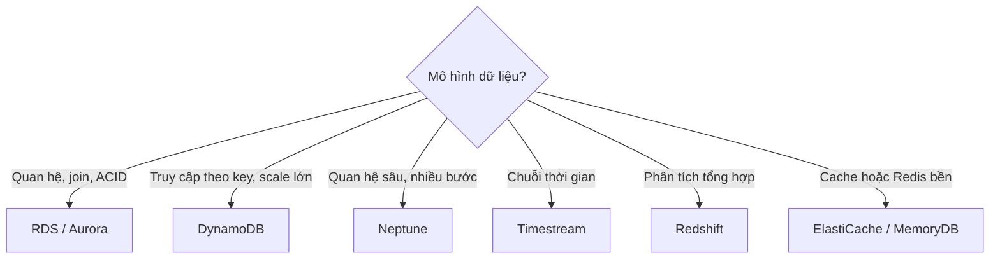

## 1. Core Concept

AWS có nhiều database chuyên dụng (purpose-built); chọn theo **mô hình dữ liệu và mẫu truy cập**, không theo thói quen. Một ứng dụng thật thường dùng **polyglot persistence**: mỗi loại dữ liệu một engine phù hợp thay vì ép mọi thứ vào một DB.

**Mental model:** như bộ dụng cụ: **SQL (RDS/Aurora)** là bộ cờ lê vạn năng cho dữ liệu có quan hệ và giao dịch; **DynamoDB** là máy dập cực nhanh cho truy cập theo key ở quy mô lớn; **Neptune** là bản đồ quan hệ; **Timestream** là nhật ký thời gian; **cache** là kệ sát tay.

## 2. How It Works

**Relational → RDS và Aurora**
- **RDS** (MySQL, PostgreSQL, MariaDB, SQL Server, Oracle) và **Aurora** (tương thích MySQL/PostgreSQL, 6 bản sao qua 3 AZ). Hợp giao dịch ACID, join, báo cáo. **Multi-AZ** (HA, standby đồng bộ) khác **Read Replica** (scale đọc, bất đồng bộ).

**Key-value và document → DynamoDB, DocumentDB**
- **DynamoDB**: độ trễ một chữ số ms, scale gần như vô hạn, truy cập theo key; **Global Tables** cho đa Region active-active. **DocumentDB** tương thích MongoDB cho workload document.

**Wide-column → Keyspaces**
- Dịch vụ tương thích Cassandra, serverless, hợp ghi khối lượng lớn theo partition.

**Graph → Neptune**
- Hỗ trợ Gremlin, SPARQL, openCypher; hợp mạng xã hội, phát hiện gian lận, recommendation cần **duyệt quan hệ nhiều bước** mà SQL join sẽ rất đắt.

**In-memory → ElastiCache, MemoryDB**
- **ElastiCache** là cache; **MemoryDB** là Redis **bền** dùng làm database chính.

**Time-series, ledger, search, warehouse**
- **Timestream** cho IoT/metric chuỗi thời gian; **QLDB** là sổ cái bất biến (AWS đang ngừng dần, nên cân nhắc Aurora + bảng audit); **OpenSearch** cho tìm kiếm/log; **Redshift** cho warehouse.

**Đa Region**
- **Aurora Global Database** (replication ~1 giây), **DynamoDB Global Tables** (multi-active, last writer wins).

## 3. Visual Diagram

## 4. Rules of Thumb & Trade-offs

| Tình huống / Nhu cầu | Chọn gì |
| --- | --- |
| Giao dịch, quan hệ, báo cáo thông thường | RDS / Aurora |
| Truy cập theo key, scale và độ trễ dự đoán được | DynamoDB |
| Bạn bè của bạn bè nhiều bước | Neptune |
| IoT, metric chuỗi thời gian | Timestream |
| Tương thích MongoDB | DocumentDB |
| Redis bền làm DB chính | MemoryDB |
| Chưa rõ yêu cầu | Bắt đầu với PostgreSQL/Aurora |

- **Được gì:** công cụ tối ưu cho từng mẫu truy cập. **Mất gì:** nhiều engine nghĩa là nhiều vận hành, đồng bộ dữ liệu và chi phí hiểu biết.

## 5. Must Remember / Production Pitfalls

- **Dùng DynamoDB cho truy vấn ad-hoc và join → sai công cụ, Scan đắt → SQL/warehouse hoặc thiết kế GSI theo access pattern**.
- **Nghĩ Multi-AZ scale được đọc → standby không phục vụ đọc → Read Replica**.
- **Đọc dữ liệu cũ sau khi ghi → replica có lag → đọc-sau-ghi dùng writer**.
- **Aurora Serverless cho tải liên tục cao có thể đắt hơn instance cố định → tính chi phí theo mẫu tải thực tế**.
- **Dùng Redis cache làm nguồn dữ liệu chính → mất khi node chết → dùng MemoryDB hoặc giữ DB làm nguồn sự thật**.
- Exam trap: "bạn của bạn bè nhiều bước" → **Neptune**; "RDS Multi-AZ dùng để" → **HA, không scale đọc**; "IoT chuỗi thời gian" → **Timestream**.

## 6. Search Hooks

- `Aurora Global Database` — DB đa Region độ trễ thấp.
- `DynamoDB Global Tables` — active-active đa Region.
- `Amazon Neptune graph database` — graph managed.
- `Amazon Timestream` — cơ sở dữ liệu time-series.
- `RDS Multi-AZ vs read replica` — HA vs scale đọc.
