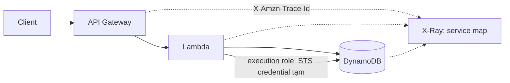

## 1. Core Concept

Bộ kiến thức AWS cho lập trình viên (trọng tâm chứng chỉ **Developer Associate**) gồm: cách ứng dụng **xác thực với AWS** (role và credential tạm thời), cách **gọi API đúng** (retry, pagination, idempotency) và cách **quan sát** (X-Ray). Nó giải quyết nỗi đau lộ access key, lỗi throttling và không biết request chậm ở đâu trong hệ thống phân tán.

**Mental model:** ứng dụng của bạn là **nhân viên đeo thẻ tạm thời** (role/STS) đi gọi hàng chục dịch vụ qua mạng; mạng lúc nào cũng có thể lỗi nên **mọi lời gọi phải chịu được thử lại**, và X-Ray là **tem dấu vết** dán lên request để theo dõi nó đi qua những đâu.

## 2. How It Works

**Credential → Không hard-code key**
- **Credential provider chain** của SDK/CLI thử theo thứ tự: biến môi trường → shared credentials/config file (profile) → **role gắn compute** (ECS task role, EC2 instance profile qua metadata service, Lambda execution role). Ưu tiên **role**; chạy local dùng profile/SSO.
- **STS**: `AssumeRole` (credential tạm 1–12 giờ, cross-account, dùng **ExternalId** cho bên thứ ba để chống confused deputy), `AssumeRoleWithWebIdentity` (OIDC/IRSA).

**Gọi API đúng → Retry, pagination, idempotency**
- Lỗi throttling (`ThrottlingException`, `ProvisionedThroughputExceededException`, `429`) cần **retry với exponential backoff + jitter** (SDK làm sẵn, đừng retry dày đặc không jitter).
- **Pagination**: API trả theo trang (`NextToken`, `ContinuationToken`, DynamoDB `LastEvaluatedKey`); dùng **paginator**, nếu không sẽ thiếu dữ liệu âm thầm.
- Thao tác ghi cần **idempotency** vì retry có thể chạy lặp (idempotency key, conditional write).

**S3 Presigned URL → Chia sẻ tạm thời**
- URL ký sẵn mang **quyền của người ký** và có hạn (tối đa 7 ngày với credential IAM user, ngắn hơn nếu ký bằng credential tạm); cho phép tải lên/xuống mà không lộ credential.

**X-Ray → Truy vết phân tán**
- **Trace** gồm **segment/subsegment**; **trace ID** truyền qua header **`X-Amzn-Trace-Id`**; có **service map**; **annotation** (có index, tìm được) và **metadata** (không index). Bật bằng SDK/daemon/ADOT hoặc **active tracing** của Lambda/API Gateway; **sampling** để giới hạn chi phí.

**Khác**
- **AppSync**: GraphQL managed, resolver tới DynamoDB/Lambda/HTTP, **subscription** realtime. **Lambda**: versions và **alias** (weighted traffic shifting), **layers**, biến môi trường mã hoá bằng KMS.

```python
import boto3
s3 = boto3.client("s3")
url = s3.generate_presigned_url("get_object",
    Params={"Bucket": "b", "Key": "k"}, ExpiresIn=300)  # 5 phút
paginator = s3.get_paginator("list_objects_v2")
for page in paginator.paginate(Bucket="b"):   # lặp hết các trang
    ...
```

## 3. Visual Diagram



## 4. Rules of Thumb & Trade-offs

| Tình huống / Nhu cầu | Chọn gì |
| --- | --- |
| Lambda/EC2/ECS gọi AWS | Role gắn compute, không nhúng key |
| Cho người ngoài tải/xuống tạm thời | S3 Presigned URL |
| Cấp quyền chéo account | STS AssumeRole (+ ExternalId) |
| Biết request chậm ở service nào | X-Ray |
| Retry khi throttle | Exponential backoff + jitter |

- **Được gì:** bảo mật tốt hơn, chịu lỗi, nhìn thấy luồng request. **Mất gì:** X-Ray thêm overhead/chi phí (kiểm soát bằng sampling); retry và idempotency làm code phức tạp hơn.

## 5. Must Remember / Production Pitfalls

- **Access key trong code/Git → bị bot quét và chiếm → role hoặc credential tạm, Secrets Manager**.
- **Throttling rồi bão retry (thundering herd) → retry đồng loạt không jitter → exponential backoff + jitter**.
- **Dữ liệu thiếu âm thầm → chỉ đọc trang đầu → dùng paginator, lặp tới hết**.
- **Retry ghi nhầm hai lần → thao tác không idempotent → idempotency key hoặc conditional write**.
- **Presigned URL báo hết hạn sớm → ký bằng credential tạm hết hạn trước → ký bằng credential dài hơn hoặc rút ngắn thời gian dùng**.
- Exam trap: "Lambda cần quyền ghi S3" → **execution role**; "chia sẻ file tạm thời không lộ credential" → **presigned URL**; "retry không jitter" → **thundering herd**.

## 6. Search Hooks

- `AWS X-Ray tracing` — truy vết phân tán.
- `AWS SDK retry exponential backoff` — retry đúng cách.
- `S3 presigned URL` — chia sẻ tạm thời không lộ credential.
- `AWS STS AssumeRole` — credential tạm thời.
- `AWS AppSync GraphQL` — GraphQL managed.
