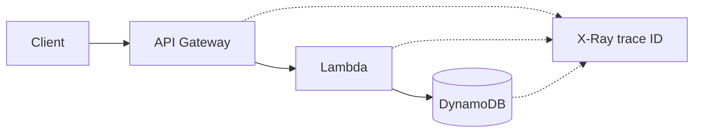

## 1. Core Concept

Bộ công cụ cho lập trình viên trên AWS (trọng tâm chứng chỉ **Developer Associate**): **SDK/CLI** và xác thực bằng role, **X-Ray** truy vết phân tán, **AppSync** (GraphQL), **SES/SNS** gửi tin, cùng các mẫu **retry, idempotency, pagination**. Mental model: *ứng dụng gọi AWS bằng credential tạm thời, và mọi lời gọi mạng đều phải chịu lỗi.*

## 2. How It Works

- **Credential chain**: biến môi trường → shared credentials/profile → **role gắn với compute** (EC2 instance profile, ECS task role, Lambda execution role); **không hard-code access key**.
- **SDK** có **retry với exponential backoff + jitter**; lỗi throttling (`ThrottlingException`, `ProvisionedThroughputExceeded`).
- **Pagination**: kết quả theo trang (`NextToken`, `LastEvaluatedKey`) — phải lặp.
- **X-Ray**: **segment/subsegment**, **trace ID** truyền qua header `X-Amzn-Trace-Id`, service map; bật bằng daemon/SDK hoặc active tracing của Lambda/API Gateway; **sampling**.
- **AppSync**: GraphQL managed, resolver tới DynamoDB/Lambda, **subscription** realtime.
- **STS**: `AssumeRole` cấp credential tạm thời, `AssumeRoleWithWebIdentity`.
- **Lambda cho dev**: **layers**, **environment variables**, **concurrency**, **versions/aliases**.
- **S3 presigned URL** cho tải lên/xuống không lộ credential.

```python
import boto3
s3 = boto3.client("s3")
url = s3.generate_presigned_url("get_object",
  Params={"Bucket": "b", "Key": "k"}, ExpiresIn=300)
```

## 3. Visual Diagram



## 4. Rules of Thumb & Trade-offs

- Dùng **role** thay access key; chia sẻ truy cập tạm thời bằng **presigned URL**/STS.
- Thao tác ghi cần **idempotency key** vì retry.
- Trade-off: **sampling cao** thấy nhiều trace nhưng tốn chi phí/overhead.

## 5. Must Remember / Production Pitfalls

- Access key trong code/Git là lỗi bảo mật kinh điển.
- Retry không jitter gây **thundering herd**.
- Quên lặp pagination → dữ liệu thiếu âm thầm.
- Presigned URL có hạn dùng và quyền của người ký.
- Lambda gọi API chậm không đặt timeout → treo.
- Interview trap: "Lambda cần quyền ghi S3?" → **execution role**, không nhúng key.

## 6. Search Hooks

- `AWS X-Ray tracing` — truy vết phân tán.
- `AWS SDK retry exponential backoff` — retry đúng cách.
- `S3 presigned URL` — chia sẻ tạm thời không lộ credential.
- `AWS STS AssumeRole` — credential tạm thời.
- `AWS AppSync GraphQL` — GraphQL managed.
