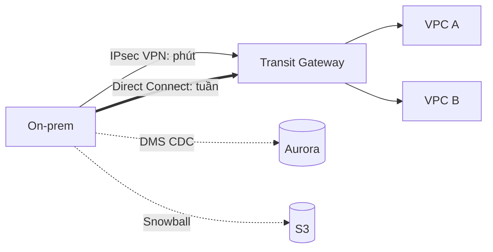

## 1. Core Concept

Kết nối on-premises với AWS và di chuyển dữ liệu dùng bốn nhóm công cụ: **Site-to-Site VPN** và **Direct Connect** (kết nối mạng), **Transit Gateway** (hub nhiều VPC), **DMS/DataSync/Snow family** (di chuyển dữ liệu). Chúng giải quyết hai câu hỏi: **đường nào đi** và **mang dữ liệu sang bằng cách nào** với băng thông và thời gian hạn chế.

**Mental model:** VPN là **đường công cộng có mã hoá** — dựng trong vài phút nhưng chất lượng phụ thuộc Internet; Direct Connect là **đường cao tốc riêng** — ổn định, nhưng mất vài tuần xây; Snowball là **xe tải chở ổ cứng** khi đường truyền quá nhỏ so với lượng hàng.

## 2. How It Works

**Site-to-Site VPN → Nhanh, rẻ, qua Internet**
- **IPsec**, mỗi connection có **2 tunnel** cho dự phòng, tối đa khoảng **1,25 Gbps mỗi tunnel**; kết thúc ở **Virtual Private Gateway** hoặc **Transit Gateway**; hỗ trợ **BGP** hoặc static route. Dựng trong **vài phút**.

**Direct Connect (DX) → Riêng tư, ổn định**
- Đường **riêng** tới AWS (dedicated **1/10/100 Gbps**, hoặc hosted qua đối tác), độ trễ ổn định, **không mã hoá mặc định** (thêm VPN trên DX hoặc MACsec). **Private VIF** tới VPC, **public VIF** tới dịch vụ công khai, **transit VIF** tới Transit Gateway; **DX Gateway** nối nhiều VPC/Region. Thời gian lắp **vài tuần**.
- **Dự phòng:** hai DX ở hai location, hoặc **DX + VPN backup**.

**Transit Gateway → Hub-and-spoke**
- Một hub nối **nhiều VPC và on-prem**, có **định tuyến transitive**, thay cho lưới **VPC Peering** (không bắc cầu). Hỗ trợ route table và peering giữa Region.

**Di chuyển dữ liệu**
- **DataSync**: chuyển file online tự động (NFS/SMB/HDFS → S3/EFS/FSx) có kiểm tra toàn vẹn. **Snowcone/Snowball Edge**: thiết bị vật lý cho dữ liệu lớn hoặc băng thông thấp. **Storage Gateway**: lưu trữ lai (File/Volume/Tape).
- **DMS**: di chuyển database với **full load + CDC** gần như không downtime; **cùng engine** (homogeneous) chỉ cần DMS, **khác engine** (ví dụ Oracle → Aurora PostgreSQL) cần **Schema Conversion Tool (SCT)** trước. **AWS MGN** rehost server bằng sao chép block-level.
- **Chiến lược 6R** (nay thêm Relocate): Rehost, Replatform, Refactor, Repurchase, Retire, Retain.

**Ví dụ tính toán:** 200 TB qua đường 1 Gbps (~100 MB/s lý thuyết) cần hơn **23 ngày** liên tục; Snowball thường nhanh hơn.

## 3. Visual Diagram

## 4. Rules of Thumb & Trade-offs

| Tình huống / Nhu cầu | Chọn gì |
| --- | --- |
| Cần kết nối ngay, rẻ | Site-to-Site VPN |
| Băng thông lớn, độ trễ ổn định, riêng tư | Direct Connect (+ VPN backup) |
| Nhiều VPC cần bắc cầu | Transit Gateway |
| Hàng chục TB, băng thông thấp | Snowball |
| Di chuyển DB ít downtime | DMS với CDC (+ SCT nếu khác engine) |
| Đồng bộ file online định kỳ | DataSync |

- **Được gì:** đúng công cụ cho đúng băng thông/thời gian. **Mất gì:** VPN phụ thuộc Internet; DX tốn thời gian và chi phí; Snowball có độ trễ vận chuyển.

## 5. Must Remember / Production Pitfalls

- **Direct Connect chết là mất kết nối → chỉ một đường là điểm lỗi đơn → thêm DX thứ hai hoặc VPN backup**.
- **Không route được giữa on-prem và VPC → CIDR chồng lấn → quy hoạch CIDR không trùng từ đầu**.
- **Dữ liệu chạy trên DX không mã hoá → DX riêng tư nhưng không mã hoá mặc định → VPN over DX hoặc MACsec nếu cần mã hoá**.
- **DMS khác engine lỗi schema → không chuyển hết schema/code → dùng SCT**.
- **Upload hàng trăm TB qua Internet quá lâu → tính băng thông trước → Snowball**.
- Exam trap: "DX mất vài tuần mà cần kết nối ngay" → **VPN trước**; "VPC peering bắc cầu" → **không, dùng Transit Gateway**; "di chuyển 200 TB, băng thông thấp" → **Snowball**.

## 6. Search Hooks

- `AWS Direct Connect vs Site-to-Site VPN` — so sánh hai kiểu kết nối lai.
- `AWS Transit Gateway` — hub nối nhiều VPC và on-prem.
- `AWS DMS CDC schema conversion tool` — di chuyển DB gần như không downtime.
- `AWS Snowball data transfer` — chuyển dữ liệu lớn bằng thiết bị vật lý.
- `6 Rs of cloud migration` — các chiến lược di chuyển.
