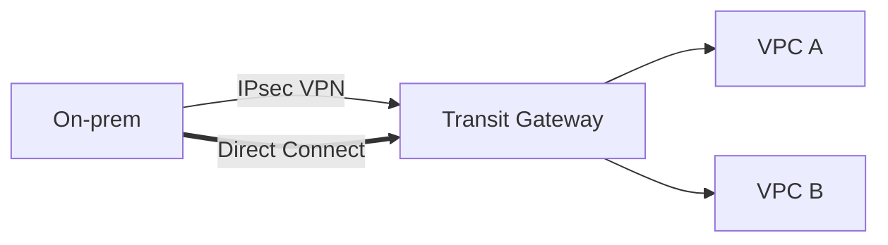

## 1. Core Concept

Kết nối on-premises với AWS và di chuyển dữ liệu dùng bốn nhóm công cụ: **Site-to-Site VPN** và **Direct Connect** (kết nối mạng), **Transit Gateway** (hub nhiều VPC), **DMS/Snow family/DataSync** (di chuyển dữ liệu). Mental model: *VPN nhanh để dựng nhưng đi qua Internet; Direct Connect riêng tư và ổn định nhưng mất thời gian lắp.*

## 2. How It Works

- **Site-to-Site VPN**: IPsec qua Internet, dựng trong phút, **2 tunnel** cho dự phòng, băng thông tới ~1.25 Gbps mỗi tunnel.
- **Direct Connect (DX)**: đường riêng tới AWS (1/10/100 Gbps), độ trễ ổn định, **không mã hoá mặc định** (thêm VPN/MACsec), thời gian lắp vài tuần; **DX Gateway** nối nhiều VPC/Region.
- **Transit Gateway**: hub nối nhiều VPC và on-prem, thay mạng lưới peering chằng chịt; **VPC Peering** không bắc cầu (non-transitive).
- **PrivateLink/VPC Endpoint**: truy cập dịch vụ riêng tư không qua Internet.
- **DMS** (+ **SCT** đổi schema): di chuyển DB, hỗ trợ **CDC** để gần như không downtime.
- **DataSync** (tự động hoá chuyển file online), **Snowcone/Snowball** (thiết bị vật lý cho dữ liệu lớn/ít băng thông), **Storage Gateway** (hybrid storage).
- **6 R** di chuyển: Rehost, Replatform, Refactor, Repurchase, Retire, Retain.

## 3. Visual Diagram

## 4. Rules of Thumb & Trade-offs

| Tình huống | Chọn |
| --- | --- |
| Cần kết nối nhanh, rẻ | Site-to-Site VPN |
| Băng thông lớn, độ trễ ổn định | Direct Connect |
| Hàng chục TB, băng thông thấp | Snowball |
| Di chuyển DB ít downtime | DMS với CDC |

- Trade-off: **tốc độ dựng và chi phí** (VPN) vs **hiệu năng và ổn định** (DX).

## 5. Must Remember / Production Pitfalls

- Direct Connect **không dự phòng** nếu chỉ một đường; thêm VPN backup hoặc DX thứ hai.
- **CIDR chồng lấn** giữa on-prem và VPC làm không định tuyến được.
- Peering không bắc cầu; dùng Transit Gateway.
- Tính băng thông trước khi chọn: vài trăm TB qua Internet mất rất lâu.
- DMS không tự chuyển hết schema/code; cần SCT.
- Interview trap: "Lắp DX mất vài tuần, cần kết nối ngay?" → dựng VPN trước, DX sau.

## 6. Search Hooks

- `AWS Direct Connect vs Site-to-Site VPN` — so sánh hai kiểu kết nối lai.
- `AWS Transit Gateway` — hub kết nối nhiều VPC.
- `AWS DMS CDC schema conversion tool` — di chuyển DB gần như không downtime.
- `AWS Snowball data transfer` — chuyển dữ liệu lớn bằng thiết bị vật lý.
- `6 Rs of cloud migration` — sáu chiến lược di chuyển.
