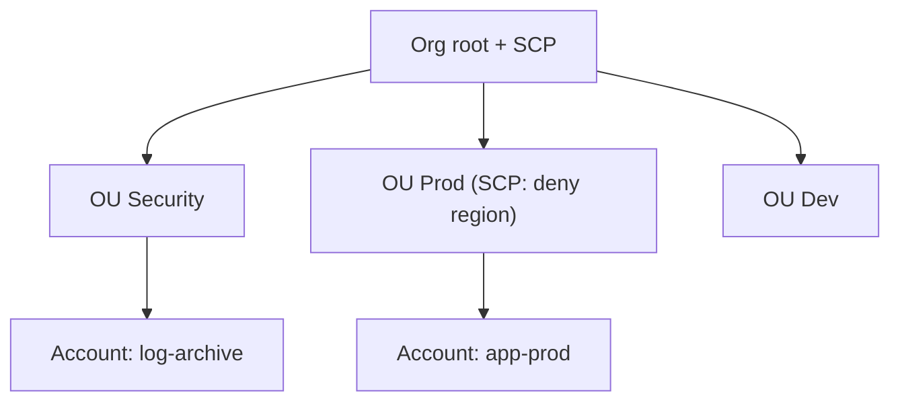

## 1. Core Concept

Khi có nhiều account, **AWS Organizations** gom chúng thành cây **OU**, áp **SCP** để giới hạn quyền tối đa và gộp hoá đơn; **Control Tower** dựng **landing zone** theo best practice. Mental model: *mỗi workload một account là ranh giới blast radius mạnh nhất; SCP là guardrail, không phải cấp quyền.*

## 2. How It Works

- **Organization**: management account + member account, chia **OU**; **consolidated billing** gộp chi phí và chia sẻ **Reserved/Savings Plans**.
- **SCP (Service Control Policy)**: đặt **giới hạn tối đa** cho IAM trong account/OU; không cấp quyền, **không áp dụng cho management account**; quyền thực = giao của SCP và IAM policy.
- **Control Tower**: landing zone, **guardrails** (preventive bằng SCP, detective bằng Config), Account Factory.
- **IAM Identity Center** (SSO): đăng nhập một lần vào nhiều account theo permission set.
- **Tập trung**: log account (CloudTrail org trail), security account (GuardDuty/Security Hub delegated admin), **RAM** chia sẻ tài nguyên (subnet, TGW).
- **Tag policy**, **backup policy**.

## 3. Visual Diagram

## 4. Rules of Thumb & Trade-offs

- Tách account theo **môi trường và workload**, không chỉ theo team.
- Dùng SCP kiểu **deny list** (chặn Region/dịch vụ cụ thể) cho dễ quản lý.
- Trade-off: **cô lập mạnh** vs **chi phí vận hành đa account** (networking, truy cập chéo).

## 5. Must Remember / Production Pitfalls

- **SCP không cấp quyền**: Allow trong SCP mà thiếu IAM policy vẫn bị từ chối.
- Quản trị trong management account là rủi ro; chỉ dùng cho billing/organization.
- SCP không ảnh hưởng **service-linked roles**.
- Interview trap: "Ngăn mọi account dùng Region ngoài ap-southeast-1" → SCP deny theo `aws:RequestedRegion`.

## 6. Search Hooks

- `AWS Organizations SCP service control policies` — guardrail quyền tối đa.
- `AWS Control Tower landing zone` — dựng môi trường đa account chuẩn.
- `IAM Identity Center permission sets` — SSO vào nhiều account.
- `AWS RAM resource access manager` — chia sẻ tài nguyên giữa account.
- `multi-account strategy AWS` — chiến lược tách account.
