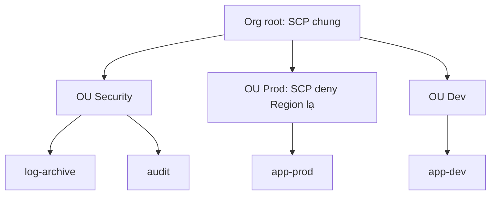

## 1. Core Concept

Khi có nhiều account, **AWS Organizations** gom chúng thành cây **OU**, gộp hoá đơn và áp **SCP** làm guardrail; **Control Tower** dựng sẵn **landing zone** theo best practice. Chúng giải quyết bài toán quản trị hàng chục đến hàng trăm account mà vẫn **cô lập blast radius** và kiểm soát được quyền.

**Mental model:** mỗi account là **một căn hộ riêng có khoá**: lỗi hay vi phạm trong căn này không lan sang căn khác. SCP là **nội quy toà nhà** vạch ra thứ tuyệt đối không được làm, nhưng **không phải chìa khoá** — bạn vẫn cần IAM để thực sự được vào.

## 2. How It Works

**Organization → Cây account và hoá đơn**
- **Management account** (trả tiền, quản trị tổ chức) và **member account**, chia vào các **OU**. **Consolidated billing** gộp hoá đơn, chia sẻ giảm giá **Savings Plans/RI** giữa các account.

**SCP (Service Control Policy) → Giới hạn tối đa**
- SCP đặt **trần quyền** cho mọi principal trong account/OU; **quyền thực tế = giao của SCP và IAM policy**. SCP **không cấp quyền**, **không áp dụng cho management account** và không ảnh hưởng **service-linked role**. Hai kiểu: **deny list** (chặn thứ cụ thể, dễ quản lý) và allow list (chặt hơn nhưng khó).

```json
{ "Effect": "Deny", "Action": "*", "Resource": "*",
  "Condition": { "StringNotEquals": { "aws:RequestedRegion": ["ap-southeast-1"] } } }
```

**Control Tower → Landing zone**
- Dựng nhanh **landing zone** gồm account **log archive** và **audit**, **guardrails** (preventive bằng SCP, detective bằng AWS Config, proactive bằng CloudFormation hooks) và **Account Factory** tạo account chuẩn hoá.

**IAM Identity Center → SSO**
- Đăng nhập một lần vào nhiều account qua **permission set**, liên kết IdP công ty.

**Dịch vụ dùng chung đa account**
- **Organization trail** của CloudTrail, **delegated administrator** (GuardDuty/Security Hub từ account security), **AWS RAM** chia sẻ subnet/Transit Gateway, **tag policy**, **backup policy**; điều kiện `aws:PrincipalOrgID` trong resource policy để chỉ cho account trong tổ chức.

## 3. Visual Diagram



## 4. Rules of Thumb & Trade-offs

| Tình huống / Nhu cầu | Chọn gì |
| --- | --- |
| Chặn mọi account tắt CloudTrail hoặc dùng Region lạ | SCP deny |
| Dựng môi trường đa account chuẩn nhanh | Control Tower |
| SSO nhiều account | IAM Identity Center |
| Chia sẻ subnet/Transit Gateway giữa account | AWS RAM |
| Gộp hoá đơn, chia sẻ giảm giá | Consolidated billing |

- **Được gì:** cô lập mạnh, guardrail tập trung, chi phí rõ theo account. **Mất gì:** chi phí vận hành đa account (mạng, truy cập chéo, tooling) và cần kỷ luật tag/naming.

## 5. Must Remember / Production Pitfalls

- **SCP có Allow mà vẫn AccessDenied → SCP không cấp quyền → thêm IAM policy tương ứng**.
- **Cần chặn cả management account nhưng SCP không có tác dụng → management account miễn SCP → không chạy workload ở đó**.
- **Dùng management account cho workload → quyền quá rộng, rủi ro cao → chỉ dùng cho billing/organization**.
- **Chặn nhầm dịch vụ nền tảng bằng SCP → hỏng tích hợp (IAM, STS, global service) → thử SCP ở OU thử nghiệm và dùng deny theo điều kiện**.
- **Account chồng quyền nhau do không có chuẩn → không dùng Control Tower/permission set → chuẩn hoá bằng landing zone**.
- Exam trap: "ngăn mọi account dùng Region ngoài ap-southeast-1" → **SCP deny theo aws:RequestedRegion**; "SCP có cấp quyền không" → **không**; "SCP không áp dụng cho" → **management account**.

## 6. Search Hooks

- `AWS Organizations SCP service control policies` — guardrail quyền tối đa.
- `AWS Control Tower landing zone` — dựng môi trường đa account chuẩn.
- `IAM Identity Center permission sets` — SSO vào nhiều account.
- `AWS RAM resource access manager` — chia sẻ tài nguyên giữa account.
- `multi-account strategy AWS` — chiến lược tách account.
