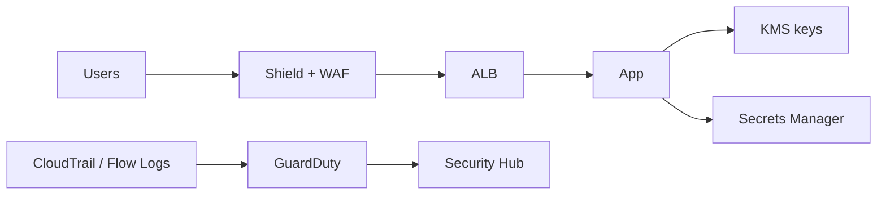

## 1. Core Concept

Ngoài IAM, AWS có bộ dịch vụ bảo mật chuyên trách: **KMS** (khoá mã hoá), **Secrets Manager/Parameter Store** (bí mật), **GuardDuty** (phát hiện đe doạ), **WAF/Shield** (chặn web và DDoS), **Cognito** (xác thực người dùng ứng dụng), **Inspector/Macie/Security Hub**. Mental model: *prevent (WAF, SG) → detect (GuardDuty, Config) → protect data (KMS, Macie) → respond.*

## 2. How It Works

- **KMS**: **CMK** (customer managed key), **envelope encryption** (data key mã hoá dữ liệu, CMK mã hoá data key), key policy + IAM, **key rotation** (tự động hằng năm), khoá theo Region; **CloudHSM** cho HSM riêng.
- **Secrets Manager**: lưu và **tự xoay** secret (RDS); **SSM Parameter Store** rẻ hơn cho cấu hình/secret đơn giản.
- **GuardDuty**: phân tích CloudTrail, VPC Flow Logs, DNS để phát hiện hành vi bất thường (không cần agent).
- **WAF**: luật trên **ALB/API Gateway/CloudFront** (SQLi, XSS, rate-based, geo); **Shield Standard** (miễn phí, L3/L4), **Shield Advanced** (DDoS nâng cao + hỗ trợ).
- **Cognito**: **User Pool** (đăng ký/đăng nhập, JWT), **Identity Pool** (cấp AWS credentials tạm thời).
- **Inspector** quét lỗ hổng EC2/ECR/Lambda; **Macie** tìm dữ liệu nhạy cảm trong S3; **Security Hub** gom phát hiện; **ACM** chứng chỉ TLS.

## 3. Visual Diagram

## 4. Rules of Thumb & Trade-offs

| Nhu cầu | Chọn |
| --- | --- |
| Chặn SQLi/XSS/rate limit | WAF |
| Phát hiện tài khoản bị chiếm | GuardDuty |
| Secret tự xoay | Secrets Manager |
| Đăng nhập cho app web/mobile | Cognito |

- Trade-off: **kiểm soát khoá (CMK)** vs **vận hành/chi phí** so với AWS managed key.

## 5. Must Remember / Production Pitfalls

- Key policy sai có thể **khoá chính bạn**; account root vẫn cần quyền.
- KMS có **giới hạn request/giây**; dữ liệu lớn dùng envelope encryption.
- Khoá KMS gắn **Region**; đa Region cần multi-Region key.
- Secret hard-code trong biến môi trường/code thay vì Secrets Manager.
- GuardDuty chỉ **phát hiện**, không tự chặn.
- Interview trap: "Mã hoá file lớn bằng KMS?" → **envelope encryption**, không gửi cả file tới KMS.

## 6. Search Hooks

- `AWS KMS envelope encryption` — mã hoá dữ liệu bằng data key.
- `Secrets Manager rotation` — tự xoay bí mật.
- `Amazon GuardDuty findings` — phát hiện đe doạ.
- `AWS WAF rate based rules` — chống lạm dụng ở tầng web.
- `Cognito user pool vs identity pool` — xác thực vs cấp credential AWS.
