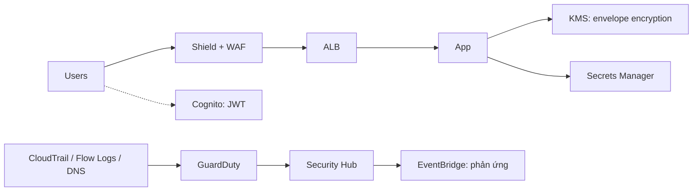

## 1. Core Concept

Ngoài IAM, AWS có bộ dịch vụ bảo mật chuyên trách theo vòng đời: **KMS** (khoá mã hoá), **Secrets Manager/Parameter Store** (bí mật), **WAF/Shield** (chặn tấn công web và DDoS), **GuardDuty/Inspector/Macie/Security Hub** (phát hiện), **Cognito** (xác thực người dùng ứng dụng). Chúng giải quyết bài toán bảo vệ ở nhiều lớp thay vì dựa vào một hàng rào duy nhất.

**Mental model:** như bảo vệ một toà nhà: **WAF/Shield** là cổng và rào chắn, **KMS/Secrets** là két và chìa khoá, **GuardDuty** là camera + nhân viên giám sát phát hiện kẻ khả nghi, **Cognito** là quầy cấp thẻ ra vào cho khách của ứng dụng.

## 2. How It Works

**KMS → Quản lý khoá và envelope encryption**
- Loại khoá: **AWS owned**, **AWS managed** (`aws/s3`, tự xoay hằng năm) và **customer managed key (CMK)** (bạn kiểm soát key policy, rotation, xoá). Khoá **gắn với Region**; **multi-Region key** nếu cần nhân bản.
- KMS chỉ mã hoá trực tiếp tối đa **4 KB**, nên dữ liệu lớn dùng **envelope encryption**: gọi `GenerateDataKey` lấy **data key**, dùng data key mã hoá dữ liệu cục bộ, rồi lưu **data key đã mã hoá** cạnh dữ liệu. Tác động: không gửi cả file lên KMS, tiết kiệm request và độ trễ.
- Quyền dùng key cần **key policy** (nguồn sự thật) cộng IAM/grant; xoá key có thời gian chờ **7–30 ngày**. **CloudHSM** khi cần HSM riêng.

**Secrets Manager vs Parameter Store → Bí mật**
- **Secrets Manager** lưu và **tự xoay** secret (RDS qua Lambda), có phí theo secret. **SSM Parameter Store** rẻ/miễn phí cho cấu hình và secret đơn giản, không có xoay tự động tích hợp sẵn như Secrets Manager.

**Phát hiện và bảo vệ**
- **GuardDuty** phân tích **CloudTrail, VPC Flow Logs, DNS logs** (không cần agent) để phát hiện hành vi bất thường; chỉ **phát hiện**, không tự chặn (kết hợp EventBridge/Lambda để phản ứng).
- **WAF** đặt trên **ALB, API Gateway REST, CloudFront**: managed rule group (SQLi, XSS), **rate-based rule**, geo, IP set. **Shield Standard** miễn phí chống DDoS L3/L4; **Shield Advanced** trả phí kèm đội hỗ trợ và bảo vệ chi phí.
- **Inspector** quét lỗ hổng EC2/ECR/Lambda; **Macie** tìm dữ liệu nhạy cảm (PII) trong S3; **Security Hub** gom phát hiện; **ACM** cấp chứng chỉ TLS miễn phí và tự gia hạn cho ELB/CloudFront.

**Cognito → Xác thực người dùng ứng dụng**
- **User Pool**: thư mục người dùng, đăng ký/đăng nhập, MFA, social login, cấp **JWT**. **Identity Pool**: đổi danh tính (từ User Pool hoặc IdP khác) lấy **AWS credentials tạm thời** để truy cập trực tiếp dịch vụ AWS.

```python
import boto3
kms = boto3.client("kms")
dk = kms.generate_data_key(KeyId="alias/app", KeySpec="AES_256")
# dk["Plaintext"] mã hoá dữ liệu cục bộ, dk["CiphertextBlob"] lưu kèm
```

## 3. Visual Diagram



## 4. Rules of Thumb & Trade-offs

| Tình huống / Nhu cầu | Chọn gì |
| --- | --- |
| Chặn SQL injection, XSS, rate limit | AWS WAF |
| Phát hiện tài khoản bị chiếm, hành vi lạ | GuardDuty |
| Secret tự xoay (RDS) | Secrets Manager |
| Cấu hình/secret đơn giản, rẻ | Parameter Store |
| Đăng nhập cho app web/mobile | Cognito User Pool |
| Cấp AWS credentials cho người dùng app | Cognito Identity Pool |
| Mã hoá file lớn | KMS envelope encryption |

- **Được gì:** bảo vệ nhiều lớp, dịch vụ managed. **Mất gì:** chi phí theo request/số lượng, key policy sai có thể khoá chính bạn, nhiều dịch vụ phải phối hợp.

## 5. Must Remember / Production Pitfalls

- **Mã hoá file lớn bằng cách gửi toàn bộ lên KMS → vượt giới hạn 4 KB và tốn request → envelope encryption**.
- **Throttling KMS khi traffic cao → vượt quota request → cache data key, S3 Bucket Key, hoặc tăng quota**.
- **Key policy sai khoá chính admin → không ai dùng được key → luôn giữ quyền cho root/role quản trị và thử trước**.
- **Secret nằm trong biến môi trường/code → lộ qua log hoặc Git → Secrets Manager/Parameter Store với IAM**.
- **Kỳ vọng GuardDuty tự chặn → nó chỉ phát hiện → nối EventBridge → Lambda/SSM để tự động hoá phản ứng**.
- Exam trap: "mã hoá file lớn bằng KMS" → **envelope encryption**; "chặn SQLi ở ALB" → **WAF**; "User Pool hay Identity Pool" → **User Pool cấp JWT, Identity Pool cấp AWS credentials**.

## 6. Search Hooks

- `AWS KMS envelope encryption` — mã hoá dữ liệu bằng data key.
- `Secrets Manager rotation` — tự xoay bí mật.
- `Amazon GuardDuty findings` — phát hiện đe doạ.
- `AWS WAF rate based rules` — chống lạm dụng ở tầng web.
- `Cognito user pool vs identity pool` — xác thực vs cấp credential AWS.
