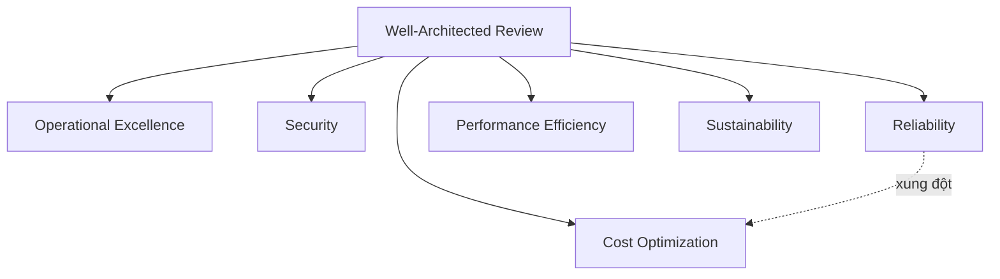

## 1. Core Concept

**AWS Well-Architected Framework** là bộ nguyên tắc để đánh giá và cải thiện kiến trúc theo **6 trụ cột**: **Operational Excellence, Security, Reliability, Performance Efficiency, Cost Optimization, Sustainability**. Nó giải quyết nỗi đau "kiến trúc chạy được nhưng chưa biết rủi ro ở đâu", và đồng thời là **khung lập luận** cho đề thi SAA/SAP.

**Mental model:** như **sáu đồng hồ trên bảng điều khiển**: bạn không thể vặn một đồng hồ lên tối đa mà bỏ qua năm đồng hồ còn lại; mọi quyết định kiến trúc đều là sự **cân bằng (trade-off)** giữa chúng.

## 2. How It Works

**Sáu trụ cột → Điều cần làm và dịch vụ điển hình**
- **Operational Excellence**: vận hành bằng code (IaC), thay đổi nhỏ và đảo ngược được, runbook, học từ sự cố. Ví dụ: CloudFormation, CloudWatch.
- **Security**: danh tính mạnh, **least privilege**, bảo vệ dữ liệu at rest/in transit, truy vết, tự động hoá phản ứng. Ví dụ: IAM, KMS, GuardDuty, CloudTrail.
- **Reliability**: **multi-AZ**, tự phục hồi, quản lý quota, kiểm thử failover, backup/DR theo **RPO/RTO**. Ví dụ: ELB, Auto Scaling, Route 53, Backup.
- **Performance Efficiency**: chọn đúng loại tài nguyên, serverless, đo đạc, dùng edge/đa Region cho độ trễ. Ví dụ: CloudFront, ElastiCache.
- **Cost Optimization**: **right-sizing**, mô hình giá phù hợp (Savings Plans, Spot), loại bỏ lãng phí, gán chi phí bằng tag. Ví dụ: Cost Explorer, Compute Optimizer.
- **Sustainability**: dùng tài nguyên hiệu quả, giảm lãng phí (Graviton, serverless, đúng kích cỡ).

**Công cụ**
- **Well-Architected Tool** (review theo câu hỏi, sinh danh sách rủi ro), **Lenses** (Serverless, SaaS, ML…), **Trusted Advisor** (kiểm tra chi phí, hiệu năng, bảo mật, chịu lỗi, giới hạn dịch vụ; đầy đủ với Business/Enterprise Support).

**Shared Responsibility Model**
- AWS chịu trách nhiệm **bảo mật của cloud** (hạ tầng vật lý, dịch vụ managed); khách hàng chịu trách nhiệm **bảo mật trong cloud** (dữ liệu, IAM, cấu hình, OS với EC2).

**Cách lập luận khi chọn giải pháp**
- Mặc định ưu tiên **managed/serverless, loosely coupled (queue, event), multi-AZ, least privilege, mã hoá, tự động hoá**, trừ khi đề/yêu cầu nói khác.

## 3. Visual Diagram

## 4. Rules of Thumb & Trade-offs

| Tình huống / Nhu cầu | Chọn gì |
| --- | --- |
| Chịu lỗi một AZ | Multi-AZ (Reliability) |
| Giảm chi phí mà giữ availability | Right-sizing, Savings Plans, Spot cho tải chịu gián đoạn |
| Quyền tối thiểu, mã hoá, truy vết | Security |
| Đánh giá kiến trúc theo checklist chính thức | Well-Architected Tool |
| Gợi ý tự động về chi phí, bảo mật, quota | Trusted Advisor |

- **Được gì:** nhìn đủ rủi ro, ngôn ngữ chung giữa team. **Mất gì:** các trụ cột xung đột nhau — Reliability (multi-AZ/Region) tăng Cost; Security tăng độ phức tạp vận hành; Performance (nhiều tài nguyên) tăng Cost.

## 5. Must Remember / Production Pitfalls

- **Nhầm HA với DR → chỉ làm multi-AZ rồi tưởng đã có DR → khi Region lỗi vẫn sập → DR cần cross-Region theo RPO/RTO**.
- **Tối ưu chi phí cắt cả redundancy → availability giảm → chọn tối ưu theo yêu cầu, không cắt hạ tầng chịu lỗi**.
- **Coi review là việc làm một lần → kiến trúc lệch dần → review định kỳ trước launch, sau sự cố và khi thay đổi lớn**.
- **Quyền rộng "cho tiện" → rủi ro Security → least privilege và Access Analyzer**.
- **Không gán tag chi phí → không biết ai tốn → chuẩn hoá tag và cost allocation**.
- Exam trap: "giảm chi phí không ảnh hưởng availability" → **right-sizing, Savings Plans, Spot cho tải chịu gián đoạn**; "multi-AZ thuộc trụ cột nào" → **Reliability**; "AWS chịu trách nhiệm gì" → **bảo mật của cloud**.

## 6. Search Hooks

- `AWS Well-Architected Framework six pillars` — sáu trụ cột kiến trúc.
- `AWS Well-Architected Tool lenses` — công cụ đánh giá theo lens.
- `AWS Trusted Advisor checks` — gợi ý chi phí, bảo mật, hiệu năng.
- `shared responsibility model AWS` — phân chia trách nhiệm bảo mật.
- `RPO RTO disaster recovery` — mục tiêu phục hồi sau thảm hoạ.
