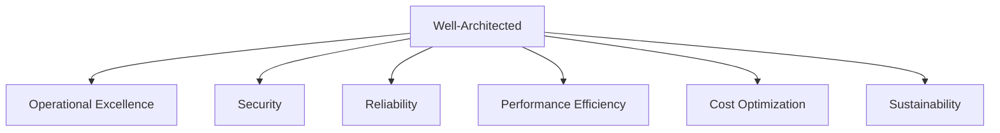

## 1. Core Concept

**AWS Well-Architected Framework** là bộ nguyên tắc đánh giá kiến trúc theo **6 trụ cột**: Operational Excellence, Security, Reliability, Performance Efficiency, Cost Optimization, Sustainability. Mental model: *checklist có hệ thống để tìm rủi ro trước khi sản xuất, và là khung lập luận của đề thi SAA/SAP.*

## 2. How It Works

- **Operational Excellence**: IaC, deploy nhỏ và đảo ngược được, **runbook**, học từ sự cố.
- **Security**: identity mạnh, **least privilege**, bảo vệ dữ liệu at rest/in transit, truy vết (CloudTrail), tự động hoá phản ứng.
- **Reliability**: **multi-AZ**, tự phục hồi, quản lý quota, test failover, backup/DR (RPO/RTO).
- **Performance Efficiency**: chọn đúng loại tài nguyên, serverless, đo đạc, đa Region/edge cho latency.
- **Cost Optimization**: **right-sizing**, pricing model (Savings Plans, Spot), loại bỏ lãng phí, tag.
- **Sustainability**: dùng tài nguyên hiệu quả, giảm lãng phí.
- Công cụ: **Well-Architected Tool**, **Trusted Advisor**, Lenses (Serverless, SaaS, ML).

## 3. Visual Diagram

## 4. Rules of Thumb & Trade-offs

- Các trụ cột **xung đột nhau**: Reliability (multi-AZ/Region) tăng Cost; Security tăng độ phức tạp vận hành.
- Đánh giá lặp lại theo mốc (trước launch, sau sự cố, định kỳ).
- Trong đề thi: chọn đáp án **managed, loosely coupled, multi-AZ, least privilege** khi yêu cầu không nói khác.

## 5. Must Remember / Production Pitfalls

- Coi framework là checklist một lần thay vì quy trình liên tục.
- Tối ưu một trụ cột mà bỏ qua rủi ro ở trụ cột khác.
- Nhầm **High Availability** (multi-AZ) với **Disaster Recovery** (multi-Region).
- Interview trap: "Giảm chi phí mà không ảnh hưởng availability" → right-sizing, Savings Plans, Spot cho tải chịu gián đoạn.

## 6. Search Hooks

- `AWS Well-Architected Framework six pillars` — sáu trụ cột kiến trúc.
- `AWS Well-Architected Tool lenses` — công cụ đánh giá theo lens.
- `AWS Trusted Advisor checks` — gợi ý chi phí, bảo mật, hiệu năng.
- `shared responsibility model AWS` — phân chia trách nhiệm bảo mật.
- `RPO RTO disaster recovery` — mục tiêu phục hồi sau thảm hoạ.
