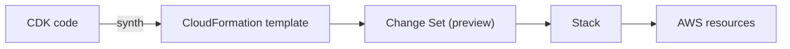

## 1. Core Concept

**CloudFormation** mô tả hạ tầng AWS bằng template khai báo (YAML/JSON) và triển khai thành **stack**; **CDK** cho phép viết bằng ngôn ngữ lập trình rồi sinh ra template. Mental model: *hạ tầng là code có version, có diff và có rollback.*

## 2. How It Works

- **Template**: `Parameters`, `Mappings`, `Conditions`, `Resources`, `Outputs`; hàm `!Ref`, `!GetAtt`, `!Sub`, `!ImportValue`.
- **Stack / Change Set**: xem trước thay đổi trước khi áp dụng; lỗi thì **rollback**; **Stack Set** triển khai đa account/Region.
- **Drift detection**: phát hiện tài nguyên bị sửa ngoài CloudFormation.
- **DeletionPolicy** (`Retain`, `Snapshot`) bảo vệ dữ liệu khi xoá stack; **Stack policy** chặn cập nhật tài nguyên.
- **Nested stack**, **cross-stack reference** (Export/Import), **custom resource** (Lambda).
- **CDK**: construct L1/L2/L3, `cdk synth`, `cdk diff`, `cdk deploy`; **SAM** cho serverless.

```yaml
Resources:
  Bucket:
    Type: AWS::S3::Bucket
    DeletionPolicy: Retain
```

## 3. Visual Diagram



## 4. Rules of Thumb & Trade-offs

- Luôn xem **change set** trước khi cập nhật production.
- Chia stack theo vòng đời (network, data, app); tránh một stack khổng lồ (giới hạn 500 tài nguyên).
- Trade-off: **CloudFormation/CDK** gắn chặt AWS, **Terraform** đa cloud nhưng cần quản lý state.

## 5. Must Remember / Production Pitfalls

- Một số thay đổi gây **replacement** (xoá rồi tạo lại) và mất dữ liệu.
- Sửa tay ngoài console gây **drift**.
- Stack bị `UPDATE_ROLLBACK_FAILED` cần xử lý thủ công.
- **Export** đang được import thì không thể xoá/đổi.
- Interview trap: "Giữ lại database khi xoá stack" → `DeletionPolicy: Retain/Snapshot`.

## 6. Search Hooks

- `CloudFormation change sets` — xem trước thay đổi.
- `CloudFormation drift detection` — phát hiện cấu hình bị sửa tay.
- `CloudFormation StackSets` — triển khai đa account và Region.
- `AWS CDK constructs L1 L2 L3` — các mức trừu tượng của CDK.
- `AWS SAM serverless` — framework cho ứng dụng serverless.
