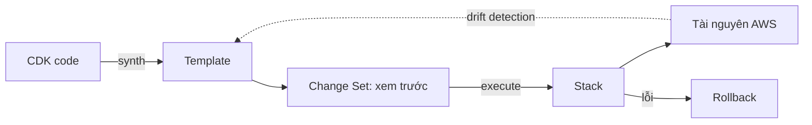

## 1. Core Concept

**CloudFormation** mô tả hạ tầng AWS bằng template khai báo (YAML/JSON) rồi triển khai thành một **stack**; **CDK** cho phép viết hạ tầng bằng ngôn ngữ lập trình (TypeScript, Python…) và sinh ra template CloudFormation. Chúng giải quyết nỗi đau dựng tay không lặp lại được, không review được và không rollback được.

**Mental model:** template là **bản vẽ kiến trúc**, CloudFormation là **đội thi công** so bản vẽ với công trình hiện có rồi chỉ sửa phần khác biệt; **Change Set** là **bản xem trước thay đổi** trước khi đội thi công đập tường.

## 2. How It Works

**Template → Cấu trúc và hàm**
- Các phần: `Parameters`, `Mappings`, `Conditions`, `Resources` (bắt buộc), `Outputs`. Hàm nội tại: `!Ref`, `!GetAtt`, `!Sub`, `!Join`, `!ImportValue`. Giới hạn thực tế: **500 tài nguyên mỗi stack**, template trực tiếp tối đa 51.200 byte (qua S3 tới 1 MB).

**Stack lifecycle → Tạo, cập nhật, rollback**
- Tạo lỗi thì **rollback** toàn bộ. Khi cập nhật, mỗi thay đổi thuộc ba loại: **không gián đoạn**, **gián đoạn một phần**, hoặc **replacement** (xoá và tạo lại, **có thể mất dữ liệu**). Trạng thái nguy hiểm: `UPDATE_ROLLBACK_FAILED` cần xử lý thủ công.

**Change Set → Xem trước**
- Tạo change set để thấy tài nguyên nào bị `Add/Modify/Remove` và có `Replacement` không, rồi mới execute. Đây là cách an toàn trước khi sửa production.

**Bảo vệ dữ liệu và an toàn**
- **DeletionPolicy**: `Delete` (mặc định), `Retain` hoặc `Snapshot` (cho RDS/EBS) khi xoá stack; **UpdateReplacePolicy** tương tự cho replacement. **Stack Policy** chặn cập nhật tài nguyên nhạy cảm. **Drift detection** so trạng thái thực với template để phát hiện sửa tay ngoài CloudFormation.

**Mở rộng**
- **Nested stack** chia nhỏ; **cross-stack reference** qua `Export/ImportValue` (đang được import thì không xoá/đổi được export); **StackSets** triển khai một template tới **nhiều account/Region** (tích hợp Organizations); **custom resource** (Lambda) cho thứ CloudFormation chưa hỗ trợ.

**CDK và SAM**
- **CDK**: construct **L1** (map 1-1 CloudFormation), **L2** (mặc định hợp lý), **L3** (pattern); `cdk synth` → template, `cdk diff`, `cdk deploy`. **SAM** là phần mở rộng CloudFormation cho serverless.

```yaml
Resources:
  Db:
    Type: AWS::RDS::DBInstance
    DeletionPolicy: Snapshot
    UpdateReplacePolicy: Snapshot
    Properties: { DBInstanceClass: db.t3.micro, Engine: postgres, AllocatedStorage: 20 }
```

## 3. Visual Diagram



## 4. Rules of Thumb & Trade-offs

| Tình huống / Nhu cầu | Chọn gì |
| --- | --- |
| Xem trước tác động trước khi cập nhật production | Change Set |
| Giữ database khi xoá stack | DeletionPolicy Retain/Snapshot |
| Triển khai một template cho 30 account | StackSets |
| Phát hiện cấu hình bị sửa tay | Drift detection |
| Hạ tầng bằng ngôn ngữ lập trình, vòng lặp/điều kiện phức tạp | CDK |
| Đa cloud | Terraform |

- **Được gì:** hạ tầng có version, review, rollback, lặp lại. **Mất gì:** gắn chặt AWS, học template, rủi ro replacement làm mất dữ liệu nếu không kiểm soát.

## 5. Must Remember / Production Pitfalls

- **Cập nhật làm mất database → thuộc tính gây replacement → xem change set và đặt DeletionPolicy/UpdateReplacePolicy Snapshot**.
- **Cấu hình khác template sau sự cố → có người sửa tay → drift detection và hạn chế quyền sửa trực tiếp**.
- **Không xoá được stack/export → export đang được stack khác import → gỡ import trước**.
- **Stack kẹt `UPDATE_ROLLBACK_FAILED` → tài nguyên bị sửa tay hoặc xoá → continue update rollback, bỏ qua tài nguyên lỗi**.
- **Stack quá lớn, chạm 500 tài nguyên → chia theo vòng đời** (network, data, app).
- Exam trap: "giữ DB khi xoá stack" → **DeletionPolicy Retain/Snapshot**; "xem trước thay đổi" → **Change Set**; "cùng template nhiều account" → **StackSets**.

## 6. Search Hooks

- `CloudFormation change sets` — xem trước thay đổi.
- `CloudFormation drift detection` — phát hiện cấu hình bị sửa tay.
- `CloudFormation StackSets` — triển khai đa account và Region.
- `AWS CDK constructs L1 L2 L3` — các mức trừu tượng của CDK.
- `AWS SAM serverless` — framework cho ứng dụng serverless.
