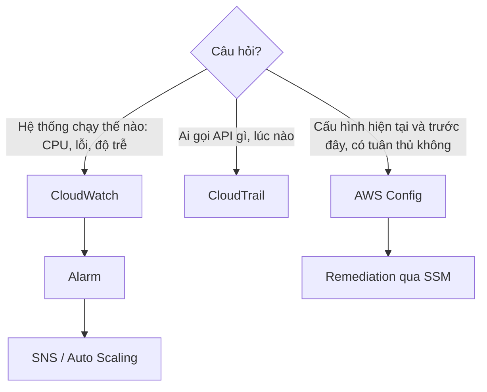

## 1. Core Concept

Ba dịch vụ quan sát của AWS trả lời ba câu hỏi khác nhau: **CloudWatch** cho biết hệ thống đang **chạy thế nào** (metric, log, alarm), **CloudTrail** cho biết **ai đã gọi API nào** (audit), còn **AWS Config** cho biết tài nguyên **được cấu hình ra sao theo thời gian** và có tuân thủ không. Nhầm ba dịch vụ này là lỗi phổ biến nhất khi điều tra sự cố và khi thi.

**Mental model:** CloudWatch là **đồng hồ trên bảng điều khiển** (tốc độ, nhiệt độ), CloudTrail là **camera ghi ai ra vào**, Config là **cuốn sổ chụp ảnh hiện trạng** từng thời điểm kèm bảng kiểm tra nội quy.

## 2. How It Works

**CloudWatch Metrics và Alarms → Hiệu năng**
- Metric thuộc **namespace** và **dimension**; EC2 mặc định gửi mỗi **5 phút** (**detailed monitoring** 1 phút); **custom metric** chuẩn 1 phút, **high-resolution** tới **1 giây**. **RAM và disk usage không có sẵn**: phải cài **CloudWatch Agent** hoặc gửi custom metric.
- **Alarm** có trạng thái `OK/ALARM/INSUFFICIENT_DATA`; hành động gồm gửi SNS, Auto Scaling, EC2 recover; **composite alarm** gộp điều kiện để giảm nhiễu; cần chọn cách xử lý **missing data**.

**CloudWatch Logs → Log tập trung**
- **Log group/stream**, **retention** (mặc định **không bao giờ hết hạn**, nên đặt), **Logs Insights** để truy vấn, **metric filter** biến log thành metric, **subscription filter** đẩy sang Lambda/Kinesis/OpenSearch, export sang S3.
- **EventBridge** phản ứng với sự kiện hoặc theo lịch.

**CloudTrail → Audit API**
- Ghi **management events** (tạo/xoá/sửa tài nguyên) mặc định, xem trong **Event history** trong **90 ngày**; muốn giữ lâu phải tạo **trail** lưu vào S3 (đa Region, **organization trail**, **log file validation**).
- **Data events** (S3 object-level, Lambda invoke) **không bật mặc định** và tính phí. CloudTrail ghi **ai/khi nào/từ đâu**, không ghi nội dung dữ liệu.

**AWS Config → Cấu hình và tuân thủ**
- Ghi **configuration item** theo thời gian (timeline), đánh giá bằng **Config Rules** (managed hoặc custom Lambda), **conformance packs**, và **auto-remediation** qua **SSM Automation**; **aggregator** gom đa account/Region.

```bash
aws cloudtrail lookup-events --lookup-attributes AttributeKey=EventName,AttributeValue=TerminateInstances
```

## 3. Visual Diagram



## 4. Rules of Thumb & Trade-offs

| Tình huống / Nhu cầu | Chọn gì |
| --- | --- |
| Ai đã terminate EC2 / xoá bucket | CloudTrail |
| CPU cao, độ trễ tăng, lỗi ứng dụng | CloudWatch |
| Bucket có bị chuyển sang public không, theo thời gian | AWS Config |
| Điều tra "ai thay đổi security group" | CloudTrail + Config |
| Theo dõi RAM/disk | CloudWatch Agent |
| Tự khắc phục vi phạm cấu hình | Config rule + remediation |

- **Được gì:** nhìn đủ hiệu năng, hành động và cấu hình. **Mất gì:** chi phí ingest log, data events và Config theo số cấu hình ghi nhận.

## 5. Must Remember / Production Pitfalls

- **Không thấy RAM/disk trong CloudWatch → EC2 không gửi mặc định → cài CloudWatch Agent**.
- **Muốn biết ai xoá object S3 nhưng không có dấu vết → data events chưa bật → bật data events cho bucket cần audit**.
- **Cần lịch sử hơn 90 ngày → chỉ dùng Event history → tạo trail lưu S3 hoặc CloudTrail Lake**.
- **Hoá đơn CloudWatch Logs phình → retention mặc định vô hạn → đặt retention và lọc log ở nguồn**.
- **Alarm nhảy ALARM/INSUFFICIENT_DATA liên tục → xử lý missing data chưa phù hợp → cấu hình treat missing data**.
- Exam trap: "ai đã terminate EC2" → **CloudTrail**; "theo dõi RAM" → **CloudWatch Agent/custom metric**; "bucket bị public theo thời gian, tự sửa" → **Config rule + remediation**.

## 6. Search Hooks

- `CloudWatch Logs Insights` — truy vấn log trực tiếp trên CloudWatch.
- `CloudWatch Agent custom metrics memory` — thu thập RAM và disk.
- `CloudTrail management events data events` — phân biệt hai loại sự kiện.
- `AWS Config rules remediation` — đánh giá tuân thủ cấu hình tự động.
- `CloudWatch composite alarms` — kết hợp nhiều alarm để giảm nhiễu.
