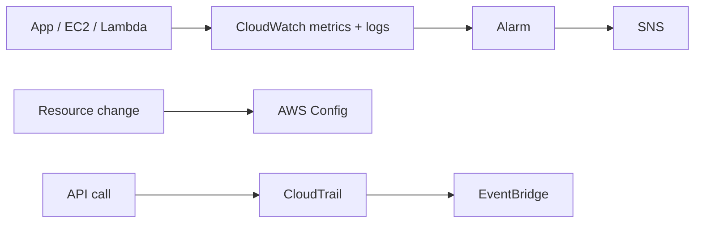

## 1. Core Concept

Ba dịch vụ quan sát của AWS trả lời ba câu hỏi khác nhau: **CloudWatch** = hệ thống đang chạy thế nào (metric, log, alarm), **CloudTrail** = ai gọi API nào (audit), **AWS Config** = tài nguyên đang cấu hình ra sao và có tuân thủ không. Mental model: *performance / who / what-changed.*

## 2. How It Works

- **CloudWatch Metrics**: namespace + dimension; EC2 mặc định 5 phút (**detailed monitoring** 1 phút); **không có metric RAM/disk** nếu không cài **CloudWatch Agent**; custom metric, **high-resolution** tới 1 giây.
- **Alarms**: trạng thái `OK/ALARM/INSUFFICIENT_DATA`, hành động gửi SNS, Auto Scaling, EC2 recover; **composite alarm**.
- **CloudWatch Logs**: log group/stream, **retention** (mặc định vĩnh viễn), **Logs Insights** để query, **metric filter**, **subscription filter** đẩy sang Lambda/Kinesis, export sang S3.
- **EventBridge** (trước là CloudWatch Events): phản ứng với sự kiện hoặc lịch.
- **CloudTrail**: ghi **management events** (mặc định 90 ngày trong Event history), **data events** (S3 object, Lambda) phải bật riêng; tạo **trail** để lưu vào S3 lâu dài, đa Region, bật **log file validation**.
- **AWS Config**: ghi lịch sử cấu hình, **Config Rules** đánh giá tuân thủ, **auto-remediation** qua SSM.

## 3. Visual Diagram

## 4. Rules of Thumb & Trade-offs

- Cần biết **ai xoá S3 bucket** → CloudTrail; **bucket có public không theo thời gian** → Config; **CPU cao** → CloudWatch.
- Log nhiều = chi phí ingest; đặt retention và lọc ở nguồn.
- Trade-off: **độ phân giải/thời gian lưu** vs **chi phí**.

## 5. Must Remember / Production Pitfalls

- **RAM và disk usage không có sẵn** trong metric EC2.
- **Data events** của CloudTrail không bật mặc định và tính phí.
- Alarm trên metric thiếu dữ liệu cần cấu hình **treat missing data**.
- Log group không retention làm hoá đơn tăng dần.
- CloudTrail ghi **ai**, không ghi nội dung gọi dữ liệu (ví dụ nội dung object).
- Interview trap: "Ai đã terminate EC2?" → **CloudTrail**.

## 6. Search Hooks

- `CloudWatch Logs Insights` — truy vấn log trực tiếp trên CloudWatch.
- `CloudWatch Agent custom metrics memory` — thu thập RAM/disk.
- `CloudTrail management events data events` — phân biệt hai loại sự kiện.
- `AWS Config rules remediation` — đánh giá tuân thủ cấu hình tự động.
- `CloudWatch composite alarms` — kết hợp nhiều alarm để giảm nhiễu.
