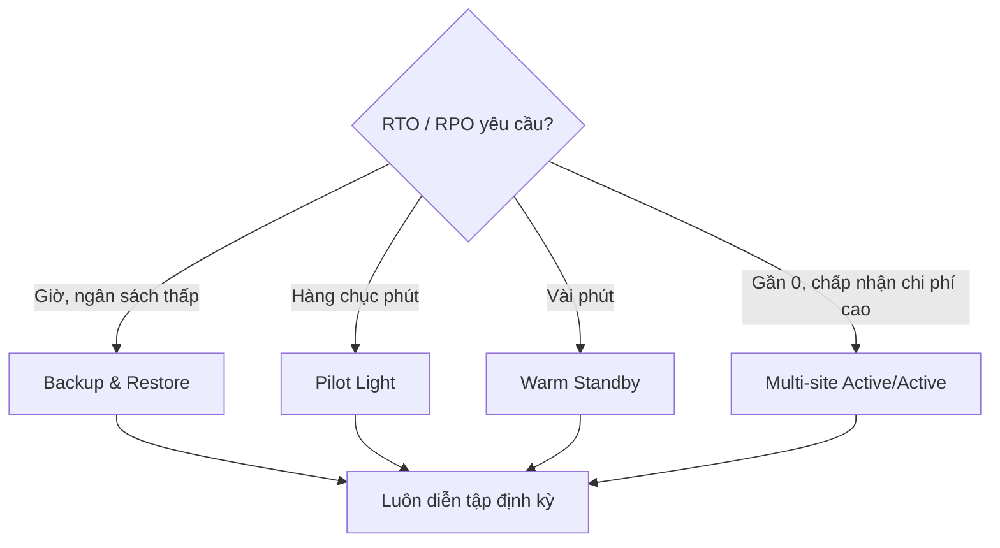

## 1. Core Concept

**Disaster Recovery (DR)** là kế hoạch khôi phục hệ thống khi mất cả datacenter hoặc Region. Mọi quyết định DR xoay quanh hai con số: **RTO** (thời gian tối đa chấp nhận ngừng dịch vụ) và **RPO** (lượng dữ liệu tối đa chấp nhận mất). RTO và RPO càng nhỏ thì **chi phí càng cao**.

**Mental model:** DR như **bảo hiểm**: bạn trả phí đều đặn để đổi lấy tốc độ phục hồi; chọn gói theo mức thiệt hại mà doanh nghiệp chịu được, không phải gói đắt nhất.

## 2. How It Works

**RTO vs RPO → Hai thước đo**
- **RTO**: bao lâu hệ thống phải chạy lại. **RPO**: dữ liệu mất tối đa tính bằng thời gian (RPO 1 giờ nghĩa là backup/replication ít nhất mỗi giờ).

**Bốn chiến lược → Từ rẻ đến đắt**
- **Backup & Restore**: sao lưu định kỳ (S3, **AWS Backup**), sự cố mới dựng lại; **RTO tính bằng giờ**, rẻ nhất.
- **Pilot Light**: giữ **phần lõi** luôn chạy (ví dụ database replica), phần ứng dụng tắt, sự cố mới bật và scale; RTO hàng chục phút.
- **Warm Standby**: chạy **bản thu nhỏ đầy đủ** ở Region khác, sự cố thì scale lên; **RTO vài phút**.
- **Multi-site Active/Active**: chạy đầy đủ nhiều Region đồng thời; RTO/RPO gần 0 nhưng **đắt nhất** và phức tạp (đồng bộ dữ liệu, xung đột ghi).

**Công cụ**
- **AWS Backup**: một policy cho lịch, retention và **copy cross-Region/cross-account**. **AWS Elastic Disaster Recovery (DRS)**: sao chép **block-level liên tục** từ máy nguồn (on-prem hoặc cloud) sang AWS rồi khởi chạy instance khi sự cố.
- Dữ liệu: **Aurora Global Database** (~1 giây), **S3 CRR**, **DynamoDB Global Tables**. Định tuyến: **Route 53 failover** với health check.

**Multi-AZ vs Multi-Region**
- Multi-AZ bảo vệ khi **một datacenter** lỗi (**HA**); chỉ triển khai **cross-Region** mới sống sót khi **cả Region** gặp sự cố (**DR**).

## 3. Visual Diagram

## 4. Rules of Thumb & Trade-offs

| Tình huống / Nhu cầu | Chọn gì |
| --- | --- |
| RTO tính bằng giờ, ngân sách thấp | Backup & Restore |
| RTO hàng chục phút | Pilot Light |
| RTO vài phút, ngân sách vừa | Warm Standby |
| RPO/RTO gần 0, chấp nhận đắt | Multi-site Active/Active |
| Chống lỗi một AZ | Multi-AZ (HA, không phải DR) |
| Sao lưu tập trung nhiều dịch vụ | AWS Backup |

- **Được gì:** hệ thống sống sót sau thảm hoạ. **Mất gì:** chi phí hạ tầng song song, độ phức tạp đồng bộ dữ liệu và diễn tập.

## 5. Must Remember / Production Pitfalls

- **Nhầm HA với DR → chỉ triển khai Multi-AZ rồi tưởng đã có DR → khi cả Region lỗi vẫn sập; cần cross-Region**.
- **Chọn Active/Active cho hệ thống không cần → chi phí và độ phức tạp thừa → chọn chiến lược theo RTO/RPO thực tế**.
- **Backup có nhưng không restore được → chưa từng thử → diễn tập restore và failover định kỳ**.
- **Backup cùng account/Region với dữ liệu gốc → mất cả hai khi bị chiếm → copy cross-Region/cross-account**.
- **RPO không khớp tần suất backup → backup hằng đêm nhưng yêu cầu RPO 5 phút → dùng replication liên tục**.
- Exam trap: "RTO vài phút ngân sách vừa" → **Warm Standby**; "RTO tính bằng giờ, ngân sách thấp" → **Backup & Restore**; "RPO gần 0, RTO vài phút, chấp nhận chi phí cao" → **Active/Active**.

## 6. Search Hooks

- `RTO vs RPO` — mục tiêu thời gian phục hồi và lượng dữ liệu chấp nhận mất.
- `AWS disaster recovery strategies pilot light warm standby` — bốn chiến lược DR.
- `AWS Elastic Disaster Recovery` — sao chép liên tục và dựng lại server.
- `AWS Backup cross-region cross-account` — sao lưu tập trung.
- `Multi-AZ vs Multi-Region` — HA so với DR.
