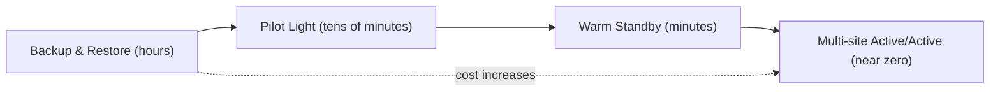

## 1. Core Concept

**Disaster Recovery (DR)** là khả năng khôi phục workload sau sự cố lớn (mất AZ/Region, lỗi dữ liệu). Chiến lược DR được chọn dựa trên **RTO** (thời gian chấp nhận mất dịch vụ) và **RPO** (lượng dữ liệu chấp nhận mất). Mental model: *càng muốn RTO/RPO nhỏ thì càng phải giữ nhiều tài nguyên chạy sẵn ở Region dự phòng, và càng tốn tiền.*

## 2. How It Works

- **RTO (Recovery Time Objective)**: từ lúc sập đến lúc hoạt động lại. **RPO (Recovery Point Objective)**: khoảng thời gian dữ liệu có thể mất, quyết định tần suất backup/replication.
- Bốn chiến lược theo AWS (chi phí và tốc độ tăng dần):
  - **Backup & Restore**: chỉ giữ backup (snapshot, **AWS Backup**, S3 CRR); RPO/RTO tính bằng **giờ**.
  - **Pilot Light**: giữ sẵn phần lõi (database replicate), compute tắt/tối thiểu; bật khi sự cố; RTO **hàng chục phút**.
  - **Warm Standby**: bản thu nhỏ đầy đủ chạy sẵn, scale lên khi sự cố; RTO **phút**.
  - **Multi-site Active/Active**: nhiều Region phục vụ đồng thời; RTO/RPO gần **0**.
- **Dịch vụ hỗ trợ**: **AWS Elastic Disaster Recovery (DRS)** (replicate server liên tục), **Aurora Global Database**, **DynamoDB Global Tables**, **S3 Cross-Region Replication**, **Route 53 Failover** + health check, **CloudFormation** để dựng lại hạ tầng.
- Phạm vi lỗi: **trong Region** (Multi-AZ) khác với **cross-Region** (DR thực sự).

## 3. Visual Diagram

## 4. Rules of Thumb & Trade-offs

| Chiến lược | RTO | Chi phí | Dùng khi |
| --- | --- | --- | --- |
| Backup & Restore | Giờ | Thấp nhất | Hệ thống nội bộ, chịu được downtime |
| Pilot Light | Hàng chục phút | Thấp | Cần phục hồi khá nhanh, ngân sách vừa |
| Warm Standby | Phút | Trung bình | Dịch vụ quan trọng |
| Active/Active | ≈ 0 | Cao nhất | Tài chính, y tế, SLA rất cao |

- Bắt đầu từ **yêu cầu kinh doanh** (RTO/RPO/chi phí downtime) rồi mới chọn chiến lược.
- Trade-off cốt lõi: *Chi phí* so với *RTO/RPO*; tự động hoá failover giảm RTO nhưng tăng độ phức tạp.

## 5. Must Remember / Production Pitfalls

- **Backup chưa test restore = chưa có backup**: lên lịch diễn tập DR định kỳ.
- Multi-AZ **không phải** DR cross-Region; replication **không thay** backup (xoá nhầm cũng được nhân bản).
- DR Region cần cùng **service quota**, **AMI/Secrets/KMS key** đã được sao chép; thiếu những thứ này failover sẽ nghẽn.
- Failover DNS bị trễ vì **TTL** → đặt TTL thấp cho bản ghi quan trọng.
- Exam trap: "RPO gần 0, RTO vài phút, ngân sách hạn chế" → Warm Standby/Pilot Light; "chi phí thấp nhất, chấp nhận vài giờ" → Backup & Restore.

## 6. Search Hooks

- `RTO vs RPO` — thời gian phục hồi và lượng dữ liệu chấp nhận mất.
- `AWS disaster recovery strategies pilot light warm standby` — các chiến lược DR chính thức của AWS.
- `AWS Elastic Disaster Recovery DRS` — replicate liên tục server cho DR.
- `AWS Backup cross-Region copy` — tự động hoá và sao chép backup đa Region.
- `Route 53 failover routing health check` — chuyển traffic sang Region dự phòng.
- `Multi-AZ vs multi-Region` — phân biệt chịu lỗi trong Region với DR.
