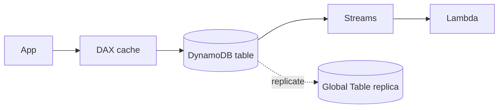

## 1. Core Concept

**Amazon DynamoDB** là NoSQL key-value/document **serverless** với latency **một chữ số mili-giây** ở bất kỳ quy mô nào. Nó giải quyết nhu cầu scale ngang gần như vô hạn mà không phải quản lý server. Mental model: *thiết kế bảng theo **access pattern** trước, vì thứ duy nhất truy cập nhanh là key.*

## 2. How It Works

- **Primary key**: **partition key** (hash, quyết định partition lưu trữ) hoặc **partition key + sort key**. Item tối đa **400 KB**.
- **Capacity mode**:
  - **On-demand**: trả theo request, hợp tải khó đoán.
  - **Provisioned**: khai báo **RCU/WCU** (có auto scaling), rẻ hơn khi tải ổn định.
- **RCU/WCU**: 1 RCU = 1 lần đọc **strongly consistent** ≤ 4 KB/giây (đọc **eventually consistent** được gấp đôi); 1 WCU = 1 lần ghi ≤ 1 KB/giây; **transaction** tốn gấp đôi.
- **Index**:
  - **GSI**: partition/sort key khác, tạo bất cứ lúc nào, đọc eventually consistent, có capacity riêng.
  - **LSI**: cùng partition key, sort key khác, **chỉ tạo khi tạo bảng**, tối đa 5, hỗ trợ strongly consistent.
- **Query** dùng key (hiệu quả) khác **Scan** đọc toàn bảng (đắt, chậm).
- **DynamoDB Streams** ghi thay đổi (giữ 24 giờ) → kích hoạt Lambda; **TTL** tự xoá item hết hạn; **PITR** khôi phục trong 35 ngày.
- **DAX**: cache in-memory **write-through** cho bảng, giảm latency xuống mức micro-giây.
- **Global Tables**: nhân bản **multi-Region, multi-active**, ghi xung đột theo "last writer wins".

```python
table.query(
    KeyConditionExpression=Key("customerId").eq("c-42") & Key("orderDate").begins_with("2026-11")
)
```

## 3. Visual Diagram



## 4. Rules of Thumb & Trade-offs

- Dữ liệu dạng key-value/document, truy cập theo key, scale lớn (giỏ hàng, session, IoT) → DynamoDB; join/ad-hoc query phức tạp → RDS/Aurora.
- Tải đột biến, mới ra mắt → **on-demand**; tải ổn định, dự đoán được → **provisioned + auto scaling**.
- Đọc lặp lại nhiều → **DAX** (chỉ ích với eventually consistent reads).
- Trade-off: *Scalability & latency* đổi lấy *linh hoạt truy vấn*; đổi sort key/access pattern sau này rất tốn công.

## 5. Must Remember / Production Pitfalls

- **Hot partition**: partition key phân bố lệch (ví dụ `status = ACTIVE`) gây throttling dù tổng capacity còn dư → chọn key có **cardinality cao**.
- `Scan` trên bảng lớn tiêu tốn RCU và chậm; dùng Query + GSI.
- LSI không thêm được sau khi bảng đã tạo; giới hạn **10 GB mỗi giá trị partition key** khi dùng LSI.
- `ProvisionedThroughputExceededException` → retry với exponential backoff (SDK làm sẵn).
- Exam trap: "cần cache cho DynamoDB" → **DAX** (còn ElastiCache cho truy vấn phức tạp); "ghi nhiều Region" → **Global Tables**.

## 6. Search Hooks

- `DynamoDB partition key design hot partition` — thiết kế key tránh quá tải một partition.
- `DynamoDB RCU WCU calculation` — cách tính đơn vị capacity đọc/ghi.
- `DynamoDB GSI vs LSI` — khác biệt hai loại secondary index.
- `DynamoDB Accelerator DAX` — cache in-memory cho DynamoDB.
- `DynamoDB Streams Lambda trigger` — phản ứng với thay đổi dữ liệu theo thời gian thực.
- `DynamoDB Global Tables` — nhân bản đa Region, đa vùng ghi.
