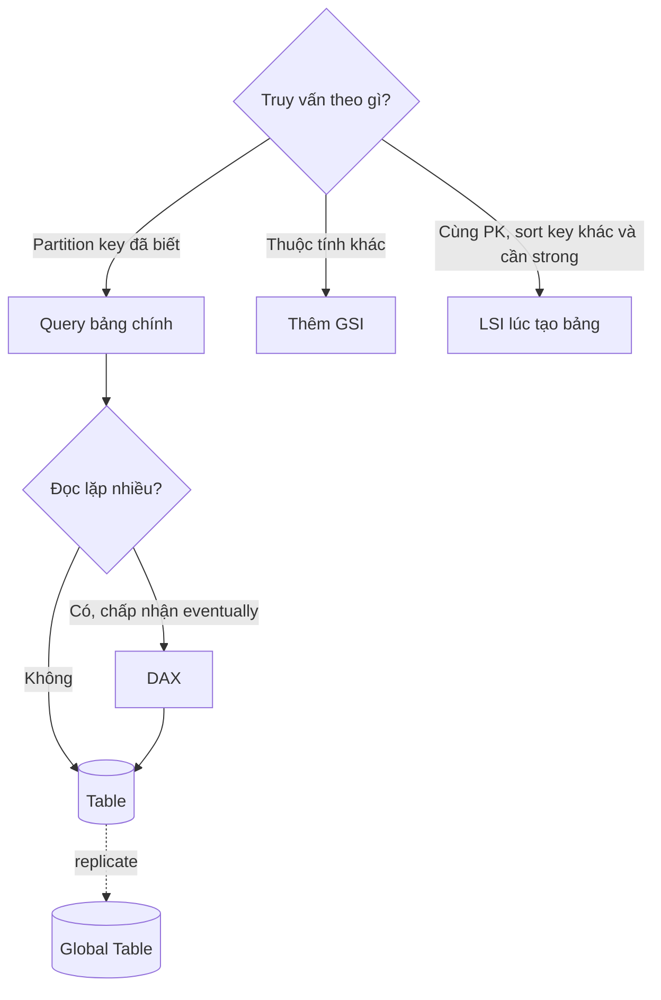

## 1. Core Concept

**Amazon DynamoDB** sinh ra để giải bài toán scale ngang gần như vô hạn mà không phải vá lỗi, shard hay vận hành server: mọi thao tác đọc/ghi theo key đều giữ latency **một chữ số mili-giây** dù bảng có vài GB hay vài trăm TB. Cái giá phải trả là bạn chỉ truy cập nhanh được theo **key** — mọi thứ khác phải được thiết kế trước.

**Mental model:** DynamoDB giống một **dãy tủ hồ sơ có đánh số**: bạn rút hồ sơ cực nhanh nếu biết số tủ (partition key), nhưng nếu phải lục từng tủ để tìm thì chính là `Scan` — đắt và chậm. Vì vậy thiết kế bảng bắt đầu từ **access pattern**, không phải từ thực thể.

## 2. How It Works

**Primary key → Phân phối dữ liệu**
- **Cơ chế:** DynamoDB băm **partition key** để chọn partition vật lý; **sort key** (nếu có) sắp xếp item trong cùng partition, cho phép `begins_with`, `between`.
- **Số thực tế:** mỗi partition chịu tối đa khoảng **3.000 RCU và 1.000 WCU**, lưu tối đa **10 GB**; item tối đa **400 KB**.
- **Tác động:** key có **cardinality cao** (`customerId`, `orderId`) trải tải đều; key lệch (`status = ACTIVE`, ngày hiện tại) dồn tải vào một partition → **hot partition** và throttling dù tổng capacity của bảng còn dư.

**Capacity (RCU/WCU) → Chi phí và throttling**
- **1 RCU** = một lần đọc **strongly consistent** ≤ **4 KB**/giây; **eventually consistent** đọc được gấp đôi; **transaction** tốn gấp đôi. **1 WCU** = một lần ghi ≤ **1 KB**/giây.
- **Ví dụ:** item 6 KB đọc strongly consistent tốn `ceil(6/4) = 2` RCU, đọc eventually consistent chỉ `1` RCU; ghi item 2,5 KB tốn `3` WCU.
- **Hai chế độ:** **on-demand** (trả theo request, không phải dự đoán, hợp tải khó đoán nhưng **không phải lúc nào cũng rẻ hơn**) và **provisioned** (khai báo RCU/WCU, kèm auto scaling, rẻ hơn khi tải ổn định).
- **Tác động:** vượt capacity → `ProvisionedThroughputExceededException`; SDK tự **retry với exponential backoff**.

**Query vs Scan → Độ trễ và chi phí**
- `Query` chỉ chạm một partition key (và khoảng sort key), tốn RCU theo lượng dữ liệu **trả về**; `Scan` đọc **toàn bộ bảng**, tốn RCU theo kích thước bảng.

```python
table.query(
    KeyConditionExpression=Key("customerId").eq("c-42") & Key("orderDate").begins_with("2026-11")
)
```

**Secondary index → Truy vấn theo thuộc tính khác**
- **GSI:** partition/sort key hoàn toàn khác, **tạo bất cứ lúc nào**, có **capacity riêng**, chỉ đọc **eventually consistent**. Ghi vào bảng bị GSI throttle có thể làm **ghi vào bảng chính cũng bị chậm**.
- **LSI:** **cùng partition key**, sort key khác, **chỉ tạo khi tạo bảng**, tối đa **5**, hỗ trợ strongly consistent, nhưng giới hạn **10 GB** cho mỗi giá trị partition key.
- **Tác động:** cần truy vấn theo thuộc tính không phải partition key → thêm **GSI** thay vì `Scan` hay tăng RCU.

**DAX → Cache đọc**
- **DAX** là cache in-memory **write-through** đứng trước bảng, cho latency đọc cỡ **micro-giây**. Nó chỉ phục vụ **eventually consistent reads**; strongly consistent bị chuyển thẳng xuống bảng.

**Global Tables → Multi-Region**
- Mỗi Region có một replica **ghi được** (multi-active); xung đột giải quyết theo **last writer wins**. Dùng cho **DR** và đưa dữ liệu gần người dùng; thường đi kèm **Streams** (giữ 24 giờ) để kích hoạt Lambda, **TTL** để tự xoá item hết hạn, **PITR** để khôi phục trong 35 ngày.

## 3. Visual Diagram



## 4. Rules of Thumb & Trade-offs

| Tình huống / Nhu cầu | Chọn gì |
| --- | --- |
| Truy cập theo key, scale lớn (giỏ hàng, session, IoT) | DynamoDB |
| Join, báo cáo ad-hoc, ràng buộc toàn vẹn | RDS / Aurora |
| Tải mới ra mắt hoặc đột biến | On-demand |
| Tải ổn định, dự đoán được | Provisioned + auto scaling |
| Truy vấn theo thuộc tính khác | GSI |
| Cùng partition key, cần strongly consistent | LSI (phải quyết định lúc tạo bảng) |
| Đọc lặp lại, cần micro-giây | DAX |
| Ghi ở nhiều Region, DR | Global Tables |

- **Được gì:** scale và latency dự đoán được, gần như không vận hành.
- **Mất gì:** **linh hoạt truy vấn** — đổi access pattern về sau rất tốn công (thêm GSI, backfill, đôi khi thiết kế lại key).

## 5. Must Remember / Production Pitfalls

- **Throttling dù capacity còn dư → Hot partition → Chọn key cardinality cao** (kết hợp hậu tố ngẫu nhiên/shard nếu cần), tránh key theo trạng thái hoặc ngày hiện tại.
- **Chi phí RCU tăng vọt → Dùng `Scan` trên bảng lớn → Dùng `Query` và GSI**, giới hạn kết quả bằng projection và filter ở key.
- **Cần LSI nhưng bảng đã tạo → LSI không thêm được sau → Quyết định lúc thiết kế**; nhớ giới hạn 10 GB mỗi giá trị partition key.
- **Ghi bảng chính bị chậm → GSI hết capacity và gây back-pressure → Cấp đủ WCU cho GSI hoặc dùng on-demand**.
- **Dữ liệu ghi từ hai Region bị mất bản cập nhật → Last writer wins → Thiết kế ghi theo Region hoặc dùng điều kiện ghi/version**.
- Exam trap: "cần cache cho DynamoDB" → **DAX** (ElastiCache dùng cho kết quả truy vấn phức tạp); "ghi ở nhiều Region" → **Global Tables**; "truy vấn theo thuộc tính không phải key" → **GSI**, không phải Scan hay tăng RCU.

## 6. Search Hooks

- `DynamoDB partition key design hot partition` — thiết kế key tránh quá tải một partition.
- `DynamoDB RCU WCU calculation` — cách tính đơn vị capacity đọc và ghi.
- `DynamoDB GSI vs LSI` — khác biệt hai loại secondary index.
- `DynamoDB Accelerator DAX` — cache in-memory write-through cho DynamoDB.
- `DynamoDB Streams Lambda trigger` — phản ứng với thay đổi dữ liệu gần thời gian thực.
- `DynamoDB Global Tables` — nhân bản đa Region, đa vùng ghi, last writer wins.
