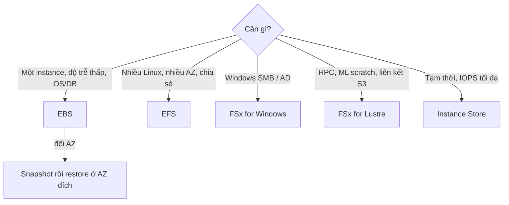

## 1. Core Concept

Ngoài S3 (object), EC2 dùng ba họ storage khác: **EBS** (block storage, như ổ đĩa gắn vào một máy), **EFS** (file system NFS dùng chung cho nhiều máy Linux) và **FSx** (file system managed cho Windows, HPC, NetApp, OpenZFS). Chọn sai họ thường là nguyên nhân của lỗi **AZ, hiệu năng hoặc mất dữ liệu**.

**Mental model:** EBS là **ổ cứng cắm vào một máy trong một phòng (AZ)**; EFS là **ổ mạng dùng chung cả toà nhà**; Instance Store là **bàn nháp gắn liền máy**, rút máy là mất; S3 là **kho lưu trữ qua API**, không phải ổ đĩa.

## 2. How It Works

**EBS → Block storage theo AZ**
- Volume nằm trong **một AZ**, gắn vào **một instance** (trừ **io1/io2 Multi-Attach**: tối đa 16 instance cùng AZ, ứng dụng phải tự xử lý ghi đồng thời).
- **gp3**: SSD mặc định, baseline **3.000 IOPS và 125 MiB/s**, chỉnh IOPS/throughput **độc lập** với dung lượng (tới 16.000 IOPS). **gp2** dùng 3 IOPS/GB với **burst credits**: hết credit là IOPS rơi.
- **io2**: IOPS cao ổn định cho database (tới 64.000, **io2 Block Express** tới 256.000). **st1/sc1**: HDD throughput/cold, **không dùng làm boot volume**.
- **Snapshot**: incremental, lưu trong S3 (do AWS quản lý), copy được sang Region/AZ khác, tạo **AMI**; mã hoá bằng KMS và chia sẻ khoá cùng snapshot. **Elastic Volumes** đổi kích thước/loại khi đang chạy.

**EFS → File system dùng chung**
- **NFSv4.1**, chỉ Linux, **multi-AZ**, tự scale, gắn đồng thời hàng nghìn instance qua **mount target** (một cái mỗi AZ, kiểm soát bằng SG).
- **Performance mode**: **General Purpose** (mặc định, độ trễ thấp) vs **Max I/O**. **Throughput mode**: **Bursting**, **Provisioned**, **Elastic**. **Lifecycle** chuyển file ít dùng sang **EFS-IA/Archive**; có lớp **One Zone** rẻ hơn.

**FSx → File system chuyên dụng**
- **FSx for Windows** (SMB, tích hợp Active Directory), **FSx for Lustre** (HPC/ML, throughput rất cao, nạp và ghi lại dữ liệu từ **S3**), **FSx for NetApp ONTAP** (NFS/SMB/iSCSI) và **FSx for OpenZFS**.

**Instance Store → Đĩa tạm gắn vật lý**
- NVMe gắn trực tiếp vào host, **IOPS rất cao**, nhưng **mất dữ liệu khi stop/terminate hoặc phần cứng lỗi** (reboot thì còn). Dùng cho cache/buffer.

```bash
aws ec2 create-snapshot --volume-id vol-0abc --description "pre-upgrade"
aws ec2 create-volume --snapshot-id snap-0abc --availability-zone ap-southeast-1b
```

## 3. Visual Diagram



## 4. Rules of Thumb & Trade-offs

| Tình huống / Nhu cầu | Chọn gì |
| --- | --- |
| Boot volume, database thông thường | EBS gp3 |
| DB cần IOPS cao, ổn định | EBS io2 |
| File dùng chung Linux nhiều AZ | EFS |
| File server Windows/AD | FSx for Windows |
| HPC/ML tốc độ cao | FSx for Lustre |
| Cache/buffer tạm, IOPS tối đa | Instance Store |

- **Được gì:** đúng loại cho đúng workload. **Mất gì:** EFS đắt hơn EBS theo GB; EBS gắn theo AZ; Instance Store không bền.

## 5. Must Remember / Production Pitfalls

- **Cần chuyển EBS sang AZ khác → volume gắn theo AZ → tạo snapshot rồi restore ở AZ đích**.
- **Mất dữ liệu sau khi stop instance → lưu trên Instance Store → dữ liệu cần giữ phải ở EBS/EFS/S3**.
- **IOPS rơi dần trên volume gp2 → hết burst credit → chuyển gp3 hoặc io2**.
- **App nhiều AZ cần chung file → dùng EBS nên không chia sẻ được → EFS**.
- **Xoá instance mất luôn dữ liệu → Delete on Termination → bật cho root volume theo mặc định, volume thêm mặc định tắt**; kiểm tra cấu hình.
- **EFS chậm với nhiều file nhỏ → độ trễ NFS mỗi thao tác → gom file hoặc tối ưu throughput mode**.
- Exam trap: "file system chung cho EC2 Linux nhiều AZ" → **EFS**; "DB cần IOPS ổn định rất cao" → **io2**; "dữ liệu Instance Store khi stop" → **mất**.

## 6. Search Hooks

- `EBS volume types gp3 io2` — các loại volume và khi nào dùng.
- `EBS Multi-Attach` — gắn io2 vào nhiều instance cùng AZ.
- `EFS performance modes throughput modes` — chế độ hiệu năng của EFS.
- `FSx for Lustre S3 integration` — file system HPC liên kết S3.
- `EC2 Instance Store ephemeral` — đĩa tạm gắn vật lý, mất khi stop.
