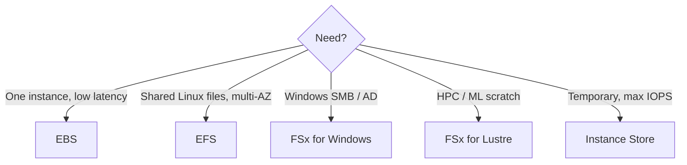

## 1. Core Concept

AWS có ba họ storage ngoài S3: **EBS** (block storage gắn vào một EC2), **EFS** (NFS file system dùng chung cho nhiều instance) và **FSx** (file system managed cho Windows, Lustre, NetApp ONTAP, OpenZFS). Mental model: *block = ổ đĩa, file = thư mục dùng chung, object = S3.*

## 2. How It Works

- **EBS**: volume nằm trong **một AZ**, gắn vào một instance (trừ **io1/io2 Multi-Attach**). Loại: `gp3` (SSD mặc định, IOPS/throughput chỉnh độc lập), `io2` (IOPS cao cho DB, tới 256,000), `st1`/`sc1` (HDD throughput/cold, không làm boot volume).
- **Snapshot**: lưu incremental vào S3, copy sang AZ/Region khác, tạo AMI; mã hoá và chia sẻ qua snapshot.
- **EFS**: NFSv4, **multi-AZ**, scale tự động, gắn đồng thời hàng nghìn instance Linux. Mode: **General Purpose** vs **Max I/O**; throughput **Bursting/Provisioned/Elastic**; có **EFS-IA** lifecycle.
- **FSx for Windows** (SMB, AD), **FSx for Lustre** (HPC/ML, tích hợp S3), **FSx for NetApp ONTAP**, **FSx for OpenZFS**.
- **Instance Store**: đĩa NVMe gắn vật lý, **mất dữ liệu khi stop/terminate**, IOPS rất cao.

## 3. Visual Diagram

## 4. Rules of Thumb & Trade-offs

| Nhu cầu | Chọn |
| --- | --- |
| Boot/DB thông thường | EBS `gp3` |
| DB cần > 16,000 IOPS ổn định | EBS `io2` / `io2 Block Express` |
| Dữ liệu dùng chung nhiều AZ | EFS |
| Cache/buffer tạm | Instance Store |

- EFS đắt hơn EBS nhiều lần theo GB; EBS rẻ nhưng gắn theo AZ.

## 5. Must Remember / Production Pitfalls

- **EBS gắn theo AZ**: muốn chuyển AZ phải snapshot rồi restore.
- **Delete on Termination** mặc định bật cho root volume, tắt cho volume thêm.
- Instance Store **mất khi stop**; không dùng cho dữ liệu cần giữ.
- `gp2` dùng cơ chế **burst credits**, hết credit thì IOPS rơi; `gp3` có baseline 3,000 IOPS.
- Snapshot lần đầu đầy đủ, sau đó incremental; xoá snapshot cũ không làm mất dữ liệu của snapshot sau.
- Interview trap: "Chia sẻ file system giữa EC2 ở nhiều AZ" → **EFS**, không phải EBS.

## 6. Search Hooks

- `EBS volume types gp3 io2` — các loại volume và khi nào dùng.
- `EBS Multi-Attach` — gắn một io2 vào nhiều instance cùng AZ.
- `EFS performance modes throughput modes` — chế độ hiệu năng của EFS.
- `FSx for Lustre S3 integration` — file system HPC liên kết S3.
- `EC2 Instance Store ephemeral` — đĩa tạm gắn vật lý, mất khi stop.
