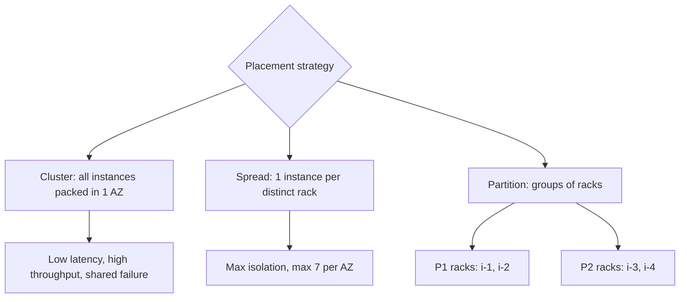

## 1. Core Concept

**Placement Group** điều khiển cách AWS đặt các EC2 instance lên phần cứng vật lý, để tối ưu **network performance** hoặc **fault isolation**. Có ba chiến lược: **Cluster**, **Spread**, **Partition**. Mental model: *Cluster = đặt sát nhau để nhanh; Spread = tách xa nhau để an toàn; Partition = chia thành các nhóm rack độc lập.*

## 2. How It Works

- **Cluster**: gom instance gần nhau trong **một AZ** → latency thấp, throughput cao (tới 10 Gbps/flow, cao hơn với ENA/EFA). Đổi lại, một sự cố phần cứng/rack có thể ảnh hưởng nhiều instance.
- **Spread**: mỗi instance nằm trên **rack riêng** (nguồn điện, mạng riêng). Tối đa **7 instance đang chạy/AZ/group**, có thể trải nhiều AZ trong region.
- **Partition**: chia group thành các **partition** logic, tối đa **7 partition/AZ**; mỗi partition có tập rack riêng, instance ở partition khác nhau không chung phần cứng hay nguồn điện. Mỗi partition chứa được nhiều instance; instance có thể biết mình ở partition nào qua metadata.
- **Di chuyển instance**: instance phải ở trạng thái **stopped**; đổi placement group bằng **AWS CLI/SDK** (`modify-instance-placement`), không làm được trên console.

```bash
aws ec2 stop-instances --instance-ids i-0123456789abcdef0
aws ec2 modify-instance-placement --instance-id i-0123456789abcdef0 \
  --group-name hpc-cluster
aws ec2 start-instances --instance-ids i-0123456789abcdef0
```

## 3. Visual Diagram



## 4. Rules of Thumb & Trade-offs

| Strategy | Dùng khi | Trade-off |
| --- | --- | --- |
| Cluster | HPC, MPI, big data cần network nhanh giữa node | Rủi ro tập trung, 1 AZ |
| Spread | Số ít instance critical (primary/standby, quorum nhỏ) | Giới hạn 7/AZ |
| Partition | Hệ phân tán lớn nhận biết topology: HDFS, HBase, Cassandra, Kafka | Phải tự đặt replica qua partition |

- Cluster: dùng **cùng instance type**, launch tất cả trong **một request** để giảm lỗi `InsufficientInstanceCapacity`.

## 5. Must Remember / Production Pitfalls

- Cluster không trải nhiều AZ; thiếu capacity khi thêm instance → stop/start toàn bộ group rồi launch lại.
- Không merge được placement group; một instance chỉ thuộc một group.
- Spread giới hạn **7 instance đang chạy/AZ** → không hợp cho fleet lớn; fleet lớn cần cách ly lỗi → **Partition**.
- Placement group không tính phí.
- Exam trap: "low latency, 10 Gbps giữa các node HPC" → **Cluster**; "HDFS/Cassandra, cách ly lỗi theo rack" → **Partition**; "vài instance quan trọng phải nằm phần cứng khác nhau" → **Spread**.

## 6. Search Hooks

- `EC2 cluster placement group` — tối ưu network trong một AZ.
- `EC2 spread placement group limit` — giới hạn 7 instance/AZ.
- `EC2 partition placement group Cassandra HDFS` — cách ly lỗi cho hệ phân tán lớn.
- `modify-instance-placement` — lệnh CLI đổi placement group.
- `InsufficientInstanceCapacity placement group` — xử lý lỗi thiếu capacity.
