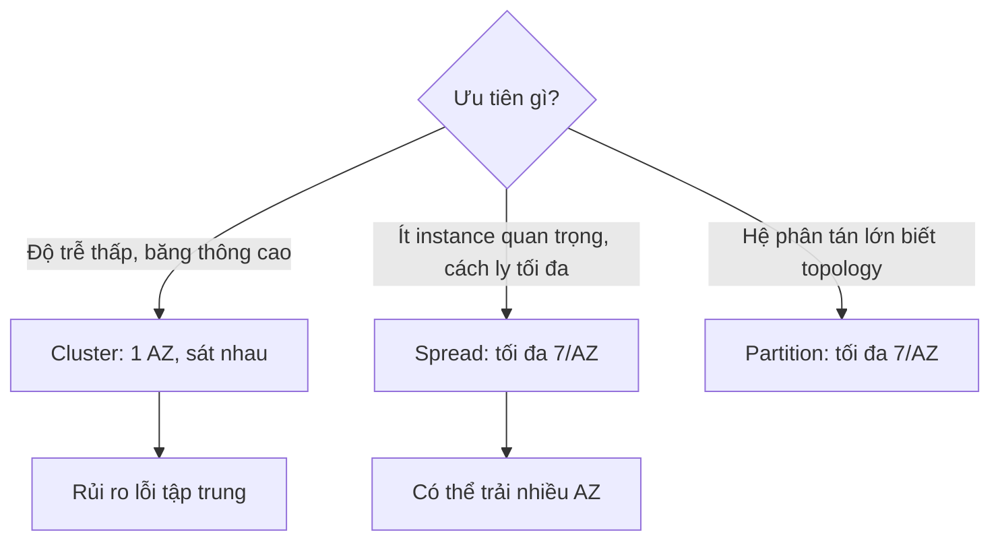

## 1. Core Concept

**Placement Group** cho bạn điều khiển **vị trí vật lý** của các instance trong datacenter: gần nhau để mạng nhanh, hoặc xa nhau để lỗi phần cứng không kéo cả nhóm. Đây là cách duy nhất để đổi giữa **hiệu năng mạng** và **khả năng chịu lỗi** ở tầng phần cứng.

**Mental model:** như xếp xe trong bãi: **Cluster** là đậu sát nhau trong cùng dãy để chạy tiếp sức nhanh, nhưng một vụ cháy là hỏng cả dãy; **Spread** là mỗi xe một ô riêng cách xa; **Partition** là chia thành vài dãy độc lập.

## 2. How It Works

**Cluster → Gần nhau, nhanh nhất**
- Gom instance sát nhau trong **một AZ** (cùng rack hoặc rack lân cận), cho độ trễ rất thấp và băng thông cao (**single-flow tới 10 Gbps**, hơn nữa khi dùng ENA/EFA). Hợp HPC, tính toán gắn chặt.
- Đánh đổi: rủi ro **lỗi phần cứng tập trung**. Nên dùng cùng instance type và **launch tất cả cùng lúc**; nếu gặp `InsufficientInstanceCapacity`, stop/start nhóm để thử lại.

**Spread → Cách ly tối đa**
- Mỗi instance trên **phần cứng riêng** (rack riêng, nguồn và mạng riêng). Giới hạn **7 instance đang chạy mỗi AZ mỗi group**, nhưng group có thể **trải nhiều AZ**. Hợp ít instance cực kỳ quan trọng (master node, DB primary).

**Partition → Chia nhóm rack**
- Chia thành tối đa **7 partition mỗi AZ**; mỗi partition là một nhóm rack riêng, **không chung phần cứng** với partition khác, nhưng có thể chứa **hàng trăm instance**. Biết topology qua metadata để ứng dụng đặt replica đúng partition. Hợp **HDFS, HBase, Cassandra, Kafka**.

**Thao tác thay đổi**
- Muốn chuyển instance vào hoặc ra group, instance phải **stopped**, và dùng **AWS CLI/SDK** (`modify-instance-placement`), **không làm được trên console**. Không thể gộp hai group.

```bash
aws ec2 create-placement-group --group-name hpc --strategy cluster
aws ec2 run-instances --placement GroupName=hpc --count 8 ...
```

## 3. Visual Diagram



## 4. Rules of Thumb & Trade-offs

| Tình huống / Nhu cầu | Chọn gì |
| --- | --- |
| HPC, MPI, độ trễ liên node thấp | Cluster (+ EFA) |
| 3–5 instance quan trọng không được chết chung | Spread |
| Cassandra, Kafka, HDFS quy mô lớn | Partition |
| Không có yêu cầu đặc biệt | Không cần placement group |

- **Được gì:** kiểm soát hiệu năng hoặc cách ly lỗi. **Mất gì:** Cluster hy sinh chịu lỗi; Spread giới hạn số lượng; Partition cần ứng dụng hiểu topology.

## 5. Must Remember / Production Pitfalls

- **Cluster group lỗi `InsufficientInstanceCapacity` khi mở rộng dần → capacity sát nhau không đủ → launch cả nhóm cùng lúc, cùng instance type, hoặc stop/start để thử lại**.
- **Dùng Spread cho 100 instance → vượt giới hạn 7/AZ → chuyển sang Partition**.
- **Chạy cả hệ quan trọng trong một Cluster → một rack lỗi mất tất cả → dùng Spread hoặc Partition và trải AZ**.
- **Cố đổi placement bằng console cho instance đang chạy → không làm được → stop instance rồi dùng CLI/SDK**.
- **Replica Cassandra/Kafka cùng partition → cùng rack lỗi chung → đặt replica ở các partition khác nhau**.
- Exam trap: "HPC cần độ trễ mạng thấp nhất" → **Cluster**; "ít instance cực kỳ quan trọng tránh lỗi phần cứng chung" → **Spread**; "Cassandra/Kafka/HDFS lớn" → **Partition**.

## 6. Search Hooks

- `EC2 cluster placement group` — gom instance để độ trễ thấp.
- `EC2 spread placement group limits` — cách ly phần cứng, tối đa 7 mỗi AZ.
- `EC2 partition placement group` — chia nhóm rack cho hệ phân tán.
- `modify-instance-placement` — đổi placement khi instance đã stopped.
- `InsufficientInstanceCapacity cluster placement` — lỗi thiếu capacity trong cluster.
