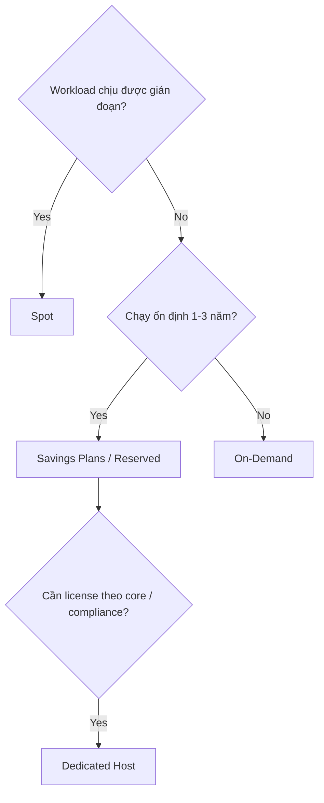

## 1. Core Concept

EC2 có nhiều **purchasing option** cho cùng một instance; khác nhau ở **cam kết**, **mức giảm giá** và **khả năng bị thu hồi**. Chọn đúng có thể giảm chi phí compute 50–90% mà không đổi kiến trúc. Mental model: *cam kết càng lâu và chấp nhận gián đoạn càng nhiều thì giá càng rẻ.*

## 2. How It Works

- **On-Demand**: trả theo giây (Linux/Windows, tối thiểu 60 giây) hoặc theo giờ (một số OS); không cam kết, giá cao nhất trong nhóm "shared".
- **Reserved Instances (RI)**: cam kết **1 hoặc 3 năm** cho instance type/region; giảm tới **72%**. Trả trước All/Partial/No Upfront. **Standard RI** giảm nhiều hơn nhưng khó đổi; **Convertible RI** đổi được instance family.
- **Savings Plans**: cam kết **$/giờ** trong 1–3 năm, giảm tới **72%**, linh hoạt hơn RI (Compute Savings Plans áp cả Fargate, Lambda).
- **Spot Instances**: dùng capacity dư, giảm tới **90%**. AWS thu hồi khi cần capacity, báo trước **2 phút**. Giá Spot thay đổi dần theo cung cầu dài hạn (không còn đấu giá).
- **Dedicated Hosts**: thuê nguyên một **server vật lý**, nhìn thấy socket/core → dùng license theo core (BYOL: Windows Server, SQL Server, Oracle). Đắt nhất.
- **Dedicated Instances**: instance chạy trên phần cứng riêng cho account, nhưng không kiểm soát được host.
- **On-Demand Capacity Reservations**: giữ chỗ capacity trong một AZ, không giảm giá (kết hợp Savings Plans để giảm).

## 3. Visual Diagram

## 4. Rules of Thumb & Trade-offs

- Baseline chạy 24/7 → **Savings Plans/RI**; phần tăng đột biến → **On-Demand**; batch, CI, rendering, big data stateless → **Spot**.
- Kết hợp trong **Auto Scaling Group** với *mixed instances policy* (một phần On-Demand + phần lớn Spot, nhiều instance type).
- Dev/test ngắn hạn, không đoán được → **On-Demand**.
- Trade-off: *Cost vs. Flexibility vs. Availability*.

## 5. Must Remember / Production Pitfalls

- Spot không dùng cho database chính hoặc job không checkpoint được; xử lý **interruption notice** qua instance metadata hoặc EventBridge.
- RI là cam kết thanh toán, không phải instance: tắt instance vẫn phải trả tiền RI. Standard RI dư có thể bán trên RI Marketplace.
- RI/Savings Plans chỉ giảm giá; muốn **đảm bảo capacity** trong AZ phải dùng zonal RI hoặc Capacity Reservation.
- Exam trap: "licensing theo socket/core, BYOL" → **Dedicated Host**; "rẻ nhất cho job chịu được gián đoạn" → **Spot**.

## 6. Search Hooks

- `EC2 On-Demand per-second billing` — tính tiền theo giây, tối thiểu 60 giây.
- `Standard vs Convertible Reserved Instances` — khác biệt mức giảm và độ linh hoạt.
- `Compute Savings Plans vs EC2 Instance Savings Plans` — hai loại Savings Plans.
- `EC2 Spot interruption notice` — cảnh báo 2 phút trước khi thu hồi.
- `Dedicated Hosts vs Dedicated Instances` — khác biệt về kiểm soát phần cứng và license.
