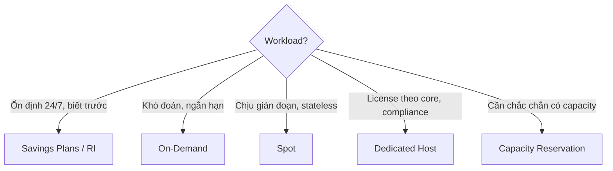

## 1. Core Concept

EC2 bán cùng một máy với nhiều mô hình giá khác nhau; chọn đúng có thể giảm **50–90%** chi phí compute. Cái bạn đánh đổi là **cam kết thời gian** hoặc **khả năng bị thu hồi** để lấy giá thấp hơn.

**Mental model:** như **đặt phòng khách sạn**: On-Demand là đến là ở nhưng giá niêm yết; Reserved/Savings Plans là hợp đồng dài hạn giá rẻ; Spot là phòng trống phút chót siêu rẻ nhưng có thể bị đuổi; Dedicated Host là thuê nguyên tầng.

## 2. How It Works

**On-Demand → Linh hoạt nhất**
- Tính **theo giây** (tối thiểu 60 giây) cho Linux/Windows, không cam kết. Đắt nhất trong shared tenancy nhưng hợp tải ngắn hạn, khó đoán.

**Reserved Instances (RI) → Cam kết 1 hoặc 3 năm**
- Giảm **tới 72%**; chọn All/Partial/No Upfront. **Standard RI** giảm nhiều hơn, **Convertible RI** đổi được instance family (giảm ít hơn, tới ~66%).

**Savings Plans → Cam kết theo $/giờ**
- Cam kết chi tiêu **$/giờ** trong 1 hoặc 3 năm, giảm **tới 72%**. **Compute Savings Plans** áp cho EC2 (mọi family/Region), **Fargate** và **Lambda**; **EC2 Instance Savings Plans** gắn một family trong một Region, giảm nhiều hơn.
- Tác động: linh hoạt hơn RI khi bạn đổi kiến trúc.

**Spot → Rẻ nhất, có thể bị thu hồi**
- Giảm **tới ~90%**; AWS có thể thu hồi với **cảnh báo 2 phút**. Chỉ hợp workload **stateless, chịu gián đoạn** (batch, CI, xử lý ảnh). Dùng đa dạng instance type/AZ để giảm xác suất bị thu hồi.

**Dedicated Host / Instances → Cô lập phần cứng**
- **Dedicated Host** là máy vật lý riêng, nhìn thấy **socket/core** để dùng **license BYOL** theo core và đáp ứng compliance; chi phí cao nhất. **Dedicated Instance** chạy trên phần cứng riêng nhưng bạn không kiểm soát host.

**Capacity Reservation → Đảm bảo có máy**
- Giữ chỗ capacity trong một AZ theo giờ, **không tự có giảm giá**; kết hợp Savings Plans/RI để giảm giá.

**Ví dụ kết hợp:** web app có tải nền ổn định dùng **Savings Plans**, phần tăng đột biến **On-Demand**, job xử lý nền **Spot**, trong cùng **Auto Scaling Group** dùng **mixed instances policy**.

## 3. Visual Diagram

## 4. Rules of Thumb & Trade-offs

| Tình huống / Nhu cầu | Chọn gì |
| --- | --- |
| Tải nền ổn định, dự đoán được | Savings Plans (hoặc Reserved) |
| Ra mắt mới, tải khó đoán | On-Demand |
| Batch ban đêm, chịu gián đoạn | Spot |
| BYOL theo socket/core | Dedicated Host |
| Dùng EC2, Fargate, Lambda và có thể đổi family | Compute Savings Plans |

- **Được gì:** giảm tới 72% (cam kết) hoặc ~90% (Spot). **Mất gì:** mất tính linh hoạt khi cam kết sai, hoặc phải chịu bị thu hồi với Spot.

## 5. Must Remember / Production Pitfalls

- **Mua RI/Savings Plans rồi đổi kiến trúc → cam kết thừa, vẫn phải trả → ưu tiên Compute Savings Plans và rà soát mức sử dụng**.
- **Chạy tải stateful hoặc không chịu gián đoạn trên Spot → mất tiến độ khi bị thu hồi → checkpoint, ASG đa instance type, hoặc chuyển On-Demand**.
- **Nhầm Dedicated Instance với Dedicated Host → không có BYOL theo core → chọn Dedicated Host khi cần nhìn thấy socket/core**.
- **Nghĩ Capacity Reservation có giảm giá → vẫn tính giá On-Demand → kết hợp Savings Plans**.
- **Quên tắt môi trường dev ngoài giờ → tốn tiền vô ích → lịch dừng tự động**.
- Exam trap: "batch chịu gián đoạn, rẻ nhất" → **Spot**; "license theo socket/core (BYOL) và tuân thủ" → **Dedicated Host**; "linh hoạt trên EC2, Fargate, Lambda" → **Compute Savings Plans**.

## 6. Search Hooks

- `EC2 On-Demand vs Reserved vs Spot` — so sánh các mô hình giá chính.
- `AWS Savings Plans vs Reserved Instances` — hai hình thức cam kết.
- `EC2 Spot interruption notice` — cảnh báo thu hồi 2 phút và cách xử lý.
- `EC2 Dedicated Host BYOL` — license theo socket/core.
- `EC2 Capacity Reservations` — giữ chỗ capacity theo AZ.
