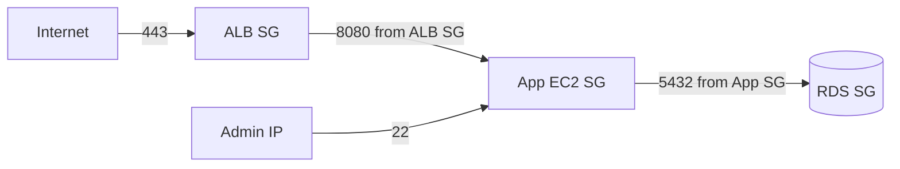

## 1. Core Concept

**Security Group (SG)** là firewall ảo **stateful** gắn vào network interface của EC2, quyết định traffic nào được vào/ra theo port, protocol và source. Về mạng, EC2 có ba mức: **ENI** (card mạng ảo cơ bản), **Enhanced Networking/ENA** (băng thông cao, latency thấp) và **EFA** (HPC/ML). Mental model: *SG là danh sách cho phép trên từng instance; card mạng quyết định tốc độ và khả năng tách mạng.*

## 2. How It Works

- Port cần nhớ: **SSH 22** (Linux), **RDP 3389** (Windows), **HTTP 80**, **HTTPS 443**.
- **Security Group**:
  - Chỉ có rule **Allow**, không có Deny.
  - Inbound mặc định **chặn tất cả**; outbound mặc định **cho phép tất cả**.
  - **Stateful**: response của request đã được cho phép tự động đi qua, không cần rule chiều ngược lại.
  - Source có thể là CIDR hoặc **SG khác** (ví dụ app SG chỉ nhận từ ALB SG).
  - Thay đổi rule có hiệu lực ngay; một instance gắn được nhiều SG.
- **ENI (Elastic Network Interface)**: card mạng ảo có private IP, MAC, SG riêng. Gắn thêm ENI để tách mạng management/log khỏi production, hoặc chuyển ENI sang instance dự phòng khi failover.
- **Enhanced Networking** dùng SR-IOV: **ENA** đạt tới 100 Gbps (và cao hơn ở thế hệ mới); Intel 82599 VF tới 10 Gbps (cũ). Không tốn thêm phí, dùng khi cần PPS cao, jitter thấp.
- **EFA (Elastic Fabric Adapter)**: ENA + **OS-bypass** (libfabric/MPI), cho HPC và distributed ML training cần giao tiếp liên node latency cực thấp.

```bash
# Chỉ cho SSH từ IP văn phòng, HTTPS từ Internet
aws ec2 authorize-security-group-ingress --group-id sg-0abc \
  --protocol tcp --port 22 --cidr 203.0.113.10/32
aws ec2 authorize-security-group-ingress --group-id sg-0abc \
  --protocol tcp --port 443 --cidr 0.0.0.0/0
```

## 3. Visual Diagram



## 4. Rules of Thumb & Trade-offs

- Mở **ít port nhất**; SSH/RDP chỉ từ IP cụ thể hoặc thay bằng **SSM Session Manager** (không cần mở port 22).
- Tham chiếu **SG-to-SG** thay vì CIDR giữa các tầng → tự đúng khi IP thay đổi.
- Cần chặn một IP cụ thể → dùng **Network ACL** (stateless, subnet-level, có Deny), không phải SG.
- Cần băng thông cao → instance hỗ trợ **ENA**; HPC/MPI → **EFA** + cluster placement group.

## 5. Must Remember / Production Pitfalls

- `0.0.0.0/0` trên port 22/3389 là lỗi bảo mật phổ biến nhất.
- Timeout khi kết nối → thường do SG/NACL; "connection refused" → port mở nhưng service không chạy.
- NACL stateless → phải mở cả **ephemeral ports** (1024–65535) cho chiều về; SG thì không cần.
- ENI gắn được vào instance khác **trong cùng AZ**; EFA chỉ hỗ trợ một số instance type.
- Exam trap: "chặn một IP cụ thể" → **NACL**; "network riêng cho management" → **thêm ENI**; "HPC cần OS-bypass" → **EFA**.

## 6. Search Hooks

- `Security Group vs Network ACL` — so sánh stateful/stateless, allow/deny.
- `Security Group stateful rules` — cơ chế tự cho phép traffic chiều về.
- `Elastic Network Interface use cases` — các tình huống gắn nhiều ENI.
- `ENA Enhanced Networking SR-IOV` — mạng tốc độ cao cho EC2.
- `Elastic Fabric Adapter OS-bypass` — mạng HPC/ML latency cực thấp.
- `SSM Session Manager vs SSH` — truy cập instance không cần mở port 22.
