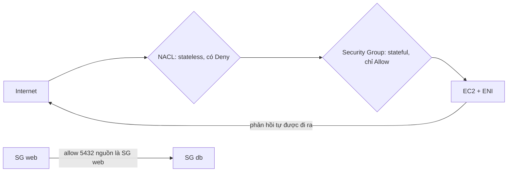

## 1. Core Concept

Mạng của EC2 có hai lớp lọc lưu lượng — **Security Group (SG)** ở cấp instance và **Network ACL (NACL)** ở cấp subnet — cộng các thành phần giao diện như **ENI**, **ENA** và **EFA** quyết định băng thông và độ trễ. Chúng giải quyết hai bài toán: ai được nói chuyện với instance, và nói chuyện nhanh đến đâu.

**Mental model:** SG là **bảo vệ đứng ngay cửa từng căn phòng** (nhớ mặt người đã cho vào nên người ra cũng không bị chặn), NACL là **cổng kiểm soát cả tầng lầu** (không nhớ gì, mỗi lượt vào và ra đều phải có luật).

## 2. How It Works

**Security Group → Tường lửa stateful ở cấp ENI**
- **Chỉ có rule Allow**, không có Deny. SG mới tạo: **inbound chặn hết, outbound cho phép hết**.
- **Stateful**: traffic được cho phép vào thì phản hồi tự được đi ra, không cần rule chiều ngược. Thay đổi rule có hiệu lực ngay.
- Nguồn của rule có thể là CIDR, prefix list hoặc **một SG khác**. Ví dụ: DB tier chỉ allow port 5432 từ SG của web tier, nên scale web tier lên 50 instance cũng không phải sửa rule.

**Network ACL → Tường lửa stateless ở cấp subnet**
- Có cả **Allow và Deny**, đánh giá theo **số thứ tự nhỏ đến lớn**, gặp rule khớp là dừng. **Stateless**: phải mở rule cả chiều về, gồm **ephemeral port 1024–65535**.
- NACL mặc định của VPC cho phép tất cả; NACL tự tạo mặc định chặn tất cả. Dùng khi cần **chặn một IP** cụ thể, vì SG không có Deny.

**ENI → Card mạng ảo**
- ENI có **private IP**, MAC, SG riêng, có thể gắn **Elastic IP**. Gắn thêm ENI để tách mạng management/log, hoặc **chuyển ENI sang instance khác** (cùng AZ) khi failover mà giữ nguyên IP và MAC.

**ENA và EFA → Hiệu năng mạng**
- **ENA (Elastic Network Adapter)** cho băng thông tới **100 Gbps**, PPS cao, độ trễ thấp, không tốn thêm phí.
- **EFA (Elastic Fabric Adapter)** là ENA cộng **OS-bypass** (libfabric/MPI/NCCL) cho giao tiếp liên node độ trễ cực thấp, dùng cho HPC và huấn luyện ML phân tán.

```bash
aws ec2 authorize-security-group-ingress --group-id sg-db \
  --protocol tcp --port 5432 --source-group sg-web
```

## 3. Visual Diagram



## 4. Rules of Thumb & Trade-offs

| Tình huống / Nhu cầu | Chọn gì |
| --- | --- |
| Mở port cho ứng dụng, tham chiếu giữa các tier | Security Group (nguồn là SG khác) |
| Chặn một IP hoặc dải IP | Network ACL (có Deny) |
| Failover giữ IP/MAC | Chuyển ENI sang instance dự phòng |
| Băng thông cao, độ trễ thấp thông thường | ENA |
| HPC/ML liên node, MPI | EFA (+ Cluster placement group) |

- **Được gì:** SG gọn, dễ mở rộng; NACL cho Deny và lớp chặn thứ hai. **Mất gì:** NACL stateless dễ cấu hình thiếu chiều về, nên chỉ dùng khi thực sự cần.

## 5. Must Remember / Production Pitfalls

- **Cần chặn IP độc hại nhưng SG không có Deny → thêm rule Deny vào NACL** với số thứ tự nhỏ hơn các rule Allow.
- **Kết nối vào được nhưng phản hồi bị rớt → NACL thiếu rule chiều về/ephemeral port → mở 1024–65535 cho chiều ngược**.
- **Rule 0.0.0.0/0 cho SSH hoặc DB → lộ ra Internet → giới hạn theo SG nguồn, bastion/SSM Session Manager**.
- **Cần giữ IP khi failover → IP gắn vào instance thay vì ENI → gắn Elastic IP/ENI rồi chuyển ENI**; nhớ ENI chỉ chuyển trong cùng AZ.
- **Nhầm EFA với ENA → không có OS-bypass nên MPI vẫn chậm → dùng EFA trong cluster placement group**.
- Exam trap: "chặn một IP cụ thể" → **NACL**; "SG stateful nghĩa là" → **phản hồi traffic đã cho phép tự được qua**; "tham chiếu giữa tier" → **SG của tầng trước làm nguồn**.

## 6. Search Hooks

- `security group vs network ACL` — stateful hay stateless, cấp instance hay subnet.
- `security group referencing another security group` — tham chiếu SG thay vì IP.
- `Elastic Network Interface ENI failover` — chuyển card mạng để giữ IP.
- `EC2 Enhanced Networking ENA` — băng thông cao, PPS cao, độ trễ thấp.
- `Elastic Fabric Adapter EFA HPC` — OS-bypass cho giao tiếp liên node.
