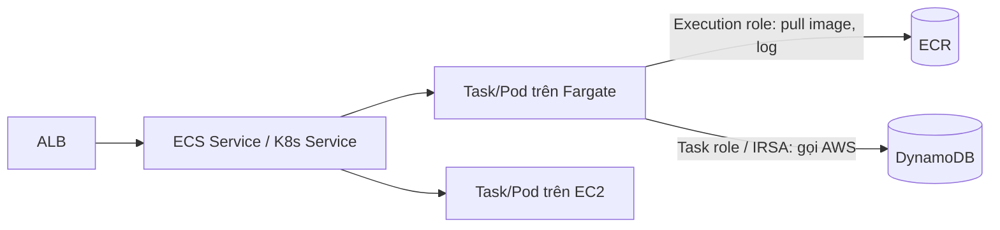

## 1. Core Concept

AWS có hai bộ điều phối container: **ECS** (đơn giản, tích hợp sâu với AWS) và **EKS** (Kubernetes managed), cùng hai cách cấp compute: **EC2** (tự quản node) hoặc **Fargate** (serverless, không quản node). Chúng giải quyết bài toán chạy, scale và cập nhật container mà không tự dựng cluster từ đầu.

**Mental model:** chọn **hai trục độc lập**: (1) orchestrator — ECS hay EKS; (2) compute — EC2 hay Fargate. Ngoài ra luôn phân biệt **ai là người gọi AWS**: ECS agent (execution role) hay ứng dụng trong container (task role).

## 2. How It Works

**ECS → Task Definition, Task, Service**
- **Task Definition** mô tả image, CPU/RAM, port, biến môi trường, role. **Task** chạy một lần; **Service** giữ **N task** chạy liên tục, thay task lỗi, đăng ký vào **ALB** và hỗ trợ rolling hoặc blue/green (CodeDeploy).
- **Hai role dễ nhầm:** **Task Role** cấp quyền cho **ứng dụng** gọi AWS (ghi DynamoDB, đọc S3); **Execution Role** cho **ECS agent** pull image từ **ECR** và ghi log CloudWatch.

**Fargate → Không quản node**
- Chỉ định **vCPU/RAM** mỗi task, **mỗi task một ENI** trong VPC (`awsvpc`), trả tiền theo giây; tác động: không patch OS/AMI nhưng giá/GB-giờ cao hơn EC2 khi tải ổn định.
- Task ở **private subnet** cần **NAT hoặc VPC endpoint** để pull image từ ECR.

**EKS → Kubernetes managed**
- **Control plane** do AWS vận hành (có phí theo giờ). Worker: **managed node group**, **Fargate profile** hoặc self-managed. Pod nhận IP từ VPC qua VPC CNI.
- **Quyền cho pod:** **IRSA** (IAM Roles for Service Accounts, dùng OIDC) hoặc **EKS Pod Identity**, cấp role **riêng cho từng service account** theo least privilege, thay vì dùng role của node.
- **Scale:** **HPA** (pod), **Cluster Autoscaler** hoặc **Karpenter** (node, tạo đúng loại instance cần thiết, nhanh hơn).

**ECR và khác**
- **ECR** lưu image, **image scanning**, **lifecycle policy** dọn image cũ. **App Runner** chạy web từ source/image với cấu hình tối thiểu.

```json
{ "family": "orders",
  "taskRoleArn": "arn:aws:iam::123:role/orders-task",
  "executionRoleArn": "arn:aws:iam::123:role/ecsTaskExecution",
  "networkMode": "awsvpc" }
```

## 3. Visual Diagram



## 4. Rules of Thumb & Trade-offs

| Tình huống / Nhu cầu | Chọn gì |
| --- | --- |
| Đơn giản, không cần Kubernetes | ECS + Fargate |
| Đã dùng K8s, cần đa cloud/hệ sinh thái | EKS |
| GPU, daemon, tải ổn định cần tối ưu chi phí | EC2 launch type |
| Web nhỏ, ít cấu hình | App Runner |
| Quyền theo pod trên EKS | IRSA / Pod Identity |
| Scale node nhanh, vừa đủ | Karpenter |

- **Được gì:** Fargate ít vận hành; EKS linh hoạt và di động. **Mất gì:** Fargate đắt hơn EC2 cho tải ổn định; EKS phức tạp và có phí control plane.

## 5. Must Remember / Production Pitfalls

- **Container báo AccessDenied khi gọi DynamoDB/S3 → sửa nhầm Execution role → sửa Task role**.
- **Task không pull được image ở private subnet → thiếu đường ra → NAT hoặc VPC endpoint cho ECR/S3**.
- **Mọi pod dùng chung quyền rộng của node → lỗ hổng một pod là lộ hết → IRSA/Pod Identity với least privilege**.
- **Task bị OOM kill → memory limit thấp hơn nhu cầu → tăng memory/giới hạn container**.
- **Hoá đơn Fargate cao với tải ổn định → trả theo vCPU/RAM mọi lúc → cân nhắc EC2 + Savings Plans**.
- Exam trap: "không muốn quản server cho container" → **Fargate**; "container ghi DynamoDB" → **Task role**; "quyền theo pod EKS" → **IRSA**.

## 6. Search Hooks

- `ECS task definition task role execution role` — phân biệt hai loại role.
- `AWS Fargate vs EC2 launch type` — chọn compute cho container.
- `EKS IRSA IAM roles for service accounts` — cấp quyền theo pod.
- `Karpenter vs Cluster Autoscaler` — scale node cho EKS.
- `Amazon ECR image scanning lifecycle policy` — quản lý và quét image.
