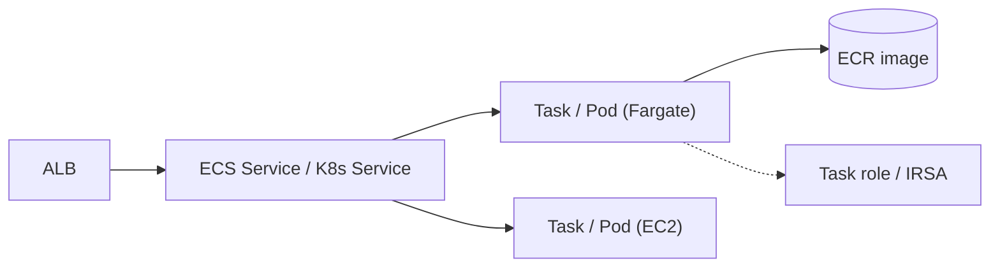

## 1. Core Concept

AWS có hai bộ điều phối container: **ECS** (đơn giản, tích hợp sâu với AWS) và **EKS** (Kubernetes managed). Cả hai chạy trên **EC2** (tự quản node) hoặc **Fargate** (serverless, không quản node). Mental model: *chọn orchestrator (ECS/EKS) trước, rồi chọn compute (EC2/Fargate).*

## 2. How It Works

- **ECS**: **Task Definition** (image, CPU/RAM, role, port) → **Task** chạy một lần hoặc **Service** giữ N task chạy liên tục, đăng ký vào **ALB**. **Task Role** cấp quyền cho container; **Execution Role** cho ECS pull image từ **ECR** và ghi log.
- **Fargate**: chỉ định vCPU/RAM mỗi task, mỗi task một ENI trong VPC, trả tiền theo giây.
- **EKS**: control plane managed, worker là **managed node group**, **Fargate profile** hoặc self-managed; quyền pod qua **IRSA** (IAM Roles for Service Accounts) hoặc **Pod Identity**.
- **ECR**: registry, **image scanning**, **lifecycle policy**.
- **Scaling**: ECS Service Auto Scaling (target tracking), EKS dùng **HPA + Cluster Autoscaler/Karpenter**.
- **Khác**: **App Runner** (từ source/image ra HTTPS service), **Copilot**, **ECS Anywhere**.

## 3. Visual Diagram

## 4. Rules of Thumb & Trade-offs

| Nhu cầu | Chọn |
| --- | --- |
| Đơn giản, không cần K8s | ECS + Fargate |
| Đã dùng K8s/đa cloud | EKS |
| GPU, daemon, tối ưu chi phí tải ổn định | EC2 launch type |
| Chạy web nhỏ không cần cấu hình | App Runner |

- Fargate: **ít vận hành** nhưng đắt hơn EC2 cho tải ổn định; EKS: **linh hoạt** nhưng phức tạp và có phí control plane.

## 5. Must Remember / Production Pitfalls

- **Task Role ≠ Execution Role**: nhầm hai role là lỗi phổ biến.
- Fargate task ở private subnet cần **NAT hoặc VPC endpoint** để pull image từ ECR.
- Không cấp quyền qua role của node trong EKS; dùng **IRSA** để least privilege.
- Task thiếu CPU/RAM bị **OOM kill** theo giới hạn container.
- Interview trap: "Không muốn quản server cho container" → **Fargate**.

## 6. Search Hooks

- `ECS task definition task role execution role` — phân biệt hai loại role.
- `AWS Fargate vs EC2 launch type` — chọn compute cho container.
- `EKS IRSA IAM roles for service accounts` — cấp quyền theo pod.
- `Karpenter vs Cluster Autoscaler` — scale node cho EKS.
- `Amazon ECR image scanning lifecycle policy` — quản lý và quét image.
