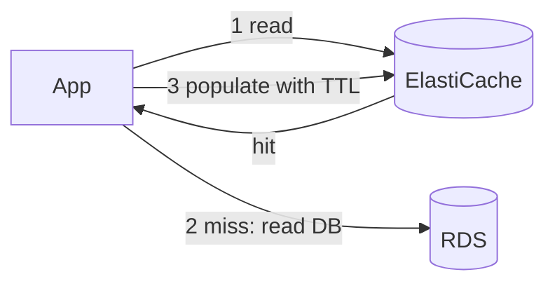

## 1. Core Concept

**ElastiCache** là Redis/Memcached managed, đặt trước DB để giảm độ trễ và tải. Ngoài ra **DAX** là cache cho DynamoDB và **CloudFront** cho nội dung edge. Mental model: *bộ nhớ trước đĩa — chọn đúng chiến lược cache và chịu trách nhiệm cho tính nhất quán.*

## 2. How It Works

- **Redis**: cấu trúc dữ liệu (list, set, sorted set, hash), **persistence**, **replication**, **Multi-AZ failover**, **Cluster mode** (sharding), pub/sub, **Redis AUTH/TLS**.
- **Memcached**: đơn giản, đa luồng, **không** replication/persistence, shard phía client.
- **Chiến lược**: **lazy loading/cache-aside** (đọc miss rồi nạp), **write-through** (ghi cache khi ghi DB), **TTL** để hết hạn.
- **Eviction**: `allkeys-lru`, `volatile-ttl`…; theo dõi `evictions`, `CPUUtilization`, `CacheHitRate`.
- **Dùng cho**: session store, leaderboard, rate limiting, cache truy vấn.
- **DAX**: cache in-memory cho DynamoDB, độ trễ micro giây, tương thích API.
- Truy cập qua **VPC**, kiểm soát bằng security group.

## 3. Visual Diagram

## 4. Rules of Thumb & Trade-offs

| Cần | Chọn |
| --- | --- |
| Cấu trúc dữ liệu, HA, persistence | Redis |
| Cache đơn giản, đa luồng | Memcached |
| Tăng tốc DynamoDB | DAX |

- Trade-off: **tốc độ** vs **dữ liệu có thể cũ** và độ phức tạp vô hiệu hoá cache.

## 5. Must Remember / Production Pitfalls

- **Cache stampede** khi key nóng hết hạn; dùng TTL ngẫu nhiên và khoá nạp.
- Dữ liệu cũ nếu không invalidate khi ghi DB.
- Coi cache như nguồn dữ liệu chính (mất nó là mất dữ liệu).
- **Hot key** dồn vào một shard.
- Không đặt TTL → bộ nhớ đầy và eviction bất ngờ.
- Interview trap: "Session lưu ở đâu để app stateless?" → Redis (ElastiCache) hoặc DynamoDB.

## 6. Search Hooks

- `ElastiCache Redis vs Memcached` — chọn engine.
- `cache-aside write-through lazy loading` — các chiến lược cache.
- `DynamoDB DAX` — cache in-memory cho DynamoDB.
- `Redis cluster mode sharding` — mở rộng Redis theo shard.
- `cache stampede` — nhiều request cùng nạp lại khi key hết hạn.
