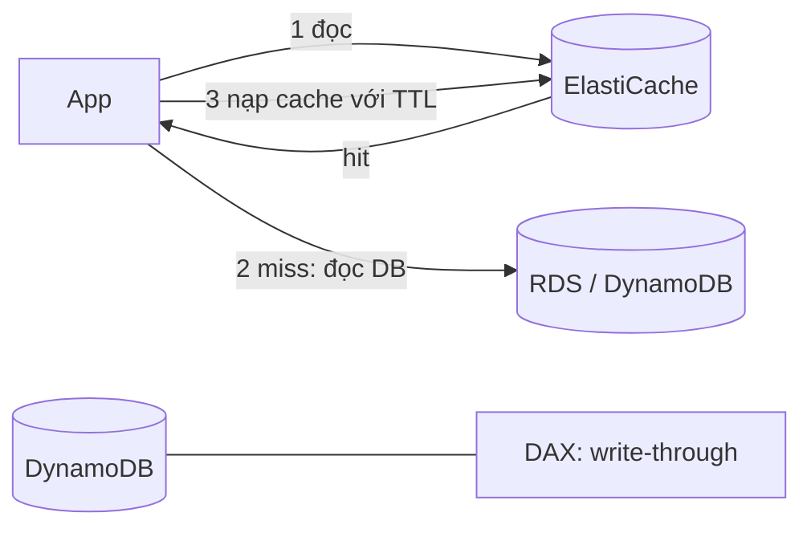

## 1. Core Concept

**ElastiCache** là Redis/Valkey hoặc Memcached managed đặt trước database để giảm độ trễ và tải; **DAX** là cache chuyên cho DynamoDB; **CloudFront** cache nội dung ở edge. Chúng giải quyết nỗi đau database chậm và đắt khi đọc lặp lại, đổi lại bạn phải gánh bài toán **tính nhất quán của cache**.

**Mental model:** cache là **kệ để đồ hay dùng ngay cạnh bàn** — lấy nhanh gấp trăm lần chạy ra kho (DB), nhưng đồ trên kệ có thể **cũ** nếu kho đã đổi, và kệ nhỏ nên phải có luật cái gì bị dọn đi (eviction/TTL).

## 2. How It Works

**Redis vs Memcached → Hai engine**
- **Redis (hoặc Valkey)**: cấu trúc dữ liệu (string, list, set, **sorted set**, hash), pub/sub, **persistence** (snapshot), **replication** (1 primary + tối đa 5 replica), **Multi-AZ failover tự động**, **cluster mode** (sharding), AUTH/TLS/mã hoá at-rest. Dùng cho session, leaderboard, rate limiting.
- **Memcached**: đơn giản, **đa luồng**, **không replication, không persistence**, shard phía client; hợp cache thuần, dữ liệu mất cũng được.

**Chiến lược cache → Khi nào ghi/đọc**
- **Cache-aside (lazy loading)**: đọc cache, **miss** thì đọc DB rồi nạp cache kèm **TTL**; chỉ dữ liệu được hỏi mới vào cache, nhưng lần đầu chậm và có thể cũ.
- **Write-through**: ghi DB và cache cùng lúc, cache luôn mới nhưng ghi chậm hơn và có thể nạp cả dữ liệu không ai đọc.
- **TTL** giới hạn độ cũ; **eviction** (`allkeys-lru`, `volatile-ttl`...) quyết định xoá gì khi đầy bộ nhớ.

**DAX → Cache cho DynamoDB**
- Cache in-memory **write-through** cho item và query, độ trễ cỡ **micro-giây**, tương thích API DynamoDB, **chỉ phục vụ eventually consistent reads** (strongly consistent đi thẳng xuống bảng).

**Vận hành**
- Chạy trong VPC, kiểm soát bằng SG. Theo dõi **CacheHitRate**, **Evictions**, CPU, **ReplicationLag**.

```python
def get_user(uid):
    v = redis.get(f"u:{uid}")
    if v: return json.loads(v)                 # hit
    row = db.fetch(uid)                        # miss
    redis.setex(f"u:{uid}", 300, json.dumps(row))  # TTL 300s
    return row
```

## 3. Visual Diagram



## 4. Rules of Thumb & Trade-offs

| Tình huống / Nhu cầu | Chọn gì |
| --- | --- |
| Cấu trúc dữ liệu, HA, persistence | Redis |
| Cache thuần đơn giản, đa luồng | Memcached |
| Tăng tốc đọc DynamoDB, không đổi code nhiều | DAX |
| Session cho ứng dụng stateless | Redis (ElastiCache) |
| Nội dung HTTP tĩnh toàn cầu | CloudFront |
| Cần dữ liệu luôn mới sau mỗi lần ghi | Write-through (+ TTL ngắn) |

- **Được gì:** giảm độ trễ và tải DB đáng kể. **Mất gì:** dữ liệu có thể cũ, phải thiết kế invalidation, chi phí bộ nhớ và độ phức tạp.

## 5. Must Remember / Production Pitfalls

- **Dữ liệu cũ hiển thị cho user → ghi DB mà không invalidate/cập nhật cache → write-through hoặc xoá key khi ghi, TTL hợp lý**.
- **DB bị dồn khi key nóng hết hạn (cache stampede) → nhiều request cùng nạp lại → TTL ngẫu nhiên (jitter), khoá nạp một request, nạp trước**.
- **Mất dữ liệu khi node cache chết → coi cache là nguồn chính → cache luôn phải tái tạo được từ DB**.
- **Một shard quá tải → hot key → tách key, thêm replica đọc, cache cục bộ ngắn hạn**.
- **Bộ nhớ đầy và eviction bất ngờ → không đặt TTL/maxmemory-policy → đặt TTL, theo dõi Evictions**.
- Exam trap: "session lưu ở đâu để app stateless" → **ElastiCache Redis (hoặc DynamoDB)**; "tăng tốc DynamoDB micro-giây" → **DAX**; "cần HA/persistence" → **Redis**, không phải Memcached.

## 6. Search Hooks

- `ElastiCache Redis vs Memcached` — chọn engine.
- `cache-aside write-through lazy loading` — các chiến lược cache.
- `DynamoDB DAX` — cache in-memory cho DynamoDB.
- `Redis cluster mode sharding` — mở rộng Redis theo shard.
- `cache stampede` — nhiều request cùng nạp lại khi key hết hạn.
