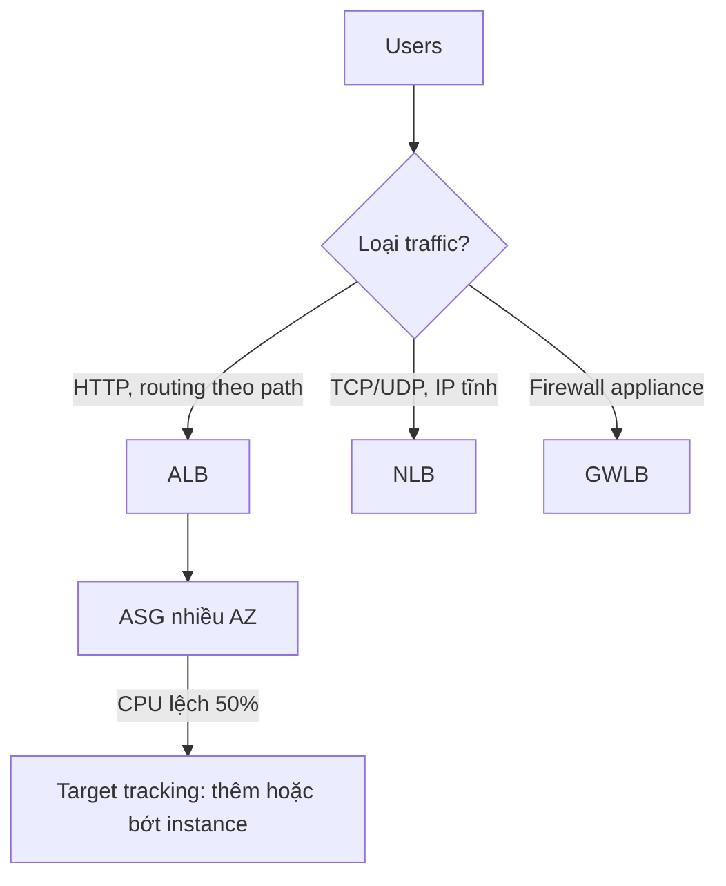

## 1. Core Concept

**Elastic Load Balancing (ELB)** chia request cho nhiều target khỏe mạnh, còn **EC2 Auto Scaling Group (ASG)** tự tăng giảm số instance theo tải. Ghép lại, chúng cho ứng dụng **chịu lỗi nhiều AZ** và **trả tiền đúng theo nhu cầu**, thay cho việc đoán trước dung lượng.

**Mental model:** ELB là **người điều phối cổng vào** chỉ dẫn khách tới quầy còn rảnh; ASG là **quản lý ca** thuê thêm hoặc cho nghỉ nhân viên theo lượng khách. Muốn thêm hoặc bớt quầy được an toàn thì nhân viên phải **stateless** — ai làm quầy nào cũng được.

## 2. How It Works

**Chọn loại load balancer → Theo tầng mạng**
- **ALB (Layer 7)**: định tuyến theo **path, host, header, query string**, hỗ trợ target là instance, IP hoặc Lambda, WebSocket, HTTP/2, redirect, fixed response, xác thực OIDC/Cognito. SG gắn vào ALB. Ví dụ: `/api/*` tới service A, `/img/*` tới service B.
- **NLB (Layer 4)**: TCP/UDP/TLS, hàng triệu request/giây, độ trễ cực thấp, **IP tĩnh/Elastic IP mỗi AZ**, giữ nguyên client IP; là lựa chọn bắt buộc khi cần **PrivateLink endpoint service**.
- **GWLB (Layer 3)**: đưa **appliance bên thứ ba** (firewall, IDS) vào luồng traffic qua **GENEVE**.

**Cross-Zone Load Balancing → Chia đều giữa các AZ**
- **Bật mặc định ở ALB** (không phí liên AZ), **tắt mặc định ở NLB/GWLB**; bật ở NLB thì chia đều theo target nhưng **phát sinh phí traffic liên AZ**.

**Health check và Deregistration Delay → Không cắt ngang**
- ELB chỉ gửi traffic tới target khỏe. **Deregistration delay** (mặc định **300 giây**) cho kết nối đang chạy hoàn tất khi instance bị thay thế hoặc scale-in.

**ASG → Min, Desired, Max và chính sách scale**
- Khai báo **min/desired/max** và **launch template**; ASG trải instance qua nhiều AZ và thay instance lỗi (dùng **ELB health check** để thay cả khi ứng dụng treo).
- **Target tracking** giữ metric ở mục tiêu (ví dụ **CPU 50%**), đơn giản nhất; **Step/Simple scaling** theo ngưỡng alarm; **Scheduled** cho tải theo lịch; **Predictive** học mẫu tải.
- **Lifecycle hooks** cho chạy script trước khi instance vào dịch vụ (`Pending:Wait`) hoặc lưu log trước khi bị huỷ (`Terminating:Wait`). **Cooldown** (mặc định 300 giây) tránh scale liên tục.

```bash
aws autoscaling put-scaling-policy --auto-scaling-group-name web \
  --policy-name cpu50 --policy-type TargetTrackingScaling \
  --target-tracking-configuration '{"PredefinedMetricSpecification":{"PredefinedMetricType":"ASGAverageCPUUtilization"},"TargetValue":50}'
```

## 3. Visual Diagram



## 4. Rules of Thumb & Trade-offs

| Tình huống / Nhu cầu | Chọn gì |
| --- | --- |
| Web/microservice, routing theo path/host | ALB |
| Hiệu năng cực cao, IP tĩnh, TCP/UDP | NLB |
| Chèn firewall bên thứ ba | GWLB |
| Giữ CPU quanh một mức | Target tracking |
| Tải theo lịch biết trước | Scheduled scaling |
| Cần cài đặt trước khi nhận traffic | Lifecycle hook |

- **Được gì:** tự chịu lỗi và tự co giãn. **Mất gì:** phải thiết kế **stateless**; scale-out có độ trễ khởi động (dùng warm pool hoặc AMI dựng sẵn).

## 5. Must Remember / Production Pitfalls

- **Mất phiên đăng nhập khi scale → session lưu trên instance → chuyển state sang ElastiCache/DynamoDB hoặc dùng sticky session có ý thức**.
- **Request lỗi khi scale-in → kết nối bị cắt → giữ deregistration delay phù hợp**.
- **Instance treo nhưng vẫn "healthy" → ASG chỉ dùng EC2 status check → bật ELB health check cho ASG**.
- **Scale dao động liên tục → ngưỡng sát và cooldown ngắn → target tracking, cooldown/warm-up hợp lý**.
- **Hoá đơn NLB tăng bất ngờ → bật cross-zone → phí traffic liên AZ**.
- Exam trap: "định tuyến theo path URL" → **ALB**; "giữ CPU quanh 50%" → **target tracking**; "IP tĩnh/hiệu năng cực cao" → **NLB**; "appliance bên thứ ba" → **GWLB**.

## 6. Search Hooks

- `ALB vs NLB vs GWLB` — chọn load balancer theo tầng mạng.
- `ELB cross-zone load balancing` — chia đều giữa các AZ và chi phí.
- `Auto Scaling target tracking policy` — giữ metric ở mức mục tiêu.
- `ELB deregistration delay connection draining` — không cắt ngang kết nối.
- `Auto Scaling lifecycle hooks` — chen script vào vòng đời instance.
