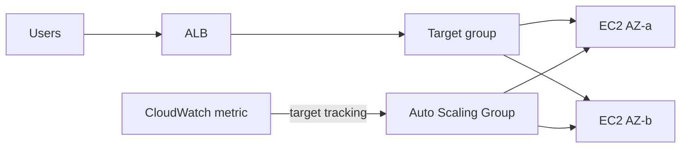

## 1. Core Concept

**Elastic Load Balancing (ELB)** phân phối traffic tới nhiều target ở nhiều AZ, còn **EC2 Auto Scaling Group (ASG)** tự tăng/giảm số instance theo tải và tự thay instance lỗi. Kết hợp lại tạo ra tầng compute **high availability + elastic**. Mental model: *ELB quyết định ai nhận request; ASG quyết định có bao nhiêu máy để nhận.*

## 2. How It Works

- **Application Load Balancer (ALB)** – **Layer 7**: HTTP/HTTPS/gRPC/WebSocket, định tuyến theo **path/host/header/query**, target là instance, IP hoặc Lambda, tích hợp **WAF**.
- **Network Load Balancer (NLB)** – **Layer 4**: TCP/UDP/TLS, latency cực thấp, hàng triệu request/giây, có **static/Elastic IP mỗi AZ**, giữ nguyên source IP.
- **Gateway Load Balancer (GWLB)** – **Layer 3**: đặt appliance bên thứ ba (firewall, IDS) trong luồng traffic qua giao thức **GENEVE** (port 6081).
- **Target group** + **health check** loại instance không khoẻ khỏi vòng phân phối. **Deregistration delay** (mặc định 300 giây) là connection draining.
- **Cross-zone load balancing**: mặc định bật ở ALB; tắt ở NLB/GWLB (bật sẽ phát sinh phí traffic liên AZ).
- **ASG**: `min / desired / max` + **launch template**; health check kiểu EC2 hoặc ELB; **instance refresh** để cập nhật AMI.
- **Scaling policy**:
  - **Target tracking**: giữ metric ở mục tiêu (ví dụ CPU 50%), đơn giản nhất.
  - **Step / Simple**: theo ngưỡng CloudWatch alarm.
  - **Scheduled** và **Predictive** (dự đoán theo chu kỳ).
- **Cooldown** (mặc định 300 giây) tránh scale liên tục; **lifecycle hooks** chạy script trước khi launch/terminate.

## 3. Visual Diagram

## 4. Rules of Thumb & Trade-offs

| Cần | Chọn |
| --- | --- |
| Routing theo URL, microservices, container | **ALB** |
| TCP/UDP, static IP, hiệu năng cực cao | **NLB** |
| Firewall/inspection appliance | **GWLB** |

- Web app thông thường: ASG trải ≥ 2 AZ + ALB + target tracking.
- Tải đoán trước được → thêm **Scheduled**/**Predictive** scaling.
- Trade-off: scale nhanh tốn tiền hơn nhưng giữ latency; scale chậm rẻ nhưng rủi ro quá tải.

## 5. Must Remember / Production Pitfalls

- Instance trong ASG nên **stateless**; session lưu ở ElastiCache/DynamoDB thay vì **sticky session**.
- Health check kiểu EC2 không biết app đã chết; bật **ELB health check** để ASG thay instance.
- Lấy client IP phía sau ALB phải đọc header **`X-Forwarded-For`**.
- ALB không có static IP: cần IP cố định → đặt ALB sau **NLB** hoặc dùng **Global Accelerator**.
- Exam trap: "khớp ALB nhưng cần whitelist IP" → NLB/Global Accelerator; "scale theo độ dài hàng đợi" → CloudWatch metric SQS cho ASG.

## 6. Search Hooks

- `ALB vs NLB vs GWLB` — chọn load balancer theo layer 7/4/3.
- `ALB path-based routing target group` — định tuyến request tới nhóm target theo URL.
- `Cross-zone load balancing` — cân bằng tải giữa các AZ và phí liên quan.
- `Auto Scaling target tracking policy` — giữ metric ở giá trị mục tiêu tự động.
- `Auto Scaling cooldown lifecycle hooks` — chống scale dồn dập và chen script vào vòng đời instance.
- `Deregistration delay connection draining` — chờ request đang xử lý xong trước khi gỡ target.
