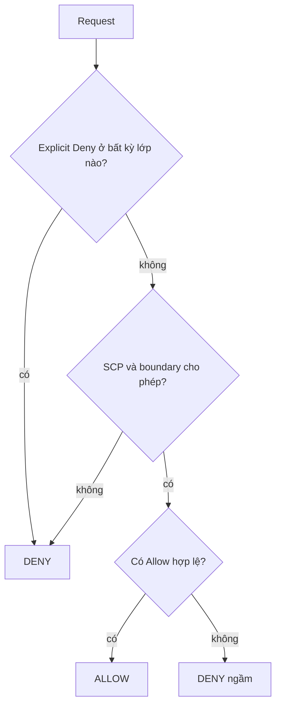

## 1. Core Concept

**AWS IAM (Identity and Access Management)** sinh ra để trả lời đúng một câu hỏi cho mọi request vào AWS: **ai** (principal) được làm **gì** (action) trên **tài nguyên nào** (resource), dưới **điều kiện nào** (condition). IAM là global service, miễn phí, và là lớp bảo mật nền cho mọi dịch vụ khác.

**Mental model:** IAM giống **bảo vệ tòa nhà chỉ tin danh sách**: không có tên trong danh sách thì không được vào (implicit deny), có tên nhưng đứng trong danh sách cấm thì vẫn bị chặn (explicit Deny luôn thắng).

## 2. How It Works

**Principal → Ai đang gọi**
- **Root user** (email đăng ký account) có toàn quyền và **không bị giới hạn bởi IAM policy**. Cách làm: bật **MFA**, xoá access key của root, chỉ dùng cho vài tác vụ bắt buộc như đổi support plan hay đóng account. Tác động: root bị lộ là mất cả account.
- **User** là danh tính dài hạn của người hoặc ứng dụng; user "trống" (không group, không policy) không làm được gì. **Group** là tập user để gắn policy chung, **không lồng nhau** và **không dùng làm principal** trong resource-based policy.
- **Role** là danh tính được **assume** tạm thời qua **STS**, trả credentials ngắn hạn (thường 1 giờ) và tự xoay vòng. Dùng cho EC2/Lambda/ECS, cross-account và federation. Tác động: không có secret dài hạn để lộ.

**Policy → Quyền cụ thể**
- Policy JSON gồm `Effect`, `Action`, `Resource`, `Condition`. Ba loại: **AWS managed** (AWS tạo và cập nhật, tiện nhưng thường rộng như `AdministratorAccess`), **customer managed** (bạn viết, tái sử dụng, có versioning) và **inline** (gắn cứng vào đúng một user/group/role).

```json
{ "Effect": "Allow", "Action": ["s3:GetObject"],
  "Resource": "arn:aws:s3:::reports-bucket/*",
  "Condition": { "Bool": { "aws:MultiFactorAuthPresent": "true" } } }
```

**Policy Evaluation Logic → Kết quả cuối**
- Bước 1: nếu có **explicit Deny** ở bất kỳ lớp nào (identity policy, resource policy, **SCP**, **permission boundary**) thì **DENY**.
- Bước 2: nếu không, cần có ít nhất một **Allow** hợp lệ; SCP và permission boundary chỉ **thu hẹp** giới hạn chứ không tự cấp quyền.
- Bước 3: không có Allow nào thì **implicit deny**. Ví dụ: một policy `Allow s3:*` cộng một policy `Deny s3:DeleteObject` thì xoá object vẫn bị từ chối.

**Role / AssumeRole → Credentials tạm thời**
- EC2 gắn **instance profile**, SDK tự gọi STS lấy credential từ metadata service và gia hạn trước khi hết hạn. Cross-account dùng trust policy cho phép account kia assume role.

**Identity Federation → Đăng nhập một lần**
- **IAM Identity Center** liên kết IdP công ty qua **SAML 2.0/OIDC** để người dùng SSO vào nhiều account với permission set, không cần IAM user riêng. Tác động: offboarding nhân sự chỉ cần khoá ở IdP.

**Least Privilege → Cách làm thực tế**
- Bắt đầu từ quyền nhỏ nhất rồi mở rộng; dùng **IAM Access Analyzer** sinh policy từ hoạt động CloudTrail thực tế. Mỗi policy nên có `Resource` và `Condition` cụ thể thay vì `*`.

## 3. Visual Diagram



## 4. Rules of Thumb & Trade-offs

| Tình huống / Nhu cầu | Chọn gì |
| --- | --- |
| Ứng dụng trên EC2/Lambda/ECS cần gọi AWS | IAM Role (instance profile) |
| Nhiều người hoặc nhiều account | IAM Identity Center + IdP công ty |
| Gán quyền cho nhiều người cùng nhóm việc | Group + customer managed policy |
| Cần giới hạn tối đa cho cả account | SCP (qua Organizations) |
| Quyền tạm thời cho bên thứ ba | STS AssumeRole với điều kiện |

- **Được gì:** quyền chính xác, tạm thời, dễ audit. **Mất gì:** công bảo trì policy; AWS managed tiện nhưng rộng, customer managed chính xác nhưng tốn công.

## 5. Must Remember / Production Pitfalls

- **Access key lộ trên GitHub → bot quét trong vài phút → bị đào coin/xoá dữ liệu** → dùng credential tạm thời, xoay vòng key, bật CloudTrail và billing alarm.
- **Gắn `AdministratorAccess` "cho nhanh" → mọi workload có quyền toàn cục → một lỗ hổng là mất tất cả** → least privilege, Access Analyzer.
- **Gắn policy trực tiếp vào từng user → người chuyển team vẫn giữ quyền cũ** → gắn vào group/role, rà soát định kỳ.
- **Vừa đổi quyền xong vẫn bị AccessDenied → IAM là eventually consistent** → chờ vài giây, không vội xoá/tạo lại.
- **Cho rằng Allow ở một policy thắng Deny ở policy khác → sai, explicit Deny thắng tất cả** (kể cả SCP).
- Exam trap: "cho EC2 đọc S3" → **IAM Role / instance profile**, không lưu access key trên instance; "group có làm principal được không" → **không**.

## 6. Search Hooks

- `IAM policy evaluation logic` — thứ tự đánh giá Deny và Allow giữa các loại policy.
- `Principle of Least Privilege` — chỉ cấp quyền tối thiểu cần thiết.
- `AWS managed vs customer managed policy` — khác biệt và khi nào dùng loại nào.
- `IAM Role AssumeRole STS` — cấp credentials tạm thời thay cho access key dài hạn.
- `IAM Identity Center SAML federation` — đăng nhập AWS bằng IdP công ty.
- `root user MFA best practices` — bảo vệ tài khoản root.
