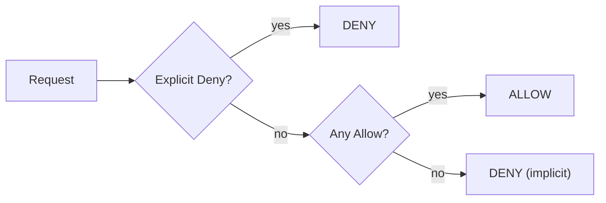

## 1. Core Concept

**AWS IAM (Identity and Access Management)** quyết định *ai* (**principal**: user, group, role) được làm *gì* (**action**) trên *tài nguyên nào* (**resource**), dưới *điều kiện nào* (**condition**). IAM là global service, miễn phí. Mental model: *mặc định mọi thứ đều bị deny; mỗi quyền phải được allow tường minh, và một explicit `Deny` luôn thắng mọi `Allow`.*

## 2. How It Works

- **Root user** (email đăng ký) có toàn quyền, không giới hạn được bằng IAM policy → bật **MFA**, xoá **access key** của root, chỉ dùng cho vài tác vụ bắt buộc (đổi support plan, đóng account…).
- **User**: danh tính dài hạn cho người/ứng dụng; có thể tạo user "trống" không group, không policy → không làm được gì.
- **Group**: tập user; gắn policy vào group (ví dụ group `Admins`) rồi thêm user vào. Group **không** lồng nhau và **không** phải principal để ghi trong policy.
- **Role**: danh tính được *assume* tạm thời qua **STS**, trả về credentials ngắn hạn. Dùng cho EC2/Lambda, cross-account, và **Identity Federation** (Google, AD công ty qua SAML/OIDC, **IAM Identity Center**).
- **Policy Document** (JSON) gồm `Effect`, `Action`, `Resource`, `Condition`:
  - **AWS managed**: AWS tạo và cập nhật (ví dụ `AdministratorAccess`, `ReadOnlyAccess`).
  - **Customer managed**: bạn tự viết, tái sử dụng, có versioning.
  - **Inline**: gắn cứng vào đúng một user/group/role.
- **Access key** (Access Key ID + Secret) cho CLI/SDK/third-party; secret chỉ hiển thị một lần.
- **Account settings → Password policy**: độ dài, độ phức tạp, thời hạn xoay vòng mật khẩu.

```json
{
  "Version": "2012-10-17",
  "Statement": [{
    "Effect": "Allow",
    "Action": ["s3:GetObject"],
    "Resource": "arn:aws:s3:::reports-bucket/*",
    "Condition": { "Bool": { "aws:MultiFactorAuthPresent": "true" } }
  }]
}
```

## 3. Visual Diagram



## 4. Rules of Thumb & Trade-offs

- **Principle of Least Privilege**: cấp quyền nhỏ nhất đủ dùng, mở rộng khi cần; dùng **IAM Access Analyzer** để sinh policy từ hoạt động thực tế.
- Gắn policy vào **group/role**, hạn chế gắn trực tiếp vào user → dễ audit khi người chuyển team.
- Ứng dụng chạy trên AWS (EC2, Lambda, ECS) → **IAM Role**, không nhúng access key vào code hoặc AMI.
- Nhiều người/nhiều account → **IAM Identity Center** + IdP công ty thay vì tạo IAM user cho từng người.
- AWS managed policy tiện nhưng thường rộng; customer managed chính xác hơn nhưng tốn công bảo trì.

## 5. Must Remember / Production Pitfalls

- Explicit `Deny` ở bất kỳ đâu (identity policy, resource policy, **SCP**, permission boundary) thắng mọi `Allow`.
- Access key lộ trên GitHub bị bot quét trong vài phút → ưu tiên credentials tạm thời, xoay vòng key, bật **CloudTrail**.
- Exam trap: "cho EC2 đọc S3" → đáp án là **IAM Role / instance profile**, không phải lưu access key trên instance.
- Exam trap: group **không thể** là principal trong resource-based policy và không chứa group khác.
- IAM là eventually consistent: thay đổi quyền có thể mất vài giây mới có hiệu lực.

## 6. Search Hooks

- `IAM policy evaluation logic` — thứ tự đánh giá Deny/Allow giữa các loại policy.
- `Principle of Least Privilege` — chỉ cấp quyền tối thiểu cần thiết.
- `AWS managed vs customer managed policy` — khác biệt và khi nào dùng loại nào.
- `IAM Role AssumeRole STS` — cấp credentials tạm thời thay cho access key dài hạn.
- `IAM Identity Center SAML federation` — đăng nhập AWS bằng IdP công ty/Google.
- `root user MFA best practices` — bảo vệ tài khoản root.
