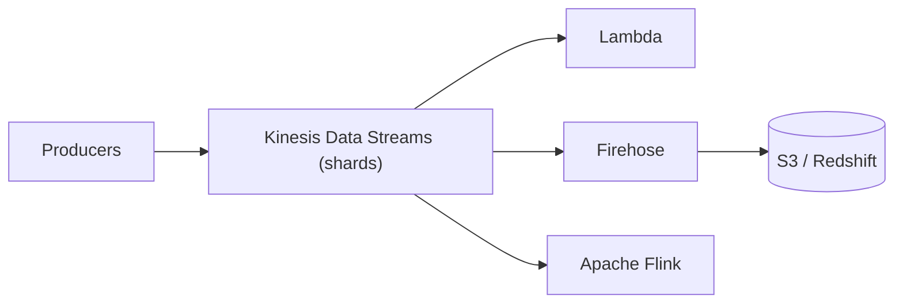

## 1. Core Concept

**Kinesis** là họ dịch vụ streaming của AWS: **Data Streams** (log phân tán có thứ tự theo shard), **Data Firehose** (giao hàng gần real-time vào S3/Redshift/OpenSearch), **Managed Service for Apache Flink** (xử lý stream). Mental model: *Data Streams ≈ Kafka managed; Firehose ≈ ống nạp dữ liệu không cần code.*

## 2. How It Works

- **Data Streams**: dữ liệu chia **shard**; mỗi shard ghi **1 MB/s hoặc 1,000 record/s**, đọc **2 MB/s**; **partition key** chọn shard; retention 24 giờ đến **365 ngày**; mode **provisioned** hoặc **on-demand**.
- **Consumer**: shared (2 MB/s chia sẻ mọi consumer) hoặc **Enhanced Fan-Out** (2 MB/s riêng mỗi consumer, push qua HTTP/2); **KCL** quản lý checkpoint trên DynamoDB.
- **Firehose**: buffer theo size/time (tối thiểu ~60 giây), chuyển đổi bằng Lambda, đổi định dạng sang Parquet/ORC, đích S3/Redshift/OpenSearch/Splunk/HTTP; **không lưu để replay**.
- **Flink**: xử lý cửa sổ thời gian, aggregation trên stream.
- Thứ tự chỉ đảm bảo **trong một shard**.

## 3. Visual Diagram

## 4. Rules of Thumb & Trade-offs

| Nhu cầu | Chọn |
| --- | --- |
| Replay, nhiều consumer, thứ tự theo key | Data Streams |
| Nạp log vào S3/Redshift đơn giản | Firehose |
| Queue một consumer, không thứ tự | SQS |

- Trade-off: **kiểm soát và replay** (Streams) vs **vận hành đơn giản** (Firehose).

## 5. Must Remember / Production Pitfalls

- **Hot shard** do partition key lệch gây `ProvisionedThroughputExceeded`.
- Thêm shard (resharding) làm đổi mapping key → shard.
- Consumer chậm tụt sau retention là **mất dữ liệu**.
- Firehose có độ trễ buffer, không phải real-time thật sự.
- Interview trap: "Replay lại dữ liệu 7 ngày" → Data Streams, không phải Firehose hay SQS.

## 6. Search Hooks

- `Kinesis Data Streams shards partition key` — phân phối dữ liệu theo shard.
- `Kinesis enhanced fan-out` — băng thông riêng cho mỗi consumer.
- `Kinesis Data Firehose buffering` — cách Firehose gom và giao dữ liệu.
- `Kinesis vs SQS vs MSK` — so sánh các lựa chọn messaging/streaming.
- `Kinesis hot shard` — chẩn đoán shard bị quá tải.
