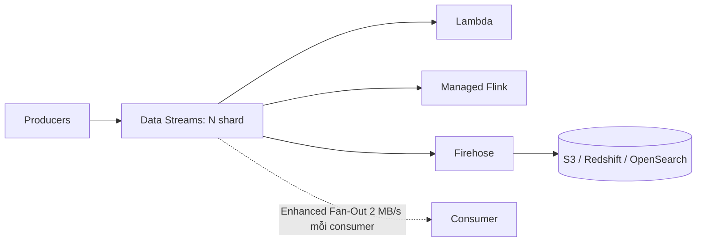

## 1. Core Concept

**Amazon Kinesis** là họ dịch vụ streaming: **Data Streams** (log phân tán có thứ tự theo shard, có thể replay), **Data Firehose** (ống nạp dữ liệu gần real-time vào S3/Redshift/OpenSearch không cần code) và **Managed Service for Apache Flink** (xử lý stream). Chúng giải quyết bài toán thu và xử lý dòng dữ liệu liên tục như log, clickstream, IoT.

**Mental model:** Data Streams giống **băng chuyền chia làn (shard)**: mỗi làn có tốc độ giới hạn và giữ thứ tự, nhiều người đứng cạnh xem được và có thể tua lại; Firehose là **xe tải gom hàng** chạy định kỳ giao vào kho, giao xong là hết, không tua lại được.

## 2. How It Works

**Data Streams → Shard là đơn vị song song**
- Mỗi **shard** nhận **1 MB/s hoặc 1.000 record/s** ghi, đọc **2 MB/s**; record tối đa **1 MB**. **Partition key** băm tới shard, nên **cùng key luôn cùng shard** và giữ thứ tự; **không có thứ tự toàn cục** giữa các shard.
- **Retention** từ 24 giờ tới **365 ngày**, cho phép **replay**. Hai chế độ: **provisioned** (tự chọn số shard, split/merge) và **on-demand**.
- Ví dụ: cần 5 MB/s ghi → tối thiểu 5 shard.

**Consumer → Chia băng thông**
- **Shared throughput**: mọi consumer chia **2 MB/s** của shard. **Enhanced Fan-Out (EFO)**: mỗi consumer nhận **2 MB/s riêng**, push qua HTTP/2, độ trễ thấp hơn (có phí thêm). **KCL** quản lý checkpoint trong DynamoDB; Lambda đọc qua event source mapping.

**Firehose → Giao hàng gần real-time**
- Gom (**buffer**) theo kích thước/thời gian rồi ghi vào **S3, Redshift, OpenSearch, Splunk, HTTP endpoint**; chuyển đổi bằng Lambda, **đổi định dạng sang Parquet/ORC**. **Không lưu để replay**, có độ trễ buffer nên **không phải real-time thật sự**.

**Managed Flink → Xử lý stream**
- Cửa sổ thời gian, join, aggregation trên stream (Java/SQL/Python).

```python
import boto3, json
k = boto3.client("kinesis")
k.put_record(StreamName="clicks", Data=json.dumps({"u": 42}), PartitionKey="user-42")
```

## 3. Visual Diagram



## 4. Rules of Thumb & Trade-offs

| Tình huống / Nhu cầu | Chọn gì |
| --- | --- |
| Replay, nhiều consumer, thứ tự theo key | Data Streams |
| Nạp log vào S3/Redshift đơn giản, không code | Firehose |
| Nhiều consumer mỗi cái cần băng thông riêng | Enhanced Fan-Out |
| Queue một consumer, không cần thứ tự/replay | SQS |
| Xử lý cửa sổ thời gian trên stream | Managed Flink |

- **Được gì:** thứ tự theo key, replay, nhiều consumer. **Mất gì:** quản lý shard, chi phí EFO, độ phức tạp so với SQS/Firehose.

## 5. Must Remember / Production Pitfalls

- **`ProvisionedThroughputExceeded` dù tổng shard đủ → hot shard do partition key lệch → chọn key phân bố đều hoặc thêm hậu tố ngẫu nhiên**.
- **Consumer chậm tụt sau retention → mất dữ liệu chưa đọc → tăng consumer/retention, giám sát iterator age**.
- **Thứ tự sai sau khi reshard → ánh xạ key đổi shard → xử lý theo sequence và kiểm soát khi resharding**.
- **Cần replay 7 ngày nhưng dùng Firehose/SQS → không lưu để đọc lại → dùng Data Streams**.
- **Nhiều consumer tranh băng thông 2 MB/s → throttle → Enhanced Fan-Out**.
- Exam trap: "replay dữ liệu và nhiều consumer" → **Data Streams**; "nạp log vào S3 Parquet đơn giản nhất" → **Firehose**; "mỗi consumer 2 MB/s riêng" → **Enhanced Fan-Out**.

## 6. Search Hooks

- `Kinesis Data Streams shards partition key` — phân phối dữ liệu theo shard.
- `Kinesis enhanced fan-out` — băng thông riêng cho mỗi consumer.
- `Kinesis Data Firehose buffering` — cách Firehose gom và giao dữ liệu.
- `Kinesis vs SQS vs MSK` — so sánh các lựa chọn messaging/streaming.
- `Kinesis hot shard` — chẩn đoán shard bị quá tải.
