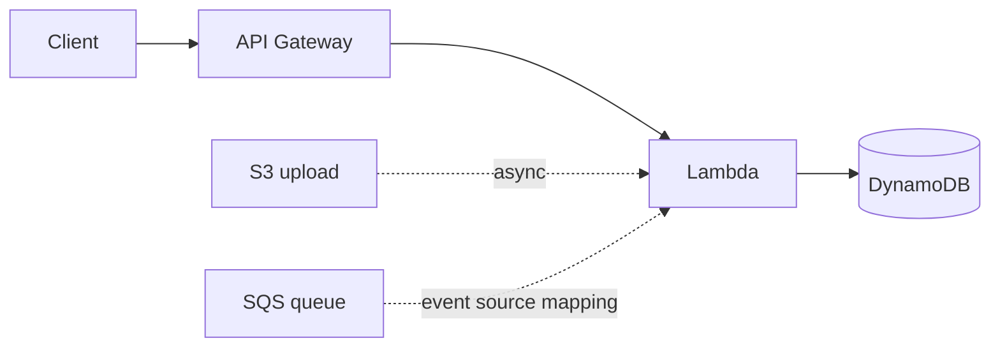

## 1. Core Concept

**AWS Lambda** chạy code theo sự kiện mà không cần quản lý server, tính tiền theo **số request và thời gian chạy (GB-giây)**. Nó giải quyết bài toán trả tiền cho máy rảnh và vận hành scale. Mental model: *một hàm ngắn, stateless, được bật lên khi có sự kiện và tắt khi xong.*

## 2. How It Works

- **Cấu hình**: memory **128 MB–10,240 MB** (CPU tăng theo memory), **timeout tối đa 15 phút**, `/tmp` 512 MB (tới 10 GB), deployment zip tối đa **50 MB** (250 MB sau giải nén) hoặc **container image** tới 10 GB.
- **Kiểu gọi**:
  - **Synchronous** (API Gateway, ALB, SDK): caller chờ kết quả và tự xử lý lỗi.
  - **Asynchronous** (S3, SNS, EventBridge): Lambda **retry 2 lần**, hỗ trợ **DLQ/destinations**.
  - **Event source mapping** (SQS, Kinesis, DynamoDB Streams): Lambda **tự poll** và gọi theo batch.
- **Concurrency**: mặc định **1,000** đồng thời mỗi Region (soft limit); **reserved concurrency** đảm bảo/giới hạn cho một hàm; **provisioned concurrency** giữ sẵn môi trường để tránh **cold start**.
- **Cold start**: lần khởi tạo môi trường mới (tải runtime + init code); **SnapStart** giảm cold start cho một số runtime (Java và các runtime được hỗ trợ).
- **Layers** (tối đa 5) chia sẻ thư viện; **environment variables** (mã hoá bằng KMS) tối đa 4 KB.
- **Lambda trong VPC** truy cập tài nguyên private (RDS); muốn ra Internet cần **NAT Gateway**.
- **Execution role** (IAM) quyết định hàm được gọi dịch vụ nào.

## 3. Visual Diagram

## 4. Rules of Thumb & Trade-offs

- Phù hợp: API ngắn, xử lý file/event, glue code, tác vụ thưa thớt hoặc tải biến động mạnh.
- Không phù hợp: tác vụ > 15 phút, cần kết nối bền (WebSocket do chính app giữ), tải cao đều đặn 24/7 (EC2/Fargate có thể rẻ hơn).
- **Provisioned concurrency** đổi chi phí cố định lấy latency ổn định.
- Trade-off: *Chi phí vận hành thấp, scale nhanh* đổi lấy *cold start, giới hạn runtime và khó debug cục bộ*.

## 5. Must Remember / Production Pitfalls

- Lambda **stateless**: không lưu state trong memory/`/tmp` và mong nó còn ở lần gọi sau; dùng DynamoDB/S3.
- Lambda gọi RDS dễ làm **cạn connection** → dùng **RDS Proxy**.
- Async + retry có thể chạy trùng → viết hàm **idempotent**.
- Một hàm tiêu hết concurrency tài khoản sẽ gây **throttling** các hàm khác → đặt reserved concurrency.
- Exam trap: "hàm trong VPC không ra được Internet" → thiếu **NAT Gateway**; "xử lý hơn 15 phút" → Fargate/Batch/Step Functions.

## 6. Search Hooks

- `Lambda cold start provisioned concurrency` — giảm độ trễ khởi tạo bằng môi trường dựng sẵn.
- `Lambda reserved vs provisioned concurrency` — khác biệt hai cơ chế concurrency.
- `Lambda synchronous vs asynchronous invocation` — kiểu gọi và cơ chế retry.
- `Lambda event source mapping SQS` — Lambda tự poll nguồn sự kiện.
- `Lambda SnapStart` — chụp snapshot để khởi động nhanh hơn.
- `Lambda in VPC NAT Gateway` — truy cập tài nguyên private và Internet từ Lambda.
