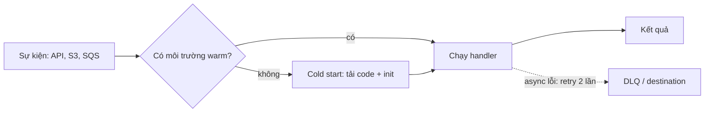

## 1. Core Concept

**AWS Lambda** chạy code theo sự kiện mà không phải quản lý server: bạn tải hàm lên, AWS cấp phát môi trường, chạy, co giãn và chỉ tính tiền theo **số lần gọi và GB-giây**. Nó giải quyết nỗi đau vận hành và trả tiền cho thời gian nhàn rỗi.

**Mental model:** Lambda giống **taxi gọi theo chuyến**: không cần mua xe (server), có xe sẵn thì đi ngay, không có xe sẵn thì chờ vài trăm mili-giây gọi xe mới (**cold start**), và mỗi chuyến có giới hạn thời gian.

## 2. How It Works

**Execution environment → Cold start và warm**
- Request đầu tiên (hoặc khi tăng đồng thời) tạo **execution environment** mới: tải code, khởi động runtime, chạy init → đó là **cold start** (từ vài chục đến vài giây tuỳ runtime/kích thước). Môi trường được **tái dùng** cho các lần gọi sau (warm), nên khởi tạo kết nối ngoài handler.
- Giảm cold start: **Provisioned Concurrency** (giữ sẵn môi trường, tính phí) hoặc **SnapStart** (khôi phục từ snapshot sau init, cho runtime được hỗ trợ).

**Concurrency → Co giãn và giới hạn**
- Mặc định tối đa **1.000 concurrent executions** mỗi Region mỗi account (có thể tăng). **Reserved concurrency** vừa **đảm bảo** vừa **giới hạn** cho một hàm (bảo vệ DB downstream); **Provisioned** giữ môi trường nóng. Vượt giới hạn → **throttle (429)**.

**Giới hạn tài nguyên**
- Timeout tối đa **15 phút**; memory **128 MB–10.240 MB** (CPU tăng theo memory); `/tmp` 512 MB–10 GB; package zip 50 MB (250 MB khi giải nén) hoặc container image tới 10 GB.

**Cách gọi → Ai xử lý lỗi**
- **Synchronous** (API Gateway, SDK `RequestResponse`): caller chờ và **tự xử lý lỗi/retry**.
- **Asynchronous** (S3, SNS, EventBridge): Lambda xếp hàng và **tự retry 2 lần**, hỗ trợ **DLQ/destinations**.
- **Event source mapping** (SQS, Kinesis, DynamoDB Streams): Lambda **poll** nguồn, đọc theo **batch** rồi gọi hàm; lỗi cả batch thì batch bị thử lại (dùng `ReportBatchItemFailures`).

**Lambda trong VPC → Mạng**
- Hàm chạy trong VPC **không có Internet mặc định**: cần **NAT Gateway** hoặc **VPC endpoint** để gọi dịch vụ ngoài.

```python
import boto3
s3 = boto3.client("s3")          # khởi tạo ngoài handler, tái dùng khi warm
def handler(event, context):
    return s3.list_buckets()["Buckets"][:1]
```

## 3. Visual Diagram



## 4. Rules of Thumb & Trade-offs

| Tình huống / Nhu cầu | Chọn gì |
| --- | --- |
| Hàm cần độ trễ ổn định, hạn chế cold start | Provisioned Concurrency / SnapStart |
| Bảo vệ DB khỏi quá tải, giới hạn song song | Reserved concurrency |
| Xử lý hàng đợi/stream theo batch | Event source mapping |
| Tác vụ dài hơn 15 phút | Step Functions, ECS/Fargate, Batch |
| Tải cao đều đặn cả ngày | Cân nhắc Fargate/EC2 (có thể rẻ hơn) |

- **Được gì:** không vận hành, co giãn tự động, trả theo dùng. **Mất gì:** cold start, giới hạn 15 phút/runtime, khó debug cục bộ, chi phí cao khi tải liên tục lớn.

## 5. Must Remember / Production Pitfalls

- **Lambda trong VPC gọi Internet bị timeout → thiếu đường ra → NAT Gateway hoặc VPC endpoint**.
- **Latency thất thường ở đỉnh tải → cold start → Provisioned Concurrency/SnapStart**, khởi tạo ngoài handler, giảm kích thước package.
- **Cạn kết nối DB khi tải tăng → mỗi môi trường mở một kết nối → RDS Proxy và reserved concurrency**.
- **Tác vụ chạy 20 phút bị cắt → timeout tối đa 15 phút → Step Functions hoặc Fargate**.
- **Message SQS xử lý lặp → batch lỗi bị retry → idempotent consumer và `ReportBatchItemFailures`**.
- Exam trap: "giảm cold start cho hàm quan trọng" → **Provisioned Concurrency** (không phải reserved); "Lambda trong VPC cần Internet" → **NAT Gateway/endpoint**; "giới hạn runtime" → **15 phút**.

## 6. Search Hooks

- `Lambda cold start` — vì sao và cách giảm.
- `Lambda reserved vs provisioned concurrency` — giới hạn và giữ nóng.
- `Lambda synchronous vs asynchronous invocation` — ai retry và xử lý lỗi.
- `Lambda event source mapping` — poll SQS, Kinesis, DynamoDB Streams.
- `Lambda SnapStart` — khôi phục từ snapshot để giảm cold start.
