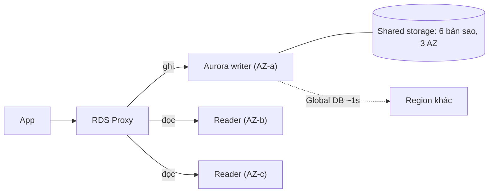

## 1. Core Concept

**RDS** là database quan hệ managed (MySQL, PostgreSQL, SQL Server, Oracle, MariaDB), còn **Aurora** là engine do AWS thiết kế lại với storage phân tán tách khỏi compute. Chúng giải quyết ba nỗi đau: **vá lỗi và backup**, **chịu lỗi AZ** và **scale đọc**, mà không phải tự vận hành server database.

**Mental model:** **Multi-AZ là phi công phụ ngồi sẵn** (đồng bộ, không lái, tiếp quản khi cần); **Read Replica là thêm tài xế phục vụ khách đọc** (bất đồng bộ, có độ trễ). Hai thứ giải hai bài toán khác nhau, đừng nhầm.

## 2. How It Works

**RDS Multi-AZ → Chịu lỗi**
- Standby **đồng bộ** ở AZ khác; khi lỗi, endpoint DNS **failover tự động** (thường 60–120 giây). Standby **không phục vụ đọc**; ứng dụng không cần đổi chuỗi kết nối.

**Read Replica → Scale đọc**
- Sao chép **bất đồng bộ** (có **replica lag**), tối đa 5 replica RDS, có thể **cross-Region**, và có thể **promote** thành DB độc lập. Ứng dụng phải tự trỏ truy vấn đọc tới endpoint của replica.

**Backup và mã hoá**
- **Automated backup** (giữ 1–35 ngày, hỗ trợ **point-in-time recovery**) và snapshot thủ công. **Mã hoá chọn lúc tạo**; DB chưa mã hoá muốn mã hoá phải **tạo snapshot → copy snapshot kèm mã hoá → restore**.

**Aurora Storage → Chịu lỗi ở tầng lưu trữ**
- Một **writer** và tối đa **15 reader** dùng chung cluster volume tự tăng tới **128 TiB**, dữ liệu có **6 bản sao qua 3 AZ**. Failover thường **dưới ~30 giây** vì reader đã có sẵn dữ liệu, chỉ cần promote.

**Aurora Global Database → DR liên Region**
- Replication storage-level khoảng **1 giây** sang Region khác, failover liên Region cỡ **một phút**; hợp DR với RPO rất nhỏ.

**RDS Proxy → Bảo vệ khỏi bão kết nối**
- Pool kết nối, giảm thời gian failover, bảo vệ DB khỏi hàng nghìn kết nối từ **Lambda**, hỗ trợ **IAM auth** và **Secrets Manager**.

**Aurora Serverless v2 → Tải thất thường**
- Co giãn theo **ACU** liên tục không ngắt kết nối; hợp dev/test và tải biến động.

## 3. Visual Diagram

## 4. Rules of Thumb & Trade-offs

| Tình huống / Nhu cầu | Chọn gì |
| --- | --- |
| Chịu lỗi AZ, chưa cần scale đọc | RDS Multi-AZ |
| Tăng thông lượng đọc | Read Replica / Aurora Replica |
| Failover nhanh, scale đọc nhiều | Aurora |
| DR đa Region RPO nhỏ | Aurora Global Database |
| Lambda mở nhiều kết nối | RDS Proxy |
| Tải thất thường, dev/test | Aurora Serverless v2 |

- **Được gì:** HA và scale đọc không phải tự vận hành. **Mất gì:** Aurora đắt hơn RDS thông thường; Read Replica có replica lag nên đọc có thể cũ.

## 5. Must Remember / Production Pitfalls

- **Ứng dụng đọc dữ liệu cũ sau khi ghi → đọc từ replica có lag → đọc-sau-ghi dùng writer**.
- **Nghĩ Multi-AZ scale được đọc → standby không phục vụ đọc → dùng Read Replica**.
- **Muốn bật mã hoá cho RDS đang chạy → không bật trực tiếp được → snapshot, copy mã hoá, restore** (có downtime cắt chuyển).
- **Lambda làm cạn kết nối DB → mỗi invoke mở kết nối mới → RDS Proxy**.
- **Failover vẫn gián đoạn vài chục giây → ứng dụng không retry/không dùng DNS endpoint → cấu hình retry và cluster endpoint**.
- Exam trap: "chịu lỗi AZ, chưa cần scale đọc" → **Multi-AZ**; "mã hoá DB đang chạy" → **snapshot → copy mã hoá → restore**; "tăng thông lượng đọc chấp nhận trễ nhỏ" → **Read Replica**.

## 6. Search Hooks

- `RDS Multi-AZ vs read replica` — HA đồng bộ so với scale đọc bất đồng bộ.
- `Aurora storage architecture` — 6 bản sao, 3 AZ, tối đa 15 reader.
- `Aurora Global Database` — DR đa Region với replication khoảng 1 giây.
- `RDS Proxy` — pool kết nối và failover nhanh.
- `Aurora Serverless v2` — co giãn theo ACU cho tải thất thường.
- `RDS encryption snapshot copy` — cách bật mã hoá cho DB đã tạo.
