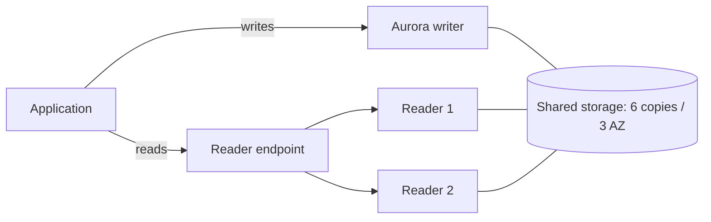

## 1. Core Concept

**Amazon RDS** là database quan hệ được quản lý (patching, backup, failover); **Amazon Aurora** là engine tương thích MySQL/PostgreSQL do AWS thiết kế lại với lớp lưu trữ phân tán. Bài toán là đạt **high availability** và **read scalability** mà không tự vận hành DB. Mental model: *Multi-AZ để sống sót khi lỗi, Read Replica để chịu tải đọc — hai việc khác nhau.*

## 2. How It Works

- **RDS Multi-AZ**: standby **đồng bộ (synchronous)** ở AZ khác, **failover tự động** (thường 60–120 giây) bằng cách đổi DNS endpoint. Standby **không phục vụ đọc** (với cấu hình instance cổ điển).
- **Read Replica**: sao chép **bất đồng bộ (asynchronous)**, tối đa **15** replica cho MySQL/MariaDB/PostgreSQL, có thể **cross-Region**, có thể promote thành DB độc lập; ứng dụng phải tự trỏ query đọc vào endpoint replica.
- **Backup**: automated backup giữ **0–35 ngày** + **point-in-time recovery**; **manual snapshot** giữ đến khi bạn xoá.
- **Aurora storage**: một volume chia sẻ, dữ liệu có **6 bản sao trên 3 AZ**, tự tăng dung lượng (tới 128 TiB). Một **writer** + tối đa **15 reader** cùng đọc chung storage.
- **Endpoint**: **cluster (writer) endpoint** và **reader endpoint** (cân bằng tải giữa reader); failover Aurora thường dưới ~30 giây.
- **Aurora Serverless v2**: tự co giãn theo **ACU**; **Aurora Global Database**: replicate cross-Region với độ trễ ~1 giây, failover cross-Region trong khoảng một phút.
- **RDS Proxy**: pool connection, giảm thời gian failover và hợp với **Lambda** (nhiều kết nối ngắn); hỗ trợ IAM auth và Secrets Manager.
- **Mã hoá** dùng **KMS**, phải chọn **lúc tạo**.

## 3. Visual Diagram

## 4. Rules of Thumb & Trade-offs

- Cần chịu lỗi AZ → **Multi-AZ**. Cần giảm tải đọc/báo cáo → **Read Replica**. Cần cả hai → Multi-AZ + replica.
- Cần hiệu năng/độ bền cao hơn, nhiều reader, Global DB → **Aurora**; tải nhỏ, engine truyền thống (Oracle, SQL Server) → RDS.
- Tải thất thường/dev/test → **Aurora Serverless v2**.
- Trade-off: Aurora đắt hơn RDS thông thường nhưng đổi lại failover nhanh, replica lag thấp, storage tự scale.

## 5. Must Remember / Production Pitfalls

- **Không thể bật mã hoá cho DB đã tạo không mã hoá**: tạo snapshot → **copy snapshot có mã hoá** → restore.
- Read replica có **replica lag** (eventual consistency): đừng đọc dữ liệu vừa ghi ở replica nếu cần tính nhất quán mạnh.
- Failover đổi DNS: ứng dụng cần **giảm cache DNS** và retry kết nối (hoặc dùng RDS Proxy).
- Multi-AZ **không thay thế backup**: xoá nhầm dữ liệu vẫn bị nhân bản sang standby.
- Exam trap: "đọc nhiều làm chậm DB chính" → Read Replica, không phải Multi-AZ; "DB cần RPO gần 0 cross-Region" → Aurora Global Database.

## 6. Search Hooks

- `RDS Multi-AZ vs Read Replica` — khác biệt giữa HA và scale đọc.
- `Aurora storage architecture 6 copies` — kiến trúc lưu trữ chia sẻ 6 bản sao.
- `Aurora Global Database` — replicate cross-Region với độ trễ rất thấp.
- `RDS Proxy connection pooling` — gom kết nối, giảm thời gian failover.
- `Aurora Serverless v2 ACU` — database tự co giãn theo đơn vị ACU.
- `Encrypt existing RDS instance snapshot` — quy trình mã hoá DB hiện có.
