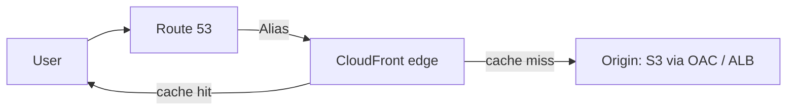

## 1. Core Concept

**Amazon Route 53** là dịch vụ DNS có sẵn tính sẵn sàng cao kèm **routing policy** và **health check**; **Amazon CloudFront** là **CDN** cache nội dung tại các edge location gần người dùng. Cặp này giải quyết latency toàn cầu và failover ở tầng DNS/edge. Mental model: *Route 53 trả lời "đi đâu", CloudFront trả lời "lấy từ đâu cho nhanh".*

## 2. How It Works

- **Record**: `A` (IPv4), `AAAA` (IPv6), `CNAME` (**không dùng ở zone apex**), **Alias** (miễn phí, dùng được ở apex, trỏ tới ELB, CloudFront, S3 website…).
- **Routing policy**:
  - **Simple**, **Weighted** (chia tỉ lệ, canary), **Latency** (Region có độ trễ thấp nhất), **Failover** (active-passive).
  - **Geolocation** (theo quốc gia/châu lục), **Geoproximity** (theo khoảng cách, có bias), **IP-based**, **Multivalue answer**.
- **Health check** kiểm tra endpoint/CloudWatch alarm; kết hợp Failover/Weighted để loại endpoint lỗi.
- **CloudFront**: **distribution** có **origin** (S3, ALB, EC2, HTTP custom), **cache behavior** theo path, **TTL**, **invalidation** (`/*`), HTTPS, **WAF**, geo restriction.
- Bảo vệ origin S3 bằng **Origin Access Control (OAC)**; giới hạn nội dung riêng tư bằng **signed URL/cookie**.
- **Lambda@Edge** và **CloudFront Functions** chạy code tại edge (rewrite, auth, header).
- **Global Accelerator**: 2 **IP anycast tĩnh**, đưa traffic vào backbone AWS sớm; hỗ trợ **TCP/UDP**, không cache.

## 3. Visual Diagram

## 4. Rules of Thumb & Trade-offs

- Nội dung tĩnh/streaming/API cacheable toàn cầu → **CloudFront**; giao thức không phải HTTP, cần IP cố định, failover nhanh → **Global Accelerator**.
- Trỏ domain gốc (`example.com`) vào ALB/CloudFront → **Alias record** (không phải CNAME).
- DR active-passive → **Failover routing** + health check; giảm latency đa Region → **Latency routing**.
- Trade-off: TTL DNS thấp chuyển hướng nhanh nhưng tăng số query; TTL cache CloudFront cao giảm tải origin nhưng nội dung cũ lâu hơn.

## 5. Must Remember / Production Pitfalls

- **Invalidation** tốn phí khi vượt hạn mức miễn phí; nên **version tên file** (`app.v2.js`) thay vì invalidate.
- Chỉ **CloudFront + OAC** mới giữ S3 private; để bucket public rồi trỏ CloudFront là mất bảo mật.
- Failover DNS không tức thời: client và resolver cache theo **TTL**.
- ACM certificate cho CloudFront phải ở Region **us-east-1**.
- Exam trap: "Alias vs CNAME ở root domain" → Alias; "người dùng ở mỗi quốc gia thấy nội dung khác" → Geolocation, còn "gần nhất về mạng" → Latency.

## 6. Search Hooks

- `Route 53 routing policies` — các chính sách định tuyến DNS và khi nào dùng.
- `Route 53 Alias vs CNAME` — Alias dùng được ở zone apex và miễn phí.
- `CloudFront Origin Access Control OAC` — chỉ cho CloudFront đọc bucket S3 private.
- `CloudFront cache invalidation versioning` — cập nhật nội dung đã cache.
- `Lambda@Edge vs CloudFront Functions` — chạy code ở edge, khác biệt về khả năng.
- `AWS Global Accelerator vs CloudFront` — IP anycast tĩnh so với CDN cache.
