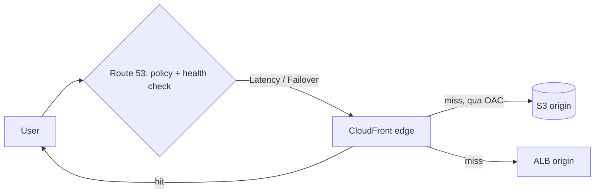

## 1. Core Concept

**Route 53** là DNS managed kiêm health check và định tuyến thông minh; **CloudFront** là CDN cache nội dung tại **edge location** gần người dùng. Cùng nhau chúng giải quyết hai nỗi đau: **đưa người dùng tới đúng endpoint khỏe nhất** và **giảm độ trễ cùng tải lên origin**.

**Mental model:** Route 53 là **người chỉ đường** (trả lời "địa chỉ nào" theo luật của bạn), CloudFront là **chuỗi cửa hàng tiện lợi** đặt gần nhà khách, giữ sẵn hàng hay mua, hết mới phải về kho gốc (origin).

## 2. How It Works

**Route 53 Routing Policies → Luật trả lời DNS**
- **Simple**, **Weighted** (chia theo tỉ lệ, canary 90/10), **Latency** (Region có độ trễ thấp nhất), **Failover** (primary/secondary kèm **health check**), **Geolocation** (theo vị trí người dùng, để tuân thủ/ngôn ngữ), **Geoproximity** (theo khoảng cách có bias, qua Traffic Flow), **IP-based**, **Multivalue** (trả tới 8 bản ghi khỏe). Health check loại endpoint lỗi khỏi câu trả lời.
- **Alias vs CNAME:** CNAME **không đặt được ở zone apex** (`example.com`); **Alias** trỏ được domain gốc tới ELB, CloudFront, S3 website, **miễn phí** truy vấn tới tài nguyên AWS và theo dõi IP thay đổi.

**CloudFront → Cache tại edge**
- Request tới edge gần nhất; **cache hit** trả ngay, **miss** thì lấy từ origin (S3, ALB, custom) rồi cache theo **TTL**. Có **regional edge cache** giữa edge và origin.
- **Origin Access Control (OAC)** giữ S3 bucket **không public** mà nội dung vẫn phân phối qua CDN (thay OAI cũ). **Signed URL/cookie** cho nội dung riêng tư.
- **Cập nhật nội dung:** invalidation tốn công/phí khi vượt hạn mức (1.000 path/tháng đầu miễn phí); cách tốt hơn là **đặt tên file có version** (`app.v2.js`).
- **CloudFront Functions** (nhẹ, sub-millisecond, đổi header/URL) vs **Lambda@Edge** (nhiều runtime hơn, truy cập mạng, xử lý nặng hơn).

**Global Accelerator → Khác CloudFront**
- Cho 2 **IP anycast tĩnh**, đưa traffic vào backbone AWS, hỗ trợ **TCP/UDP**, failover nhanh, **không cache**.

```bash
aws route53 change-resource-record-sets --hosted-zone-id Z1 --change-batch \
 '{"Changes":[{"Action":"UPSERT","ResourceRecordSet":{"Name":"example.com","Type":"A",
 "AliasTarget":{"HostedZoneId":"Z2","DNSName":"my-alb-123.elb.amazonaws.com","EvaluateTargetHealth":true}}}]}'
```

## 3. Visual Diagram



## 4. Rules of Thumb & Trade-offs

| Tình huống / Nhu cầu | Chọn gì |
| --- | --- |
| Trỏ domain gốc vào ALB/CloudFront | Alias record |
| Failover sang Region dự phòng | Failover routing + health check |
| Canary 90/10 | Weighted routing |
| User gần Region nào thì tới Region đó | Latency routing |
| Chặn truy cập trực tiếp S3, chỉ qua CDN | CloudFront + OAC |
| IP tĩnh, TCP/UDP, không cache | Global Accelerator |

- **Được gì:** độ trễ thấp, chịu lỗi, giảm tải origin. **Mất gì:** nội dung có thể cũ trong TTL; invalidation tốn công.

## 5. Must Remember / Production Pitfalls

- **Không trỏ được domain gốc → dùng CNAME ở apex → dùng Alias**.
- **Người dùng vẫn thấy bản cũ sau khi deploy → còn trong cache TTL → đặt tên file có version hoặc invalidate đúng path**.
- **Bucket S3 vẫn truy cập trực tiếp được → chưa khoá bằng OAC → bucket policy chỉ cho CloudFront**.
- **Failover không chạy → không gắn health check → luôn gắn health check cho record failover**.
- **Cache theo query string/cookie thừa → hit ratio thấp → chỉ forward những giá trị thật sự cần**.
- Exam trap: "trỏ domain gốc vào ALB" → **Alias**; "chuyển Region dự phòng" → **Failover + health check**; "S3 chỉ qua CloudFront" → **OAC**; "TCP/UDP, IP tĩnh" → **Global Accelerator**, không phải CloudFront.

## 6. Search Hooks

- `Route 53 routing policies` — các chính sách định tuyến DNS.
- `Route 53 Alias vs CNAME` — vì sao Alias dùng được ở domain gốc.
- `CloudFront Origin Access Control` — giữ S3 private trước CDN.
- `Lambda@Edge vs CloudFront Functions` — chạy code tại edge.
- `Global Accelerator vs CloudFront` — tăng tốc TCP/UDP và CDN cache HTTP.
