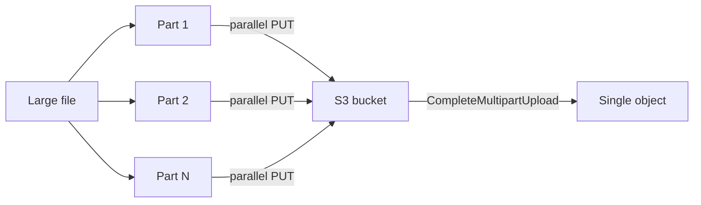

## 1. Core Concept

S3 tự scale theo **prefix**: mỗi prefix chịu được tối thiểu **3,500 PUT/COPY/POST/DELETE** và **5,500 GET/HEAD request/giây**. Muốn throughput cao hơn thì **song song hoá**: nhiều prefix, nhiều part, nhiều connection. Mental model: *S3 là hệ thống phân tán khổng lồ, throughput đến từ concurrency chứ không từ một kết nối lớn.*

## 2. How It Works

- **Prefix** là phần đường dẫn giữa bucket và tên object: `my-bucket/2026/11/report.csv` có prefix `2026/11/`. Rải dữ liệu qua 10 prefix → tối đa khoảng 55,000 GET/s.
- **Multipart Upload**: chia object thành part (5 MB–5 GB, tối đa 10,000 part), upload song song, retry từng part. Khuyến nghị cho file > **100 MB**, **bắt buộc** cho file > **5 GB**; tối đa 5 TB/object.
- **Byte-Range Fetch**: `GET` với header `Range` để tải song song nhiều đoạn của một object hoặc chỉ đọc phần header của file.
- **S3 Transfer Acceleration**: upload qua edge location của CloudFront rồi đi backbone AWS về bucket; hữu ích khi client ở xa region.
- **SSE-KMS** làm mỗi upload/download gọi `GenerateDataKey`/`Decrypt` → bị giới hạn bởi **KMS request quota** của region (5,500–30,000 req/s tuỳ region); bật **S3 Bucket Key** để giảm.

```bash
# AWS CLI tự dùng multipart cho file lớn; tăng concurrency
aws configure set default.s3.max_concurrent_requests 20
aws configure set default.s3.multipart_chunksize 64MB
aws s3 cp ./backup.tar s3://my-bucket/2026/11/backup.tar
```

## 3. Visual Diagram



## 4. Rules of Thumb & Trade-offs

- Cần throughput upload cao → **multipart + concurrency**; client ở xa region → thêm **Transfer Acceleration** (tính phí, chỉ hữu ích khi thực sự nhanh hơn).
- Download nhanh file lớn → **byte-range fetch** song song.
- Đọc lặp lại nhiều từ khắp thế giới → **CloudFront** cache phía trước S3 thay vì tối ưu chính S3.
- Ghi/đọc volume rất cao với SSE-KMS → kiểm tra KMS quota, dùng S3 Bucket Key hoặc SSE-S3.

## 5. Must Remember / Production Pitfalls

- Limit là **theo prefix**, không theo bucket; số prefix trong bucket không giới hạn.
- Bị `503 Slow Down` → retry với exponential backoff; S3 cần thời gian để scale partition khi traffic tăng đột ngột.
- Multipart dở dang vẫn tính phí lưu trữ → lifecycle `AbortIncompleteMultipartUpload`.
- Exam trap: "upload file 10 GB bị lỗi giữa chừng" → **Multipart Upload**; "throttling khi upload với SSE-KMS" → **KMS quota**.
- S3 có **strong read-after-write consistency** cho mọi PUT/DELETE.

## 6. Search Hooks

- `S3 request rate per prefix 3500 5500` — giới hạn request theo prefix.
- `S3 multipart upload limits` — kích thước part, số part, kích thước object tối đa.
- `S3 byte-range fetches` — tải song song nhiều đoạn của một object.
- `S3 Transfer Acceleration` — tăng tốc upload qua edge location.
- `KMS request quota S3 throttling` — giới hạn request KMS ảnh hưởng S3.
