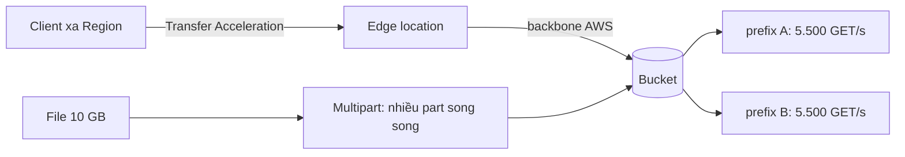

## 1. Core Concept

S3 scale gần như vô hạn nếu bạn **song song hoá**: nó giới hạn tốc độ **theo prefix**, và upload/download lớn nhanh nhất khi **chia nhỏ** thành nhiều phần chạy cùng lúc. Tối ưu S3 vì thế là bài toán rải tải, chia nhỏ và rút ngắn đường mạng.

**Mental model:** S3 như **kho nhiều cửa xuất nhập**: mỗi prefix là một cửa chịu được 3.500 lần ghi và 5.500 lần đọc mỗi giây. Muốn phục vụ nhiều hơn thì mở thêm cửa (thêm prefix) và chia đồ lớn thành nhiều thùng nhỏ khiêng song song (multipart).

## 2. How It Works

**Request rate per prefix → Rải tải**
- Mỗi prefix hỗ trợ tối thiểu **3.500 PUT/COPY/POST/DELETE** và **5.500 GET/HEAD** mỗi giây, không giới hạn số prefix. Ví dụ: 10 prefix cho tối thiểu **55.000 GET/giây**. Tác động: dữ liệu rải qua nhiều prefix thì throughput nhân lên.

**Multipart Upload → Upload lớn, chịu lỗi**
- Cơ chế: tách object thành các **part 5 MB–5 GB** (tối đa **10.000 part**, object tối đa **5 TB**), upload song song, S3 ghép lại. Khuyến nghị cho file **> 100 MB**, **bắt buộc > 5 GB**.
- Tác động: mạng lỗi chỉ thử lại part hỏng; upload 10 GB không còn đứt giữa chừng. Nhớ dọn part dở dang bằng Lifecycle.

**Byte-Range Fetch → Download song song hoặc đọc một phần**
- `GET` kèm header `Range: bytes=0-1048575` tải từng khúc song song hoặc chỉ lấy phần cần (ví dụ footer của file Parquet). Tác động: tăng tốc và giảm dữ liệu truyền.

```bash
aws s3api get-object --bucket b --key big.bin --range bytes=0-1048575 part0.bin
```

**Transfer Acceleration → Rút ngắn đường mạng**
- Client upload tới **edge location gần nhất**, rồi chạy trên **backbone AWS** về bucket. Hợp client ở xa Region; tính thêm phí và dùng endpoint riêng.

**SSE-KMS → Điểm nghẽn ẩn**
- Mỗi upload/download gọi KMS và chịu **KMS request quota**; traffic cao có thể bị throttling. Giảm bằng **S3 Bucket Key**.

## 3. Visual Diagram



## 4. Rules of Thumb & Trade-offs

| Tình huống / Nhu cầu | Chọn gì |
| --- | --- |
| File lớn, upload hay đứt | Multipart Upload |
| Cần đọc một phần object | Byte-Range Fetch |
| Client xa Region, upload chậm | Transfer Acceleration |
| Vượt giới hạn request theo prefix | Rải object qua nhiều prefix |
| Phục vụ nội dung toàn cầu | CloudFront trước S3 |
| SSE-KMS bị throttling | S3 Bucket Key |

- **Được gì:** throughput cao, chịu lỗi tốt. **Mất gì:** thêm phức tạp phía client (quản lý part) và thêm phí khi dùng Transfer Acceleration.

## 5. Must Remember / Production Pitfalls

- **Upload file 10 GB hay đứt giữa chừng → PUT đơn có giới hạn 5 GB và không retry từng phần → Multipart Upload**.
- **Bị 503 SlowDown dù prefix ít → dồn tải vào một prefix → rải qua nhiều prefix và thêm retry với backoff**.
- **Dung lượng tăng bí ẩn → multipart dở dang chưa dọn → Lifecycle AbortIncompleteMultipartUpload**.
- **Bật SSE-KMS xong hiệu năng giảm → vượt KMS quota → Bucket Key hoặc tăng quota**.
- **Dùng Transfer Acceleration cho client gần Region → không lợi và vẫn tốn phí → chỉ dùng khi client ở xa**.
- Exam trap: "upload file 5 GB nhanh, chịu lỗi" → **Multipart**; "client ở xa Region upload nhanh qua backbone AWS" → **Transfer Acceleration**; "5.500 GET/s mỗi prefix" → mở rộng bằng **nhiều prefix**.

## 6. Search Hooks

- `S3 request rate per prefix` — giới hạn request theo prefix và cách mở rộng.
- `S3 multipart upload` — chia file lớn để upload song song.
- `S3 byte-range fetch` — tải song song hoặc đọc một phần object.
- `S3 Transfer Acceleration` — upload qua edge location gần nhất.
- `KMS request quota S3 Bucket Key` — tránh throttling khi dùng SSE-KMS.
