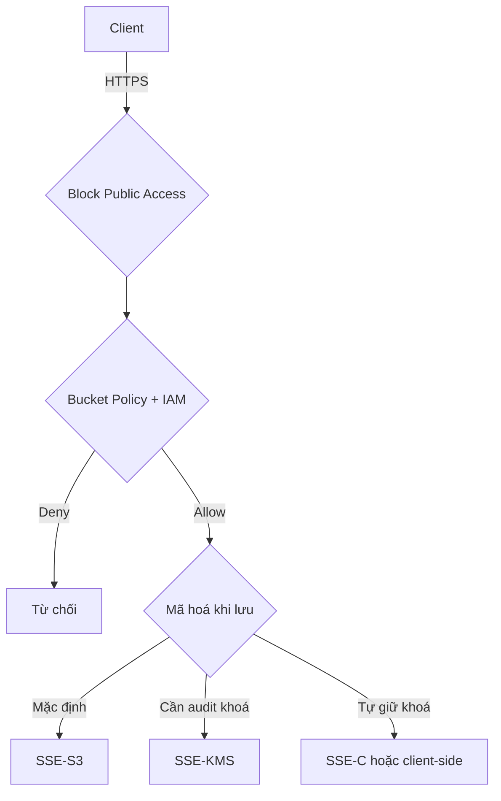

## 1. Core Concept

Bảo mật S3 gồm hai lớp độc lập: **access control** (ai được đọc/ghi bucket và object) và **encryption** (dữ liệu được mã hoá khi truyền và khi lưu). Bucket mới mặc định **private**, bật **Block Public Access**, tắt ACL, và từ 2023 mọi object mới được mã hoá **SSE-S3** tự động.

**Mental model:** Block Public Access là **cầu dao tổng** của cả tòa nhà, Bucket Policy là **nội quy từng phòng**, ACL là **tấm biển cũ** nên tắt đi; còn mã hoá là **két sắt** — câu hỏi duy nhất là ai giữ chìa khoá.

## 2. How It Works

**Access control → Ai được vào**
- **Bucket Policy** là resource-based JSON policy áp cho cả bucket hoặc một prefix; hỗ trợ cross-account và điều kiện theo IP, **VPC endpoint**, HTTPS hoặc header mã hoá. Explicit `Deny` ở đây thắng mọi `Allow` trong IAM.
- **Object Ownership = Bucket owner enforced** (mặc định bucket mới) làm **ACL bị vô hiệu**: bucket owner sở hữu mọi object, quyền chỉ quản lý qua policy. Tác động: hết cảnh object do account khác upload mà chủ bucket không đọc được.
- **Block Public Access** ghi đè mọi policy/ACL làm bucket public, có thể đặt ở mức **account**. Muốn public thật sự phải tắt cầu dao này **và** viết policy.

**Encryption in transit → Chống nghe lén**
- HTTPS/TLS bảo vệ đường truyền; ép buộc bằng bucket policy `Deny` khi `aws:SecureTransport = false`.

```json
{ "Effect": "Deny", "Principal": "*", "Action": "s3:*",
  "Resource": ["arn:aws:s3:::my-bucket", "arn:aws:s3:::my-bucket/*"],
  "Condition": { "Bool": { "aws:SecureTransport": "false" } } }
```

**Encryption at rest → Ai giữ khoá**
- **SSE-S3**: S3 quản lý key (AES-256), mặc định, miễn phí, không có audit riêng cho từng lần dùng key.
- **SSE-KMS**: key trong **AWS KMS**; mỗi lần upload/download S3 gọi KMS, nên có **audit qua CloudTrail**, phân quyền dùng key và xoay vòng key; đổi lại tốn phí và chịu **KMS request quota** (hàng nghìn request/giây tuỳ Region) nên traffic cao có thể bị throttling. **S3 Bucket Key** giảm số request tới KMS, có thể cắt tới ~99% chi phí.
- **SSE-C**: bạn gửi key trong **mỗi request** (bắt buộc HTTPS), S3 không lưu key; mất key là **mất dữ liệu**.
- **Client-side encryption**: tự mã hoá trước khi upload, S3 chỉ thấy ciphertext.

**Chia sẻ tạm thời → Presigned URL**
- URL ký sẵn mang **quyền của người ký** và có thời hạn (ví dụ 15 phút), cho đối tác tải lên mà không cần IAM user.

**Cross-account với SSE-KMS**
- Cần quyền ở **cả key policy lẫn IAM** (hoặc grant), nếu không chỉ đọc được bucket mà không giải mã được.

## 3. Visual Diagram



## 4. Rules of Thumb & Trade-offs

| Tình huống / Nhu cầu | Chọn gì |
| --- | --- |
| Chỉ cần dữ liệu được mã hoá | SSE-S3 (mặc định) |
| Audit ai giải mã, phân quyền theo key, compliance | SSE-KMS (+ Bucket Key) |
| Tự giữ key, S3 không lưu key | SSE-C |
| S3 không bao giờ thấy plaintext | Client-side encryption |
| Website tĩnh public | CloudFront + Origin Access Control, bucket vẫn private |
| Đối tác upload tạm thời | Presigned URL |

- **Được gì:** SSE-KMS cho kiểm soát và audit chi tiết. **Mất gì:** phí KMS, độ trễ thêm và nguy cơ throttling khi traffic cao.

## 5. Must Remember / Production Pitfalls

- **Upload/download bị 503 SlowDown khi traffic tăng → SSE-KMS vượt KMS quota → bật S3 Bucket Key, tăng quota hoặc dùng SSE-S3** nếu không cần audit.
- **Đối tác account khác đọc được bucket nhưng giải mã lỗi → key policy không cho account đó → cấp quyền ở key policy và IAM**.
- **Bucket vô tình public → tắt Block Public Access ở mức account hoặc ACL cũ → bật Block Public Access mức account, giữ ACL disabled**.
- **Mất khoá SSE-C → AWS không khôi phục được → quản lý key ở nơi bền hoặc chuyển sang SSE-KMS**.
- **Cần bắt buộc dùng đúng khoá KMS của công ty → default encryption chưa đủ → thêm bucket policy từ chối PUT thiếu `x-amz-server-side-encryption: aws:kms`**.
- Exam trap: "audit ai đã dùng khoá" → **SSE-KMS**; "AWS quản lý hoàn toàn, không thêm phí" → **SSE-S3**; "cho đối tác tải lên 15 phút không tạo IAM user" → **presigned URL**; "bucket mới mặc định" → **private, Block Public Access bật, ACL tắt**.

## 6. Search Hooks

- `S3 bucket policy examples` — mẫu policy giới hạn IP, VPC endpoint, HTTPS.
- `S3 Object Ownership bucket owner enforced` — cơ chế tắt ACL mặc định.
- `S3 Block Public Access` — cầu dao chặn mọi cấu hình làm bucket public.
- `SSE-S3 vs SSE-KMS vs SSE-C` — so sánh ba kiểu server-side encryption.
- `aws:SecureTransport` — điều kiện ép buộc dùng HTTPS.
- `S3 Bucket Key KMS cost` — giảm số request và chi phí KMS.
